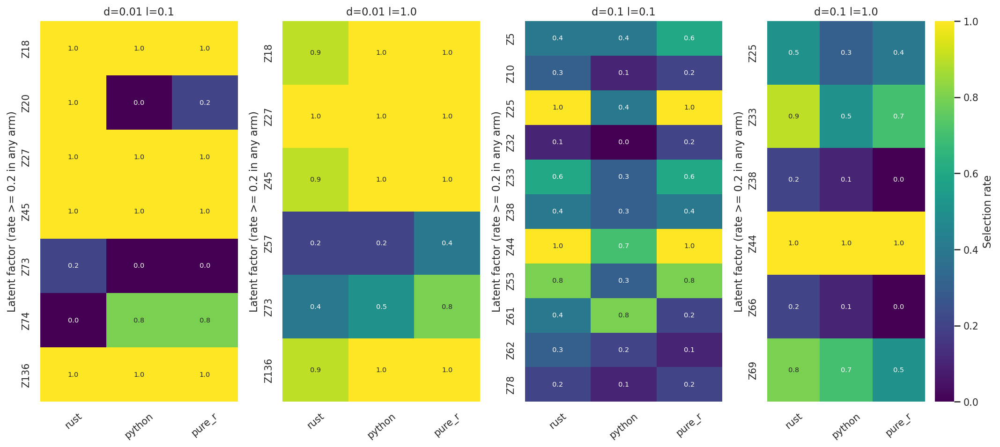

# SLIDE

R, Python and Rust implementations of SLIDE (Significant Latent Factor
Interaction Discovery and Exploration; Rahimikollu et al., *Nature Methods*).
SLIDE finds latent factors with LOVE (overlapping clustering) and then
uses knockoffs to select the standalone and interacting factors that predict
an outcome, with false discovery rate control.

You can install each implementation on its own. Each uses different YAML keys
and path rules; configuration files are not interchangeable.
Precompiled candidates are not yet verified or published; see the candidate
workflow below, or follow the source build recipes. Pixi is the preferred
source-build environment; its R-enabled development environment is separate.
The Python import is `slide_py`; there is no `loveslide` alias.

**Navigate:** [R install and usage](#r-install-and-usage) ·
[Rust install and build](#rust-install-and-build) · [Rust usage](#rust-usage) ·
[Python install](#python-install) · [Python usage](#python-usage) ·
[outputs](#result-files-and-plots) ·
[runtime comparison](#measured-backend-comparisons) · [latent-factor comparison](#latent-factor-agreement-and-remaining-differences) ·
[R-knockoff hybrid comparison](#r-knockoff-hybrid-benchmarks) ·
[publication caveats](#before-publication) · [development](#development) · [license](#license-and-citation)

| Component | What it is | Entry point |
| --- | --- | --- |
| `SLIDE` (R, `R/`) | Original R package; root package layout retained. | `library(SLIDE)` |
| `slide` (Rust, `crates/`) | Native Rust pipeline with a terminal dashboard (TUI) and SLURM helpers. | `slide run`, `slide monitor`, `slide tui`, `slide submit` |
| `slide-py` (Python, `src/slide_py`) | Python library with the same pipeline, plotting, and optional R backends via `rpy2`. | `slide-py run`, `slide_py.OptimizeSLIDE` |

This fork integrates the R package from <https://github.com/jishnu-lab/SLIDE>.
The Python and Rust implementations have R-reference tests (`tests/fixtures/`), but selected factors
can differ. Each backend renders its own R-style red/blue factor text plots and
model-score-versus-randomized-baseline density plot, without invoking the other
backend. See [result files and plots](#result-files-and-plots) for the shared
outputs and remaining backend-specific artifacts.

## R package

### R install and usage

Requires R ≥ 4.2. Install this integrated fork with:

```r
install.packages("remotes") # if not already installed
remotes::install_github("TranscriptionFactory/SLIDE")
library(SLIDE)
```

The upstream installation remains `remotes::install_github("jishnu-lab/SLIDE")`;
that repository changes only when its maintainers integrate this fork.
See [R vignettes](vignettes/) and [R examples](examples/) for usage.
R has its own version (`DESCRIPTION`) and dependencies; installing R SLIDE
does not require Python or Rust. See [backend comparisons](#measured-backend-comparisons)
for measured differences.

## Candidate installations and platform coverage

The manual [Build candidates](.github/workflows/artifacts.yml) workflow makes
candidate artifacts for verification. It does not publish to PyPI or create a
GitHub Release. No portable artifact is verified yet. Once CI runs, download
artifacts only from passing individual jobs and review their checks before installing. The current required matrix cannot complete because the
Windows Python native build gate is intentionally blocked. Linux and macOS
Python wheels and platform Rust archives can upload only when their own checks
pass.

| Candidate artifact | Target | Contents |
| --- | --- | --- |
| `slide-py-linux-x86_64-cp39`, `slide-py-linux-x86_64-cp310`, `slide-py-linux-x86_64-cp311`, `slide-py-linux-x86_64-cp312` | Linux x86-64, CPython 3.9–3.12, manylinux_2_28 | One wheel per artifact. |
| `slide-py-macos-arm64-cp39`, `slide-py-macos-arm64-cp310`, `slide-py-macos-arm64-cp311`, `slide-py-macos-arm64-cp312` | macOS 15+, arm64, CPython 3.9–3.12 | One wheel per artifact. |
| `slide-py-macos-x86_64-cp39`, `slide-py-macos-x86_64-cp310`, `slide-py-macos-x86_64-cp311`, `slide-py-macos-x86_64-cp312` | macOS 15+, x86-64, CPython 3.9–3.12 | One wheel per artifact. |
| `slide-py-sdist` | Source distribution | One `.tar.gz`; source build required. |
| `slide-rs-linux-x86_64-glibc235` | Linux x86-64, glibc ≥2.35 | `slide-linux-x86_64.tar.gz`. |
| `slide-rs-macos-arm64`, `slide-rs-macos-x86_64` | macOS 15+, separate native architectures | `slide-macos-arm64.tar.gz` or `slide-macos-x86_64.tar.gz`. |
| `slide-rs-windows-x86_64` | Windows x86-64, MSVC | `slide-windows-x86_64.zip`. |

No Windows Python wheel artifact is produced. Windows Rust uses a pinned
LAPACK-enabled OpenBLAS provider; its native checks remain pending. macOS and
Linux artifact jobs also await hosted native CI. These build and packaging
checks do not establish backend equivalence or cross-platform numerical
equivalence. Do not infer Linux ARM, Windows ARM, or universal2 support. WSL is not native Windows support. Server 2022 is the Windows CI target; a desktop minimum is unverified.

For a Python wheel, download the single artifact matching the OS, architecture,
and CPython version, extract the artifact, then install its `.whl` file. Require
binary wheels for dependencies with uv (Linux/macOS example; choose the Python
version matching your wheel):

```bash
mkdir -p ".tmpfiles/$(date +%F)_uv-install"
export TMPDIR="$PWD/.tmpfiles/$(date +%F)_uv-install"
export TMP="$TMPDIR" TEMP="$TMPDIR"
uv venv --python 3.11 .venv
uv pip install --python .venv/bin/python --only-binary=:all: ./wheel-dir/*.whl
source .venv/bin/activate
slide-py --version
```

This checks dependency-wheel availability for the target separately from SLIDE
wheel availability: the command uses the exact downloaded SLIDE wheel, and uv
fails rather than building a dependency from source if no compatible wheel
exists. No PyPI wheel is promised by this candidate workflow.

For Rust, extract the whole downloaded archive and run its launcher, not the
naked executable:

```bash
tar -xzf slide-linux-x86_64.tar.gz
./slide-linux-x86_64/slide --version
```

On macOS use `tar -xzf` and the extracted directory's `slide` launcher. On
Windows extract the ZIP and run `slide.cmd --version`. Keep each extracted
directory intact. Archive users do not need a compiler or Rust toolchain.

## Source checkout and platform coverage

Pixi is the preferred source-build environment on Linux x86-64, macOS 15+
(arm64 or x86-64), and native Windows x86-64. Install [Pixi](https://pixi.sh/latest/)
and, for Rust builds, [rustup](https://rustup.rs/). Pixi uses the locked
Python 3.11 default environment for native Python work and the isolated `rust`
environment for Rust builds. `dev` remains a Linux-only R-enabled environment.
The Pixi platform matrix is configured, but native installation and runtime
checks are still pending outside the Linux x86-64 checks listed below.

On macOS, install Xcode Command Line Tools first. From a source checkout, set
temporary paths inside the workspace before installing. On Linux and macOS:

```bash
git clone https://github.com/TranscriptionFactory/SLIDE.git
cd SLIDE
mkdir -p ".tmpfiles/$(date +%F)_pixi"
export TMPDIR="$PWD/.tmpfiles/$(date +%F)_pixi"
export TMP="$TMPDIR" TEMP="$TMPDIR"
pixi install --locked -e default
pixi run --locked -e default check
# Rust build (requires rustup; Pixi uses Rust 1.99.1):
rustup toolchain install 1.99.1 --profile minimal
pixi install --locked -e rust
pixi run --locked -e rust build
```

On Windows, use PowerShell and install Visual Studio 2022 C++ Build Tools and
the Windows SDK first. Pixi's activation package does not install Visual Studio.
Then run:

```powershell
git clone https://github.com/TranscriptionFactory/SLIDE.git
Set-Location SLIDE
$tempDir = Join-Path $PWD ".tmpfiles/$(Get-Date -Format yyyy-MM-dd)_pixi"
New-Item -ItemType Directory -Force -Path $tempDir | Out-Null
$env:TMPDIR = $tempDir
$env:TMP = $tempDir
$env:TEMP = $tempDir
pixi install --locked -e default
pixi run --locked -e default check
rustup toolchain install 1.99.1 --profile minimal
pixi install --locked -e rust
pixi run --locked -e rust build
```

The Rust tasks pin toolchain 1.99.1; the project MSRV remains 1.88.
The `rust` environment omits default Python and R dependencies. Rust output
needs the Pixi environment's native libraries at runtime, so run it through
`pixi run --locked -e rust ./target/release/slide --version`
(`./target/release/slide.exe` on Windows), rather than moving the bare executable.
Windows Rust source builds need Visual Studio's MSVC compiler and SDK; Linux and macOS Rust builds
use the compilers and numerical libraries supplied by Pixi.

The default Python installation is editable. After restoring or switching source
snapshots, force a native rebuild if needed with
`pixi reinstall --locked -e default slide-py`; an unchanged editable install can
reuse existing extension files. Prefix Python usage commands with
`pixi run --locked -e default`, for example:
`pixi run --locked -e default slide-py run --config python-quick.yaml`.
Select `knockoff_backend: python` to run without R.

Pixi does not install system prerequisites such as the Windows SDK or macOS
Command Line Tools. Keep the uv/pip and system-package recipes below as
alternatives when you do not use Pixi.

| Platform / version | Verification status |
| --- | --- |
| Linux x86-64, Python 3.11 | Local Pixi DSDP, Gaussian/binomial glmnet and native pipeline tests passed, as did the earlier source-to-wheel checks. Other matrix versions and repaired manylinux portability await CI. |
| Linux x86-64, Rust | Local Rust 1.99.1 optimized build and Rust 1.88.0 all-target check passed. The Pixi-isolated Rust release build, pipeline/final-CV, PDF and Unix TUI smoke passed; native archive portability remains pending. |
| macOS 15+, arm64 and x86-64 | Pixi and candidate recipes are configured; native install, build, relocation, runtime and plot checks await CI. |
| Windows x86-64, Rust MSVC | Pixi and candidate recipe are configured; provider-backed native CI and runtime checks remain pending. Server 2022 is the CI target only. |
| Windows, Python | Pixi is configured, but native source install and runtime checks remain pending. The Windows Python wheel build remains blocked on Flang availability and mixed C/Fortran runtime linking. |
| Pitt CRC, RHEL 9 | Rust setup wrapper below; Python development environment uses Pixi on Linux x86-64. |

The full local Pixi Rust test suite did not complete: the committed HIV parity
fixture exceeded the allotted check time. No test failure was observed; the
successful build and smoke tests above do not imply a full-suite pass.

Before any Linux/macOS source-build commands, configure workspace-local temporary
paths from the checkout root:

```bash
mkdir -p ".tmpfiles/$(date +%F)_native-build"
export TMPDIR="$PWD/.tmpfiles/$(date +%F)_native-build"
export TMP="$TMPDIR" TEMP="$TMPDIR"
```

Python metadata permits Python ≥3.9; this does not establish support beyond the
tested or proposed CPython 3.9–3.12 matrix.

## Rust CLI and TUI

### Rust install and build

Prefer the Pixi source-build commands above. The following system-package
recipes are alternatives.

Source builds support stable Rust ≥1.88 (`rust-version`); release CI pins
Rust 1.99.1. You need C/C++ compilers, CMake, libclang, pkg-config, system
OpenBLAS/LAPACK with a Fortran runtime, Cairo, fontconfig and FreeType. HiGHS
builds C++ code and uses libclang to generate Rust bindings. Install rustup first,
then install the pinned toolchain with `rustup toolchain install 1.99.1 --profile minimal`.
On Debian/Ubuntu:

```bash
sudo env TMPDIR="$TMPDIR" TMP="$TMP" TEMP="$TEMP" apt-get install build-essential libopenblas-dev liblapack-dev gfortran cmake clang libclang-dev libcairo2-dev libfontconfig1-dev libfreetype6-dev pkg-config
cargo +1.99.1 install --locked --path crates/slide-cli
# Or use installed stable Rust >=1.88:
# cargo install --locked --path crates/slide-cli
# Or build without installing:
# cargo +1.99.1 build --release --locked          # target/release/slide
```

On Pitt CRC (RHEL 9), use the setup wrapper; no manual module loads are needed:

```bash
scripts/cargo-rust-blas +1.99.1 build --release --locked
```

The wrapper loads LLVM, locates libclang, selects system GCC/G++ and binutils
instead of Linuxbrew tools, and checks OpenBLAS and Cairo availability. It keeps
compiler temporary files in `.tmpfiles/` and retains the Rust toolchain from your
original PATH. On other clusters, load the required modules first and adapt
`scripts/with-rust-blas-env.sh` for local library paths. To install on CRC, use
`scripts/cargo-rust-blas +1.99.1 install --locked --path crates/slide-cli`.

The following macOS 15+ recipe is **untested on native macOS**. Install Xcode
Command Line Tools first; use native Homebrew for the selected architecture.

```bash
brew install openblas libomp cairo fontconfig freetype pkg-config cmake llvm
export MACOSX_DEPLOYMENT_TARGET=15.0
export LIBCLANG_PATH="$(brew --prefix llvm)/lib"
export PKG_CONFIG_PATH="$(brew --prefix openblas)/lib/pkgconfig:$(brew --prefix cairo)/lib/pkgconfig"
cargo +1.99.1 build --release --locked
```

The Windows x86-64 MSVC recipe is **awaiting native CI**, not a verified install.
Use a Visual Studio 2022 x64 Developer PowerShell with C++ tools and Windows SDK,
Python 3.11, CMake, LLVM/libclang, rustup, and a bootstrapped vcpkg installation.
Set `VCPKG_ROOT` to that installation. Do not substitute vcpkg OpenBLAS.

```powershell
$ErrorActionPreference = 'Stop'
$tempDir = Join-Path $PWD ".tmpfiles/$(Get-Date -Format yyyy-MM-dd)_native-build"
New-Item -ItemType Directory -Force -Path $tempDir | Out-Null
$env:TMPDIR = $tempDir
$env:TMP = $tempDir
$env:TEMP = $tempDir
$prefix = Join-Path $tempDir 'OpenBLAS provider'
python scripts/prepare-windows-openblas.py "$prefix"
if ($LASTEXITCODE -ne 0) { throw 'OpenBLAS preparation failed' }
& "$env:VCPKG_ROOT/vcpkg.exe" install "cairo[fontconfig,freetype]:x64-windows" "pkgconf:x64-windows"
if ($LASTEXITCODE -ne 0) { throw 'vcpkg installation failed' }
$installed = "$env:VCPKG_ROOT/installed/x64-windows"
$env:VCPKGRS_DYNAMIC = '1'
$env:PKG_CONFIG = "$installed/tools/pkgconf/pkgconf.exe"
$env:PKG_CONFIG_PATH = "$prefix/lib/pkgconfig;$installed/lib/pkgconfig;$installed/share/pkgconfig"
$env:LIBCLANG_PATH = 'C:/Program Files/LLVM/bin'
$env:PATH = "$prefix/bin;$installed/bin;$env:PATH"
rustup toolchain install 1.99.1 --profile minimal
if ($LASTEXITCODE -ne 0) { throw 'Rust toolchain installation failed' }
cargo +1.99.1 build --release --locked --target x86_64-pc-windows-msvc
if ($LASTEXITCODE -ne 0) { throw 'Rust build failed' }
```

Windows desktop terminal behavior remains unverified. For Windows Python, use
the experimental Pixi source recipe above; no verified native installation is available.

The executable still needs shared libraries at runtime, including OpenBLAS,
Cairo and compiler runtimes. Keep the required libraries available on compute
nodes; copying the executable alone does not make a portable installation.

### Rust usage

From the repository root, save this small smoke-test config as `rust-quick.yaml`:

```yaml
x_path: examples/HIV+cytokines_X.csv
y_path: examples/HIV+cytokines_y.csv
out_path: out/rust-quick
delta: [0.1]
lambda: [0.1]
y_factor: true
pure_homo: true
spec: 0.1
fdr: 0.1
thresh_fdr: 0.2
SLIDE_iter: 10
do_interacts: true
knockoff_backend: rust
```

Ten draws exercise the pipeline, not a scientific analysis. After installing the
CLI on your PATH, choose either the headless run or the monitored run:

```bash
# Pipeline only (headless; good for batch jobs)
slide run --config rust-quick.yaml --checkpoint out/checkpoint.json

# Pipeline and live dashboard together
slide monitor --config rust-quick.yaml --checkpoint out/checkpoint.json

# Dashboard for an existing or running checkpoint
slide tui --checkpoint out/checkpoint.json

# Submit a SLURM job and watch it
slide submit --script job.sh --checkpoint out/checkpoint.json
```

Run these from the repository root; Rust resolves relative input paths against
the working directory. The bundled data live in `examples/`. Add `-v` to print per-stage timing.
`slide monitor` exits non-zero if the pipeline fails or you quit the TUI
before it finishes.

See [docs/tui-guide.md](docs/tui-guide.md) for the dashboard tabs, keyboard
reference and SLURM workflows.

### Config

```yaml
x_path: examples/HIV+cytokines_X.csv   # samples x features, first column = sample IDs
y_path: examples/HIV+cytokines_y.csv   # samples x 1 response
delta: [0.05, 0.1]                    # LOVE thresholds; each (delta, lambda) pair is one grid cell
lambda: [0.1, 0.5]
y_factor: true                        # categorical response
do_interacts: true
pure_homo: true
spec: 0.1
fdr: 0.1
thresh_fdr: 0.2
SLIDE_iter: 500
knockoff_backend: rust                # or "r" (needs Rscript with knockoff + corpcor; set rscript:)
```

Rust rejects unknown config keys at load time and writes the checkpoint JSON
after each grid cell. You can resume an interrupted run from that checkpoint.

Set optional `out_path` to export result tables and plots after the pipeline.
Without it, Rust retains checkpoint-only execution. Use a fresh output path:
Rust refuses existing result directories rather than mixing old and new plots.
An export failure does not remove the completed checkpoint.

`SLIDE_KNOCKOFF_TOL`, `SLIDE_KNOCKOFF_MAX_ITER`, `SLIDE_KNOCKOFF_MATCH_R_LAMBDA`
and `SLIDE_KNOCKOFF_MATCH_R_COV` override knockoff fitting for R-parity
experiments. When any is set, `slide` warns and stores it under
`config.env_overrides` in the checkpoint.

## Python package

### Python install

Prefer the Pixi source-build commands above. The following uv recipe is an
alternative using system compilers and libraries.

Install [uv](https://docs.astral.sh/uv/getting-started/installation/) first and
configure the workspace-local temporary paths above. These examples use Python
3.11 and a new `.venv`; do not overwrite an environment you want to keep.
On Debian/Ubuntu:

```bash
sudo env TMPDIR="$TMPDIR" TMP="$TMP" TEMP="$TEMP" apt-get install build-essential gfortran python3-dev python3-venv libopenblas-dev liblapack-dev
uv venv --python 3.11 .venv
uv pip install --python .venv/bin/python .       # native Python backend, including plots
# uv pip install --python .venv/bin/python ".[r]"  # also needs R and R packages
source .venv/bin/activate
slide-py --version
```

Source installation builds the bundled C DSDP and Fortran glmnet extensions.
It needs C/C++/Fortran compilers, Python headers, BLAS/LAPACK; the isolated
Python build environment installs Meson/Ninja. R is not needed for the native
Python backend. Installation fails if either native extension cannot build; it
does not silently install a different fitting backend. Local Linux source-build
checks cover Python 3.11 only; repaired wheels and other interpreters await CI.
The Windows Pixi recipe supplies Flang, but its mixed C/Fortran linking and
runtime behavior still require native CI; no verified Windows Python recipe is available. Dependency-wheel checks do not
prove that the SLIDE wheel builds.

The uv commands have not been tested end-to-end here; the local installation
checks above used pip. uv does not replace the native compiler prerequisites.

For an isolated source-distribution build, build the sdist from the checkout or
download `slide-py-sdist`, then extract it and build its wheel in a fresh
environment. PEP 517 isolation installs the declared build dependencies; install
runtime dependencies as binary wheels when checking an install. Examples are
repository files and are not guaranteed to be included in the sdist. With the
`build` frontend installed, from the checkout root:

```bash
mkdir -p .tmpfiles/2026-10-19_sdist-build
export TMPDIR="$PWD/.tmpfiles/2026-10-19_sdist-build"
export TMP="$TMPDIR" TEMP="$TMPDIR"
python -m build --sdist --outdir "$TMPDIR/dist"
mkdir -p "$TMPDIR/extracted-sdist"
tar -xzf "$TMPDIR"/dist/*.tar.gz -C "$TMPDIR/extracted-sdist"
python -m build --wheel --outdir "$TMPDIR/wheels" "$TMPDIR"/extracted-sdist/*
```

For macOS 15+, install Xcode Command Line Tools and a CPython 3.9–3.12
interpreter first. The following source recipe is **untested on native macOS**:

```bash
brew install openblas gcc
export MACOSX_DEPLOYMENT_TARGET=15.0
export FC="$(brew --prefix gcc)/bin/gfortran"
export BLAS_LIB_DIR="$(brew --prefix openblas)/lib"
export LAPACK_LIB_DIR="$BLAS_LIB_DIR"
uv venv --python 3.11 .venv
uv pip install --python .venv/bin/python .
source .venv/bin/activate
slide-py --version
```

For the R-enabled development environment on Linux x86-64, install Pixi and run:

```bash
pixi install --locked -e dev
pixi run --locked -e dev slide-py --version
```

This environment intentionally includes CVXPY, R, `rpy2`, and R backend
packages. Only this R-enabled environment is Linux-only; the default and Rust
environments have four-target locks. Do not add R or
`rpy2` as native Python build requirements.
For a native uv or pip installation, select `knockoff_backend: python` as in the example
below to avoid requiring R at runtime; some lower-level Python methods default
to the R backend. The `[r]` extra installs the bridge, not R or its packages.

### Python usage

Save this as `python-quick.yaml` in the repository root:

```yaml
x_path: examples/HIV+cytokines_X.csv
y_path: examples/HIV+cytokines_y.csv
out_path: out/python-quick
delta: [0.1]
lambda: [0.1]
y_factor: true
pure_homo: true
spec: 0.1
fdr: 0.1
thresh_fdr: 0.2
niter: 10
knockoff_backend: python
do_interacts: true
n_workers: 1
```

```bash
slide-py run --config python-quick.yaml
```

As with the Rust example, ten draws are for a smoke test only.

The YAML is a flat mapping of the keys in the parameter table below.
Unlike `slide`, `slide-py run` resolves relative paths against the config
file's directory. `--x-path`, `--y-path` and `--out-path` override the
config. From Python:

```python
from slide_py import OptimizeSLIDE

params = {
    "x_path": "examples/HIV+cytokines_X.csv",
    "y_path": "examples/HIV+cytokines_y.csv",
    "out_path": "results/",
    "delta": [0.01],
    "lambda": [0.5, 0.1],
    "spec": 0.2,
    "fdr": 0.1,
    "thresh_fdr": 0.1,
    "y_factor": True,
    "niter": 500,
    "knockoff_backend": "python",
}
OptimizeSLIDE(params).run_pipeline(verbose=True, n_workers=1)
```

### Parameters

| Name | Type | Description | Default |
| --- | --- | --- | --- |
| `x_path` | str | Feature matrix CSV | required |
| `y_path` | str | Response CSV | required |
| `out_path` | str | Output directory | current working directory |
| `delta` | list | LOVE thresholds | `[0.05, 0.1]` |
| `lambda` | list | LOVE penalty values | `[0.1]` |
| `fdr` | float | Knockoff FDR target | 0.1 |
| `thresh_fdr` | float | FDR threshold for LOVE correlations | 0.2 |
| `spec` | float | Minimum selection frequency for a factor | 0.2 |
| `y_factor` | bool | Treat `y` as categorical | True |
| `niter` | int | Knockoff iterations | 100 |
| `SLIDE_top_feats` | int | Top features per factor to plot | 20 |
| `pure_homo` | bool | Pure variables have loading 1 | True |

## Result files and plots

Python and Rust export per-cell `<delta>_<lambda>_out/` directories with labelled
`A.csv`, `z_matrix.csv`, `sig_LFs.txt`, `sig_interacts.txt`, `scores.txt`, and
`run_params.txt`. Factor labels use zero-based `Z0`, `Z1`, etc.; interaction
labels use `Z0.Z1`. A label match alone does not establish factor alignment.

For selected factors, both produce:

- `feature_list_Zi.txt`: tab-separated R-style feature names, absolute loadings,
  Spearman correlations, colors, and raw-feature AUC for binary responses.
- `plotSigGenes_marginals.pdf`: marginal-factor feature names in red/blue.
  With interactions enabled, `plotSigGenes.pdf` includes interaction partners
  and emphasizes marginal factors.
- `ControlPerformance.csv`: `group,value` rows for the real model and random
  controls. `ControlPerformancePlot.png` renders these when interactions are
  enabled; disabling interactions uses PDF, following R's format choice. The
  filename spelling is consistent across branches.

The control plot follows R's in-sample OLS calculation, including binary
responses, with 1,000 full-random fits and 1,000 partial-random fits when selected
interactions exist. It is **not held-out predictive performance**. The shared
`summary_table.csv` names this value `Control_Performance`; final CV is separate.
If no marginal factors pass selection, both backends write empty selection
files and omit the control plot.

Independent random streams and near-singular least-squares rank decisions can
produce different scores. KDE uses R's Gaussian kernel and `bw.nrd0` bandwidth,
not identical FFT discretization or pixel layout. Python also exports network
plots and pickled state; Rust retains checkpoints instead. These extra
outputs differ between backends.

## Measured backend comparisons

These are profiled measurements of frozen source `4b32111`, not benchmarks of
every subsequent change. All rows use 500 knockoff draws, four workers, one BLAS
thread and homogeneous LOVE; final predictive CV is excluded. CD4 and synthetic
capacity runs use Gaussian parity settings. The localized scleroderma (LS) dataset uses native binary-response
settings, whose solver/grid differences are intentional. Delta/lambda are 0.1/0.1.

| Dataset (samples n × features p) | Runs per backend | Estimated factors K (Rust / Python / R) | Rust wall seconds | Python wall seconds | R wall seconds |
| --- | ---: | --- | ---: | ---: | ---: |
| CD4 (2,482 × 1,776) | 10 | 39 / 39 / 39 | 5.31 [5.03–5.58] | 22.07 [21.85–22.83] | 93.52 [91.32–98.60] |
| Synthetic (50 × 10,000) | 1 | 178 / 178 / unavailable | 115.93 | 111.85 | timeout at 7,200 |
| Synthetic (50 × 15,000) | 1 | 136 / 136 / unavailable | 76.86 | 114.00 | timeout at 7,200 |
| Synthetic (50 × 20,000) | 1 | 109 / 109 / unavailable | 90.69 | 137.00 | timeout at 7,200 |
| LS skin transcriptomics (44 × 15,496) | 1 | 434 / 434 / unavailable | 1,305.27 | 4,817.10 | timeout at 7,200 |

The LS benchmark uses processed, cluster-specific expression summaries from
skin single-cell RNA sequencing: 44 samples and 15,496 features, with a binary
LS/control response. The study includes adult and pediatric participants;
see [Rosen et al., *JCI Insight* (2025), DOI: 10.1172/jci.insight.185758](https://doi.org/10.1172/jci.insight.185758).
The benchmark uses the full cohort, rather than an age subgroup; it does not
rerun the paper's predictive cross-validation.

CD4 entries are median [25th–75th percentile], not confidence intervals. Sources:
[CD4 analysis and provenance](benchmarks/results/2026-10-16_production-readiness/README.md),
[capacity results](benchmarks/results/2026-10-16_large-feature-scaling/README.md)
and [LS skin transcriptomics results and provenance](benchmarks/results/2026-10-17_torok-all-binary/README.md).
For original-to-rewritten source revisions, see the
[revision mapping](benchmarks/README.md#source-revisions-after-history-cleanup).
Capacity factor counts come from the corresponding per-backend
`results/<dataset>/<backend>/seed_20000/benchmark_summary.json` files retained
on the shared filesystem. The synthetic inputs have planted K=20, far below
estimated K=109–178: successful execution does not establish factor recovery.
Different p values use nonnested datasets, so runtime need not increase with p.

Peak sampled process-group RSS for Rust/Python was 2.30/4.73 GiB at p=10,000,
5.02/10.31 GiB at p=15,000, 8.97/18.13 GiB at p=20,000, and 3.79/9.43 GiB for
LS skin transcriptomics (bytes divided by 2³⁰). Sampling every 50 ms can miss peaks and double-count
shared pages; these are not exact cgroup peaks. Timings include fresh-process
startup, imports, input I/O and preprocessing. Profiling overhead is unmeasured;
caches were not flushed. Shared AMD EPYC 9575F nodes can experience interference.
Singleton rows provide capacity observations, not timing uncertainty or universal
speedup claims. R timeouts are bounded observations, not completed runtimes.

### Latent-factor agreement and remaining differences

In the SSc and CD4 pilot, Rust, Python and R produce latent-score matrices
that agree within 4.7×10⁻¹¹, but can select different factors. Matching scores does not establish
selection equivalence. See the [latent-factor benchmark comparisons](benchmarks/README.md#latent-factor-comparisons)
for selection counts, marginal/interaction overlap, statistical tests and
R-knockoff hybrid results.



*Ten runs per backend. The heatmap shows factors with selection rates of at
least 20% in any arm. See the benchmark CSVs for pointwise Wilson intervals;
the colors show no uncertainty. Compare factor identities within a
dataset/parameter cell, not across cells.*

### R-knockoff hybrid benchmarks

`rust_r_knockoffs` uses Rust LOVE and downstream selection with R-generated
knockoffs (including R SDP and Gaussian draws). `r_knockoffs` uses Python LOVE
and the Python pipeline with R knockoffs through `rpy2`; neither is the pure-R
SLIDE pipeline.

The table below comes from the `c4726e3` replicate campaign, separate from
the `4b32111` pilot above. Python with R knockoffs completed only 17/40 cells
under the original task limit; the seven-run timing is completion-conditioned.
We submitted an [extended-limit rerun](benchmarks/results/2026-10-17_python-r-knockoffs-extended/README.md).
The table retains the original timings pending validation of that rerun.

Median wall seconds per completed cell (ten repeats unless noted):

| Delta | Lambda | Rust | Python | R | Rust with R knockoffs | Python with R knockoffs |
| --- | ---: | ---: | ---: | ---: | ---: | --- |
| 0.01 | 0.1 | 35.66 | 27.64 | 61.43 | 43.53 | 581.0 (10 completed) |
| 0.01 | 1.0 | 29.61 | 24.13 | 58.36 | 45.86 | 521.7 (7 completed) |
| 0.1 | 0.1 | 14.49 | 12.35 | 25.49 | 15.85 | No completed cells |
| 0.1 | 1.0 | 14.23 | 12.40 | 23.76 | 14.28 | Not started |

These timing boundaries differ from the pilot's fresh-process timings;
see the [replicate report](benchmarks/results/2026-10-16_backend-replicates/README.md)
for details.

Ten replicates cannot certify the pilot's narrow equivalence margins. The user
cancelled the remaining simulations; partial truth results do not establish FDR
control or production equivalence. See the [readiness pilot](benchmarks/results/2026-10-16_production-readiness/README.md)
for frozen provenance, solver interventions and untested cases. Older speedup
multipliers in [backend benchmark notes](docs/dev-notes/backend-benchmark.md)
describe historical code and settings, not current release performance.

## Before publication

- Resolve remaining statistical-selection differences before claiming backend
  equivalence; matching output formats does not establish matching selections.
- Choose one duplicate-feature-name policy. The bundled example contains repeated
  CSV headers: Python adds suffixes such as `.1`, while Rust preserves duplicates.
  Use unique feature names for unambiguous cross-backend exports meanwhile.
- Native platform builds and archive relocation await hosted CI. The Windows
  Python gate remains blocked on Flang and mixed C/Fortran runtime linking.
  macOS ad-hoc signatures are not notarization; Windows native console and
  desktop-minimum checks remain pending. No production-readiness claim follows
  from local builds or packaging alone.
- Qualified redistribution review remains open for GPLv2 glmnet and GPLv3-or-later
  DSDP against MIT metadata, Rust/native dependencies, fonts, and the OpenBLAS
  GCC/libgfortran/libquadmath and MinGW runtime notices. Bundled notices do not
  provide legal clearance.
- Promotion requires a successful candidate run on current `main` and reuses the
  exact tested artifacts. `publish.yml` takes `candidate_run_id`; `publish=false`
  validates without publication. Publishing additionally requires qualified
  runtime/visual and redistribution review, explicit maintainer approval, and
  operator verification of PyPI Trusted Publishing and `pypi` environment
  protections. The workflow does not create Rust GitHub Releases.
- R package metadata/version and lockfile alignment, including optional `rpy2`,
  remain separate maintenance issues. Python rerun state restoration also needs
  repair and testing before that workflow is advertised.

The manual inputs are `candidate_run_id`, `publish` (default `false`),
`redistribution_approved` and `runtime_visual_approved` (both default `false`).
After integration and approval, the intended sequence is:

```bash
gh workflow run artifacts.yml --ref main
gh workflow run publish.yml --ref main -f candidate_run_id=RUN_ID -f publish=false
# Publication only after the stated gates and explicit user approval:
gh workflow run publish.yml --ref main -f candidate_run_id=RUN_ID \
  -f publish=true -f redistribution_approved=true -f runtime_visual_approved=true
```

These commands document the workflow; no remote run or publication has occurred.

Checkpoint-error reporting and narrow-terminal rendering have regression tests;
live-terminal usability remains unverified.

## Repository layout

```
R/, man/, vignettes/  R package sources, reference docs and vignettes
DESCRIPTION, NAMESPACE  R package metadata
crates/            Rust workspace (slide-cli = `slide` binary; slide-core, -love, -knockoff, -glmnet, -sdp, ...)
src/slide_py/     Python package
tests/             Python tests, shared R-reference fixtures, quick-start config
examples/          R configs and saved outputs; HIV + cytokines dataset and Python notebook
benchmarks/        Maintained tools (`scripts/`) and dated evidence (`results/`)
archive/           Retired benchmark runs and diagnostic scripts
docs/              User docs (tui-guide.md); docs/dev-notes/ holds design and research notes
```

## Development

```bash
cargo test --workspace && cargo clippy --workspace --all-targets
pytest tests/tests -m "not slow"
```

CI (`.github/workflows/ci.yml`) runs both on every push and pull request.
See [CONTRIBUTING.md](CONTRIBUTING.md) and [CHANGELOG.md](CHANGELOG.md).

## License and citation

Project code uses MIT; see [LICENSE](LICENSE). Bundled components have their own
terms, including the [DSDP wrapper](src/slide_py/dsdp_solver/LICENSE) and
[glmnet wrapper](src/slide_py/knockoff/_vendor/glmnet/LICENSE). Before publication, review redistribution terms and distribution-license
metadata. Do not treat the combined Python artifact as MIT-only.

If you use SLIDE, cite the SLIDE paper (Rahimikollu et al.,
*Nature Methods*) and this repository.
Issues: <https://github.com/TranscriptionFactory/SLIDE/issues>.
