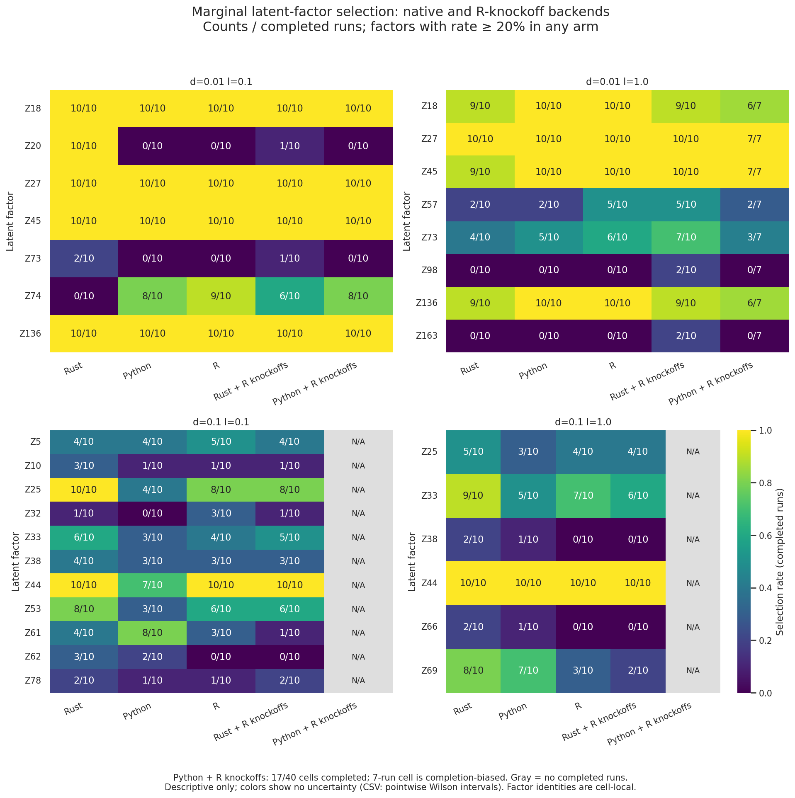
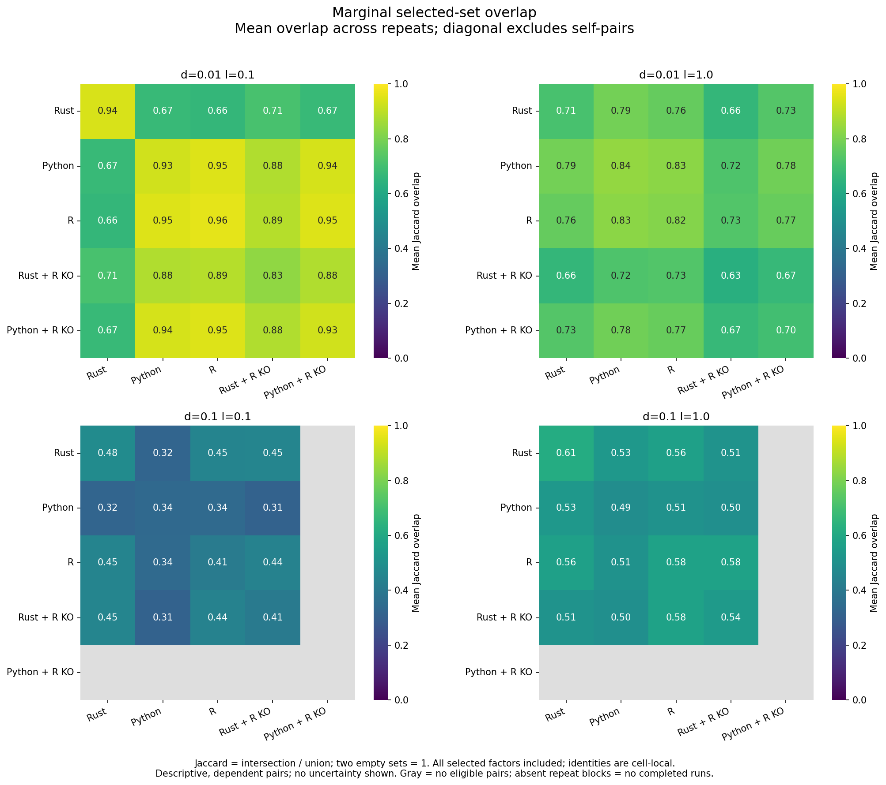

# SLIDE

SLIDE (Significant Latent Factor Interaction Discovery and Exploration) identifies
latent factors and their interactions that predict an outcome in high-dimensional
data. It combines LOVE overlapping clustering with knockoff-based selection.

This repository provides R, Python, and Rust implementations. The original R
package comes from [jishnu-lab/SLIDE](https://github.com/jishnu-lab/SLIDE).
You can install each implementation independently.

**Contents:** [Installation](#installation) · [Quick start](#quick-start) ·
[Outputs](#result-files-and-plots) · [Documentation](#documentation) ·
[Benchmarks](#benchmarks) · [Known limitations](#known-limitations) ·
[Contributing](#development) · [License and citation](#license-and-citation)

| Implementation | Features | Entry point |
| --- | --- | --- |
| R | Original R package | `library(SLIDE)` |
| Rust | Native pipeline, terminal dashboard, and SLURM helpers | `slide run`, `slide monitor`, `slide tui`, `slide submit` |
| Python | Library and CLI with plotting and optional R backends | `slide-py run`, `slide_py.OptimizeSLIDE` |

## Installation

Use Pixi for Python and Rust source installations. Precompiled distributions
are not yet available as verified releases.

Choose an implementation: [R](#r-installation) · [Python](#python-installation) ·
[Rust](#rust-installation). You do not need to install all three.

### Source checkout and platform coverage

Pixi is the preferred source-build environment on Linux x86-64, macOS 15+
(arm64 or x86-64), and native Windows x86-64. Install [Pixi](https://pixi.sh/latest/)
for Python or Rust. Pixi uses the locked Python 3.11 default environment for native Python work and the isolated `rust`
environment for Rust builds. See the platform status below before installing.

#### Prerequisites

- Linux x86-64: Pixi.
- macOS 15+ (Intel or Apple Silicon): Pixi and Xcode
  Command Line Tools (`xcode-select --install`).
- Windows x86-64: Pixi, Visual Studio 2022 C++ Build
  Tools, and the Windows SDK. Use PowerShell. Pixi does not install Visual
  Studio or the SDK.

For Python or Rust, clone the repository once. R installation does not need
Pixi or a local checkout:

```bash
git clone https://github.com/TranscriptionFactory/SLIDE.git
cd SLIDE
```

### R installation

Requires R ≥ 4.2:

```r
install.packages("remotes") # if not already installed
remotes::install_github("TranscriptionFactory/SLIDE")
library(SLIDE)
```

R SLIDE does not require Python or Rust. See the [R vignettes](vignettes/) and
[R examples](examples/) for usage.

### Python installation

Complete the [shared source setup](#source-checkout-and-platform-coverage).
Pixi supplies Python 3.11; Rust and R are not required for the native Python backend.

```bash
pixi install --locked -e default
pixi run --locked -e default check
```

Run Python commands through the same environment:

```bash
pixi run --locked -e default slide-py --version
```

Select `knockoff_backend: python` to run without R. For optional R integration,
see [Python development setup](CONTRIBUTING.md#python).

Alternative: [Python uv/pip and system packages](docs/python-source-alternatives.md).

### Rust installation

Complete the [shared source setup](#source-checkout-and-platform-coverage),
then install [rustup](https://rustup.rs/). Python and R installations are not
required. These commands apply on Linux, macOS, and Windows PowerShell:

```bash
rustup toolchain install 1.99.1 --profile minimal
pixi install --locked -e rust
pixi run --locked -e rust build
```

The Rust tasks pin toolchain 1.99.1; the project MSRV remains 1.88.
The `rust` environment omits default Python and R dependencies. You do not need
to install the `default` environment for a Rust build.

Run through Pixi so the executable can find its native libraries. On Linux/macOS:

```bash
pixi run --locked -e rust ./target/release/slide --version
```

On Windows:

```powershell
pixi run --locked -e rust ./target/release/slide.exe --version
```

Keep the Pixi environment available at runtime; moving the bare executable does
not make a portable installation. Linux and macOS Rust builds use the compilers
and numerical libraries supplied by Pixi; Windows also needs MSVC and the SDK.

Alternative: [Rust system packages and cluster modules](docs/rust-source-alternatives.md).

### Platform status

| Platform | Rust | Python |
| --- | --- | --- |
| Linux x86-64 | Build and smoke tests passed | Python 3.11 source build and smoke tests passed |
| macOS 15+, Intel / Apple Silicon | Experimental; native validation pending | Experimental; native validation pending |
| Windows x86-64 | Experimental; native validation pending | Experimental; native compiler/runtime validation pending |

## Quick start

### Rust usage

From the repository root, save this example config as `rust-quick.yaml`:

```yaml
x_path: examples/HIV+cytokines_X.csv
y_path: examples/HIV+cytokines_y.csv
out_path: out/rust-quick
delta: [0.1]
lambda: [0.1]
y_factor: true
pure_homo: true
spec: 0.1
fdr: 0.1
thresh_fdr: 0.2
SLIDE_iter: 10
do_interacts: true
knockoff_backend: rust
```

The ten iterations are for a quick demonstration, not a scientific analysis.
Run from the repository root using Pixi:

```bash
# Pipeline only (headless; good for batch jobs)
pixi run --locked -e rust ./target/release/slide run --config rust-quick.yaml --checkpoint out/checkpoint.json

# Pipeline and live dashboard together
pixi run --locked -e rust ./target/release/slide monitor --config rust-quick.yaml --checkpoint out/checkpoint.json
```

On Windows, use `./target/release/slide.exe` in these commands.
Run these from the repository root; Rust resolves relative input paths against
the working directory. The bundled data live in `examples/`. Add `-v` to print per-stage timing.
`slide monitor` exits non-zero if the pipeline fails or you quit the TUI
before it finishes.

See [docs/tui-guide.md](docs/tui-guide.md) for the dashboard tabs, keyboard
reference and SLURM workflows.

See [saved backend examples](examples/README.md#saved-backend-examples) for labeled Rust and Python outputs.

Rust rejects unknown config keys at load time and writes the checkpoint JSON
after each grid cell. You can resume an interrupted run from that checkpoint.

Set optional `out_path` to export result tables and plots after the pipeline.
Without it, Rust retains checkpoint-only execution. Use a fresh output path:
Rust refuses existing result directories rather than mixing old and new plots.
An export failure does not remove the completed checkpoint.

### Python usage

Save this as `python-quick.yaml` in the repository root:

```yaml
x_path: examples/HIV+cytokines_X.csv
y_path: examples/HIV+cytokines_y.csv
out_path: out/python-quick
delta: [0.1]
lambda: [0.1]
y_factor: true
pure_homo: true
spec: 0.1
fdr: 0.1
thresh_fdr: 0.2
niter: 10
knockoff_backend: python
do_interacts: true
n_workers: 1
```

```bash
pixi run --locked -e default slide-py run --config python-quick.yaml
```

The ten iterations are for a quick demonstration, not a scientific analysis.

The YAML is a flat mapping of the keys in the parameter table below.
Unlike `slide`, `slide-py run` resolves relative paths against the config
file's directory. `--x-path`, `--y-path` and `--out-path` override the
config. In a Python session started with `pixi run --locked -e default python`:

```python
from slide_py import OptimizeSLIDE

params = {
    "x_path": "examples/HIV+cytokines_X.csv",
    "y_path": "examples/HIV+cytokines_y.csv",
    "out_path": "results/",
    "delta": [0.01],
    "lambda": [0.5, 0.1],
    "spec": 0.2,
    "fdr": 0.1,
    "thresh_fdr": 0.1,
    "y_factor": True,
    "niter": 500,
    "knockoff_backend": "python",
}
OptimizeSLIDE(params).run_pipeline(verbose=True, n_workers=1)
```

### Parameters

| Name | Type | Description | Default |
| --- | --- | --- | --- |
| `x_path` | str | Feature matrix CSV | required |
| `y_path` | str | Response CSV | required |
| `out_path` | str | Output directory | current working directory |
| `delta` | list | LOVE thresholds | `[0.05, 0.1]` |
| `lambda` | list | LOVE penalty values | `[0.1]` |
| `fdr` | float | Knockoff FDR target | 0.1 |
| `thresh_fdr` | float | FDR threshold for LOVE correlations | 0.2 |
| `spec` | float | Minimum selection frequency for a factor | 0.2 |
| `y_factor` | bool | Treat `y` as categorical | True |
| `niter` | int | Knockoff iterations | 100 |
| `SLIDE_top_feats` | int | Top features per factor to plot | 20 |
| `pure_homo` | bool | Pure variables have loading 1 | True |

## Result files and plots

Python and Rust export per-cell `<delta>_<lambda>_out/` directories with labelled
`A.csv`, `z_matrix.csv`, `sig_LFs.txt`, `sig_interacts.txt`, `scores.txt`, and
`run_params.txt`. Factor labels use zero-based `Z0`, `Z1`, etc.; interaction
labels use `Z0.Z1`. A label match alone does not establish factor alignment.

For selected factors, both produce:

- `feature_list_Zi.txt`: tab-separated R-style feature names, absolute loadings,
  Spearman correlations, colors, and raw-feature AUC for binary responses.
- `plotSigGenes_marginals.pdf`: marginal-factor feature names in red/blue.
  With interactions enabled, `plotSigGenes.pdf` includes interaction partners
  and emphasizes marginal factors.
- `ControlPerformance.csv`: `group,value` rows for the real model and random
  controls. `ControlPerformancePlot.png` renders these when interactions are
  enabled; disabling interactions uses PDF, following R's format choice.

The control plot follows R's in-sample OLS calculation, including binary
responses, with 1,000 full-random fits and 1,000 partial-random fits when selected
interactions exist. It is **not held-out predictive performance**. The shared
`summary_table.csv` names this value `Control_Performance`; final CV is separate.
If no marginal factors pass selection, both backends write empty selection
files and omit the control plot.

Python also exports network plots and pickled state; Rust retains checkpoints.

## Documentation

- [R vignettes](vignettes/) and [examples](examples/)
- [Terminal dashboard and SLURM guide](docs/tui-guide.md)
- [Saved Python and Rust outputs](examples/README.md#saved-backend-examples)
- [Development and release guide](CONTRIBUTING.md)

## Benchmarks

### Runtime

Frozen-source measurements: 500 knockoff draws, four workers, one BLAS thread;
final predictive CV excluded. Wall time includes process startup and I/O.

| Dataset (samples × features) | Rust (s) | Python (s) | R (s) |
| --- | ---: | ---: | ---: |
| CD4 (2,482 × 1,776) | 5.31 | 22.07 | 93.52 |
| Synthetic (50 × 20,000) | 90.69 | 137.00 | Timeout at 7,200 |
| LS skin transcriptomics (44 × 15,496) | 1,305.27 | 4,817.10 | Timeout at 7,200 |

CD4 values are medians of ten runs; other rows are single runs. CD4/synthetic
use Gaussian parity settings; LS uses native binary settings. These are
configuration-specific observations, not universal speedups. See
[measurement conditions, memory and full results](benchmarks/README.md#runtime-and-memory-comparisons).

### Latent-factor selection and repeat overlap

Matching latent scores does **not** guarantee matching selected factors.
The separate five-backend SSc campaign compares native Rust/Python, pure R,
and Rust/Python with R-generated knockoffs.



Counts / completed repeats; display includes factors selected in ≥20% of runs
in any backend. Compare factor identities only within a parameter cell.



Mean Jaccard overlap uses **all selected marginal factors**, including rare ones.
Off-diagonal entries compare all cross-backend repeat pairs; diagonal entries
compare distinct repeats within a backend. Two empty sets count as 1; gray
means no eligible pairs. Pairs reuse runs and are not independent observations.

[Repeat-by-repeat heatmaps, CSVs and reproduction command](benchmarks/results/2026-10-19_backend-overlap/README.md)
show variation behind these averages. Native backends and the Rust hybrid have
ten repeats per cell; the Python hybrid has 10/7/0/0 completed runs, with timeout
bias in the seven-run cell. Colors show no uncertainty or equivalence test.
SSc preserves historical positional sample pairing; biological sample identity
was not verified. See [benchmark details and limits](benchmarks/README.md#latent-factor-comparisons).

## Known limitations

- The implementations can select different factors even when latent scores
  agree. Do not assume backend equivalence.
- Configuration keys and relative-path rules differ between implementations;
  YAML files are not interchangeable.
- Use unique feature names. Python adds suffixes to duplicate CSV headers,
  while Rust preserves duplicates.
- macOS and Windows source recipes are experimental; native validation is
  pending. See [platform status](#platform-status).
- Python rerun state restoration needs repair; do not rely on it to resume work.

## Development

After setting up the Rust Pixi environment:

```bash
pixi run --locked -e rust test
pixi run --locked -e rust check
```

For Python tests, use the Linux x86-64 development environment, which includes
pytest and the optional R dependencies:

```bash
pixi install --locked -e dev
pixi run --locked -e dev test
```

See [CONTRIBUTING.md](CONTRIBUTING.md) for development setup and release
procedures, and [CHANGELOG.md](CHANGELOG.md) for changes.
Report bugs through [GitHub Issues](https://github.com/TranscriptionFactory/SLIDE/issues).

## License and citation

Project code uses the MIT license; see [LICENSE](LICENSE). Bundled components
have separate terms, including the [DSDP wrapper](src/slide_py/dsdp_solver/LICENSE)
and [glmnet wrapper](src/slide_py/knockoff/_vendor/glmnet/LICENSE).
The combined Python distribution is not MIT-only.

If you use SLIDE, cite:

Rahimikollu, J., Xiao, H., Rosengart, A. et al. **SLIDE: Significant Latent Factor
Interaction Discovery and Exploration across biological domains.**
*Nature Methods* **21**, 835–845 (2024).
[doi:10.1038/s41592-024-02175-z](https://doi.org/10.1038/s41592-024-02175-z).
