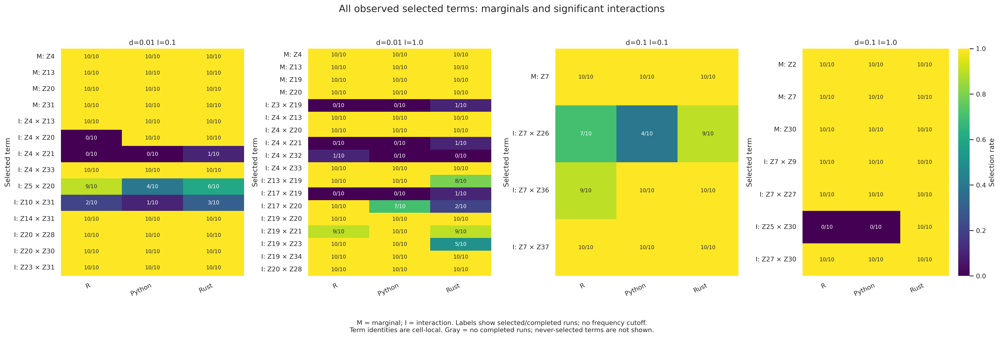
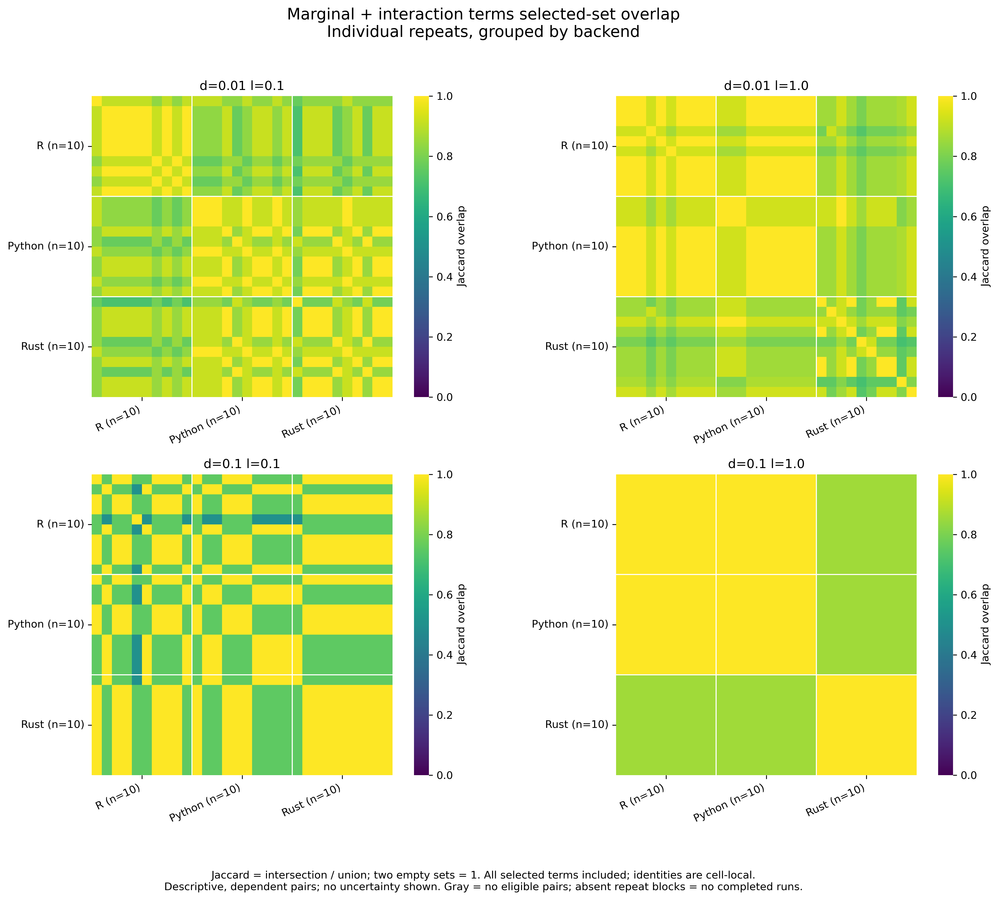
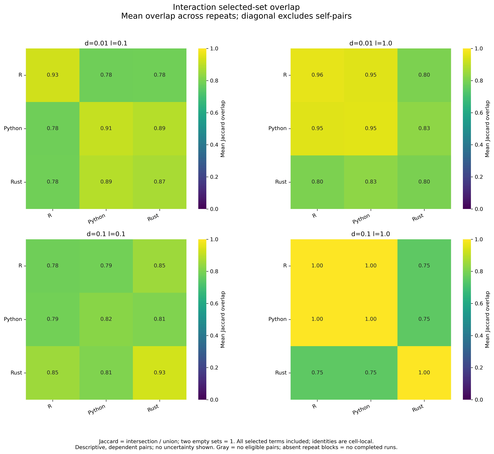

# SLIDE

SLIDE (Significant Latent Factor Interaction Discovery and Exploration) identifies
latent factors and their interactions that predict an outcome in high-dimensional
data. It combines LOVE overlapping clustering with knockoff-based selection.

This repository provides R, Python, and Rust implementations. The original R
package comes from [jishnu-lab/SLIDE](https://github.com/jishnu-lab/SLIDE).
You can install each implementation independently.

**Contents:** [Installation](#installation) · [Quick start](#quick-start) ·
[Outputs](#result-files-and-plots) · [Documentation](#documentation) ·
[Benchmarks](#benchmarks) · [Contributing](#development) · [License and citation](#license-and-citation)

| Implementation | Features | Entry point |
| --- | --- | --- |
| R | Original R package | `library(SLIDE)` |
| Rust | Native pipeline, terminal dashboard, and SLURM helpers | `slide run`, `slide run --tui`, `slide view`, `slide submit` |
| Python | Library and CLI with plotting and optional R backends | `slide-py run`, `slide_py.OptimizeSLIDE` |

## Installation

Use Pixi for Python and Rust source installations. Precompiled distributions
are not yet available as verified releases.

Choose an implementation: [R](#r-installation) · [Python](#python-installation) ·
[Rust](#rust-installation). You do not need to install all three.

### Source checkout and platform coverage

Pixi is the preferred source-build environment on Linux x86-64, macOS 15+
(arm64 or x86-64), and native Windows x86-64. Install [Pixi](https://pixi.sh/latest/)
for Python or Rust. Pixi uses the locked Python 3.11 default environment for native Python work and the isolated `rust`
environment for Rust builds. See the platform status below before installing.

#### Prerequisites

- Linux x86-64: Pixi.
- macOS 15+ (Intel or Apple Silicon): Pixi and Xcode
  Command Line Tools (`xcode-select --install`).
- Windows x86-64: Pixi, Visual Studio 2022 C++ Build
  Tools, and the Windows SDK. Use PowerShell. Pixi does not install Visual
  Studio or the SDK.

For Python or Rust, clone the repository once. R installation does not need
Pixi or a local checkout:

```bash
git clone https://github.com/TranscriptionFactory/SLIDE.git
cd SLIDE
```

### R installation

Requires R ≥ 4.2:

```r
install.packages("remotes") # if not already installed
remotes::install_github("TranscriptionFactory/SLIDE")
library(SLIDE)
```

R SLIDE does not require Python or Rust. See the [R vignettes](vignettes/) and
[R examples](examples/) for usage.

### Python installation

Complete the [shared source setup](#source-checkout-and-platform-coverage).
Pixi supplies Python 3.11; Rust and R are not required for the native Python backend.

```bash
pixi install --locked -e default
pixi run --locked -e default check
```

Run Python commands through the same environment:

```bash
pixi run --locked -e default slide-py --version
```

Select `knockoff_backend: python` to run without R. For optional R integration,
see [Python development setup](CONTRIBUTING.md#python).

Alternative: [Python uv/pip and system packages](docs/python-source-alternatives.md).

### Rust installation

Complete the [shared source setup](#source-checkout-and-platform-coverage),
then install [rustup](https://rustup.rs/). Python and R installations are not
required. These commands apply on Linux, macOS, and Windows PowerShell:

```bash
rustup toolchain install 1.99.1 --profile minimal
pixi install --locked -e rust
pixi run --locked -e rust build
```

The Rust tasks pin toolchain 1.99.1; the project MSRV remains 1.88.
The `rust` environment omits default Python and R dependencies. You do not need
to install the `default` environment for a Rust build.

Run through Pixi so the executable can find its native libraries. On Linux/macOS:

```bash
pixi run --locked -e rust ./target/release/slide --version
```

On Windows:

```powershell
pixi run --locked -e rust ./target/release/slide.exe --version
```

Keep the Pixi environment available at runtime; moving the bare executable does
not make a portable installation. Linux and macOS Rust builds use the compilers
and numerical libraries supplied by Pixi; Windows also needs MSVC and the SDK.

Alternative: [Rust system packages and cluster modules](docs/rust-source-alternatives.md).

### Platform status

| Platform | Rust | Python |
| --- | --- | --- |
| Linux x86-64 | Build and smoke tests passed | Python 3.11 source build and smoke tests passed |
| macOS 15+, Intel / Apple Silicon | Experimental; native validation pending | Experimental; native validation pending |
| Windows x86-64 | Experimental; native validation pending | Experimental; native compiler/runtime validation pending |

## Quick start

### Rust usage

From the repository root, save this example config as `rust-quick.yaml`:

```yaml
x_path: examples/HIV+cytokines_X.csv
y_path: examples/HIV+cytokines_y.csv
out_path: out/rust-quick
delta: [0.1]
lambda: [0.1]
y_factor: true
pure_homo: true
spec: 0.1
fdr: 0.1
thresh_fdr: 0.2
SLIDE_iter: 10
do_interacts: true
knockoff_backend: rust
```

The ten iterations are for a quick demonstration, not a scientific analysis.
Run from the repository root using Pixi:

```bash
# Pipeline only (headless; good for batch jobs)
pixi run --locked -e rust ./target/release/slide run --config rust-quick.yaml --checkpoint out/checkpoint.json

# Pipeline and live dashboard together
pixi run --locked -e rust ./target/release/slide run --tui --config rust-quick.yaml --checkpoint out/checkpoint.json

# Read-only dashboard for a running or completed job
pixi run --locked -e rust ./target/release/slide view --config rust-quick.yaml --checkpoint out/checkpoint.json
```

For a fixed full-data fit, use [`slide fit`](docs/native-full-fit.md). It defaults
to unweighted OLS and needs no weights. Select `--predictor weighted-binomial`
explicitly to use prior sample weights with the method-4 upsilon predictor.

For repeated CV on saved factors without refitting LOVE, use [`slide cv`](docs/native-cv.md).
It runs observed and permuted-label branches and reports separate pooled-repeat summaries.

On Windows, use `./target/release/slide.exe` in these commands.
Run these from the repository root; Rust resolves relative input paths against
the working directory. The bundled data live in `examples/`. Add `-v` to print per-stage timing.
`slide run --tui` exits non-zero if the pipeline fails or you quit the TUI
before it finishes after confirming the stop.


`run` starts or resumes a compatible checkpoint; corrupt or incompatible state
is rejected, never reset. A full grid does not establish final CV/export success.
`run --tui` shows its worker status and log, and asks before stopping an active
worker. `view` only observes files; `--config` supplies metadata, not execution.
Progress files do not prove an external job is alive. Use a new checkpoint path
for a new run. The adjacent `.log` is currently truncated by `run --tui` at startup.

See [docs/tui-guide.md](docs/tui-guide.md) for the dashboard tabs, keyboard
reference and SLURM workflows, or browse the [visual/output screenshots](docs/tui-guide.md#release-screenshots).
The former `monitor` and `tui` subcommands have been removed: use `run --tui`
and `view`, respectively.

See [saved backend examples](examples/README.md#saved-backend-examples) for labeled Rust and Python outputs.

Rust rejects unknown config keys at load time and writes the checkpoint JSON
after each grid cell. You can resume an interrupted run from that checkpoint.

Set optional `out_path` to export result tables and plots after the pipeline.
Without it, Rust retains checkpoint-only execution. Use a fresh output path:
Rust refuses existing result directories rather than mixing old and new plots.
An export failure does not remove the completed checkpoint.

### Python usage

Save this as `python-quick.yaml` in the repository root:

```yaml
x_path: examples/HIV+cytokines_X.csv
y_path: examples/HIV+cytokines_y.csv
out_path: out/python-quick
delta: [0.1]
lambda: [0.1]
y_factor: true
pure_homo: true
spec: 0.1
fdr: 0.1
thresh_fdr: 0.2
niter: 10
knockoff_backend: python
do_interacts: true
n_workers: 1
```

```bash
pixi run --locked -e default slide-py run --config python-quick.yaml
```

The ten iterations are for a quick demonstration, not a scientific analysis.

The YAML is a flat mapping of the keys in the parameter table below.
Unlike `slide`, `slide-py run` resolves relative paths against the config
file's directory. `--x-path`, `--y-path` and `--out-path` override the
config. In a Python session started with `pixi run --locked -e default python`:

```python
from slide_py import OptimizeSLIDE

params = {
    "x_path": "examples/HIV+cytokines_X.csv",
    "y_path": "examples/HIV+cytokines_y.csv",
    "out_path": "results/",
    "delta": [0.01],
    "lambda": [0.5, 0.1],
    "spec": 0.2,
    "fdr": 0.1,
    "thresh_fdr": 0.1,
    "y_factor": True,
    "niter": 500,
    "knockoff_backend": "python",
}
OptimizeSLIDE(params).run_pipeline(verbose=True, n_workers=1)
```

### Parameters

| Name | Type | Description | Default |
| --- | --- | --- | --- |
| `x_path` | str | Feature matrix CSV | required |
| `y_path` | str | Response CSV | required |
| `out_path` | str | Output directory | current working directory |
| `delta` | list | LOVE thresholds | `[0.05, 0.1]` |
| `lambda` | list | LOVE penalty values | `[0.1]` |
| `fdr` | float | Knockoff FDR target | 0.1 |
| `thresh_fdr` | float | FDR threshold for LOVE correlations | 0.2 |
| `spec` | float | Minimum selection frequency for a factor | 0.1 |
| `y_factor` | bool | Treat `y` as categorical | True |
| `niter` | int | Knockoff iterations (`SLIDE_iter` alias) | 1000 |
| `sample_cv_iterations` | int | Screening holdouts (`sampleCV_iter` alias) | 500 |
| `sample_cv_k` | int | Screening holdout denominator (`sampleCV_K` alias); K=n when n ≤ 20 | 4 |
| `eval_type` | str | Screening metric: `auc` or `corr`; infer from response if omitted | inferred |
| `auto_select` | bool | Choose highest finite sampleCV metric; first-grid tie break | false |
| `SLIDE_top_feats` | int | Top features per factor to plot | 20 |
| `pure_homo` | bool | Pure variables have loading 1 | True |

## Result files and plots

Python and Rust export per-cell `<delta>_<lambda>_out/` directories with labelled
`A.csv`, `z_matrix.csv`, `sig_LFs.txt`, `sig_interacts.txt`, `scores.txt`, and
`run_params.txt`. Factor labels use zero-based `Z0`, `Z1`, etc.; interaction
labels use `Z0.Z1`. A label match alone does not establish factor alignment.

For selected factors, both produce:

- `feature_list_Zi.txt`: tab-separated R-style feature names, absolute loadings,
  Spearman correlations, colors, and raw-feature AUC for binary responses.
- `plotSigGenes_marginals.pdf`: marginal-factor feature names in red/blue.
  With interactions enabled, `plotSigGenes.pdf` includes interaction partners
  and emphasizes marginal factors.
- `ControlPerformance.csv`: `group,value` rows for the real model and random
  controls. `ControlPerformancePlot.png` renders these when interactions are
  enabled; disabling interactions uses PDF, following R's format choice.

The control plot follows R's in-sample OLS calculation, including binary
responses, with 1,000 full-random fits and 1,000 partial-random fits when selected
interactions exist. It is **not held-out predictive performance**. The shared
`summary_table.csv` names this value `Control_Performance`; final CV is separate.

Both optimizers report candidates in grid order without choosing or ranking a
winner by default, matching R. Set `auto_select: true` to choose the highest
finite `sampleCV_Performance` (first-grid tie break). Python writes the manual
or automatic state in `selected_candidate.json`; Rust writes this file only for
opt-in auto-selection and refuses to overwrite prior result directories.
An unscorable grid has no automatic winner.
Single-candidate runs remain directly usable. Multi-candidate final CV requires
opt-in selection or a manual choice of saved factors.

SampleCV screens the fixed raw selected marginals and products with unweighted
intercept OLS on repeated uniform holdouts. It pools held-out AUC (fixed
orientation) or Spearman correlation, without rerunning selection. Summary
columns add `sampleCV_Performance`, `sampleCV_Provenance`, `sampleCV_Status` and
`f_size`; missing metrics stay missing. Per candidate, `sampleCV_predictions.csv`
retains pooled predictions and sample IDs. `sampleCV_model.json` retains the LAST
holdout model and its training IDs, ordered terms and aliased coefficients,
not a full-data predictor. Model terms match the native zero-based
`z_matrix.csv` headers (`Z0`, `Z1`, and products such as `Z0.Z1`). SampleCV is
screening, not rigorous SLIDEcv.

Python's [`SLIDEcv` API](docs/native-cv.md#native-python-api) performs method-4
reselection on saved factors within each fold, with Gaussian submodel/final
predictors for both continuous and binary responses. It retains observed and
training-y-permuted predictions and scores separately. Its results are not
interchangeable with historical Python CV or with sampleCV screening scores.

Legacy Rust checkpoints without screening results cannot resume optimization;
use a fresh checkpoint. Their control scores are not sampleCV metrics.
If no marginal factors pass selection, both backends write empty selection
files and omit the control plot.

Python also exports network plots and pickled state; Rust retains checkpoints.

## Documentation

- [R vignettes](vignettes/) and [examples](examples/)
- [Terminal dashboard and SLURM guide](docs/tui-guide.md)
- [Saved Python and Rust outputs](examples/README.md#saved-backend-examples)
- [Development and release guide](CONTRIBUTING.md)

## Benchmarks

The current benchmark overview presents the **120 successful CD4 fits** from the
[CD4 full-fitting comparison](benchmarks/results/2026-11-08_cd4-rust-rerun/README.md): ten seeds per backend, four delta/lambda settings, and native
Rust, native Python and checked-in R. Each fit uses **1,000 knockoff-selection
draws**, four workers and one BLAS thread per worker, plus sampleCV with 500
holdouts (K=4). All 120 CD4 sampleCV scores are defined. **Final CV is excluded.**
SSc remains in the saved campaign as a diagnostic dataset, not a headline
benchmark target: it has only 24 observations for 88–172 estimated factors.

### Runtime

Median fresh-process wall seconds over ten runs, including fitting, exports,
sampleCV and profiling. Python is fastest in every CD4 setting. These are
workflow comparisons, not equal-work solver timings.

| Dataset (samples × features) | delta / lambda | Rust (s) | Python (s) | R (s) |
| --- | --- | ---: | ---: | ---: |
| CD4 (2,482 × 1,776) | 0.01 / 0.1 | 70.85 | 44.69 | 103.81 |
| CD4 | 0.01 / 1.0 | 71.54 | 45.92 | 102.57 |
| CD4 | 0.1 / 0.1 | 32.62 | 25.72 | 69.95 |
| CD4 | 0.1 / 1.0 | 51.07 | 37.47 | 97.55 |

[Runtime distributions, memory and measurement limits](benchmarks/results/2026-11-08_cd4-rust-rerun/README.md#runtime-and-memory)
retain node/system variation and sampled-RSS caveats. The
[historical synthetic and LS capacity measurements](benchmarks/README.md#historical-capacity-and-runtime-measurements)
use different settings and timing boundaries; they are not pooled with this campaign.

### Latent-factor selection and repeat overlap

Matching latent scores does **not** guarantee matching selected factors.
CD4 marginal selections match across all backends in all ten runs per setting:

| delta / lambda | Selected marginal factors |
| --- | --- |
| 0.01 / 0.1 | Z4, Z13, Z20, Z31 |
| 0.01 / 1.0 | Z4, Z13, Z19, Z20 |
| 0.1 / 0.1 | Z7 |
| 0.1 / 1.0 | Z2, Z7, Z30 |

Factor identities are local to a parameter cell.

Marginal Jaccard is 1.000 for every backend pairing in every setting.
Mean Jaccard uses **all selected marginal factors**, including rare ones.
Cross-backend entries average 100 run pairs; within-backend entries average
45 distinct pairs, excluding self-comparisons. Two empty sets count as 1.
These pairs reuse runs and are not independent observations or equivalence tests.

### All selected marginals and interactions



This view has **no frequency cutoff**: it includes every term selected at least
once, including one-off selections. `M` labels a marginal LF and `I` labels an
interaction term; a marginal Z7 and an interaction Z7 × Z9 are distinct rows.
Entries are selected/completed runs, including zeros in other backends.
Never-selected terms are not shown. See the
[CD4 combined-set backend overlap](benchmarks/results/2026-11-08_cd4-rust-rerun/analysis/cd4/overlap_combined_backends.png).

### Run-to-run variability



Each pixel compares the full marginal-plus-interaction term sets from two
individual runs, with no frequency cutoff; white boundaries separate backends.
Within-backend blocks show selection variability across ten seeds. The main
diagonal compares each run with itself and equals 1; it is not evidence of
repeat stability. Each term has equal weight, so larger interaction sets can
dominate combined overlap; separate marginal and interaction views remain in
the report. See the [CD4 per-run selected-count distributions](benchmarks/results/2026-11-08_cd4-rust-rerun/analysis/cd4/counts.png)
for a complementary view.

### CD4 interaction differences



Perfect CD4 marginal agreement does not extend to interactions. At delta=0.1,
lambda=1.0, R and Python select the same three interactions in all ten runs;
Rust adds Z30–Z25 in all ten, giving R–Rust interaction Jaccard 0.750.

No marginal size-cap retries were logged in these 120 CD4 fits, so this campaign
does not demonstrate an effect from the retry fix. Selection draws and seed
counts also differ from earlier campaigns. The full-fitting report retains
screening-score denominators and limits; sampleCV is not nested validation.

[Historical five-backend and R-knockoff-hybrid comparisons](benchmarks/README.md#r-knockoff-hybrid-comparisons)
remain separate from these native-backend results.

## Development

After setting up the Rust Pixi environment:

```bash
pixi run --locked -e rust test
pixi run --locked -e rust check
```

For Python tests, use the Linux x86-64 development environment, which includes
pytest and the optional R dependencies:

```bash
pixi install --locked -e dev
pixi run --locked -e dev test
```

See [CONTRIBUTING.md](CONTRIBUTING.md) for development setup and release
procedures, and [CHANGELOG.md](CHANGELOG.md) for changes.
Report bugs through [GitHub Issues](https://github.com/TranscriptionFactory/SLIDE/issues).

## License and citation

Project code uses the MIT license; see [LICENSE](LICENSE). Bundled components
have separate terms, including the [DSDP wrapper](src/slide_py/dsdp_solver/LICENSE)
and [glmnet wrapper](src/slide_py/knockoff/_vendor/glmnet/LICENSE).
The combined Python distribution is not MIT-only.

If you use SLIDE, cite:

Rahimikollu, J., Xiao, H., Rosengart, A. et al. **SLIDE: Significant Latent Factor
Interaction Discovery and Exploration across biological domains.**
*Nature Methods* **21**, 835–845 (2024).
[doi:10.1038/s41592-024-02175-z](https://doi.org/10.1038/s41592-024-02175-z).
