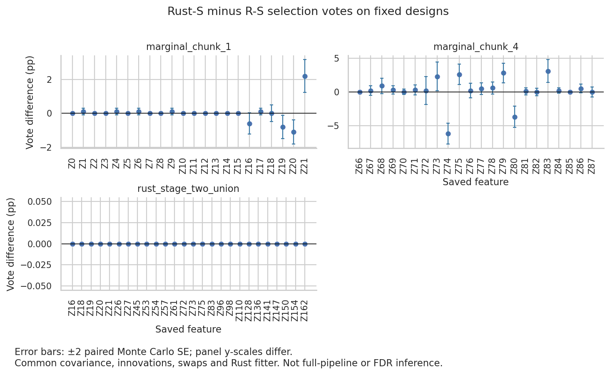

# S-only paired replay at δ=0.01, λ=1.0

**Taking R's S instead of Rust's moves Z74 and Z21 but not Z20 or Z73.** With
Rust's fitter, the covariance, innovations and swap masks fixed, R's DSDP S
restores Z74 in marginal chunk 4 (11.6% vs 5.4% of draws) and drops Z21 from
chunk 1 (8.3% vs 10.5%). Z20 is selected in chunk 1 under both S (29.6% vs
28.5%). Z73 is selected in chunk 4 under both (33.9% vs 36.2%). On the fixed
stage-two union the two arms are identical in every draw.

So on this seed-42 design, Clarabel's near-zero S explains the Z74 loss at the
chunk level and Z21 marginally. Rust's Z20 selection and its missing Z73
relative to R's full runs must come from elsewhere: the fitter, knockoff
generation outside S, or later pipeline stages.

## Question

With Rust's fitter, the covariance, the innovations and the swap masks held
fixed, does R's DSDP S in place of Rust's Clarabel S remove Rust's Z20/Z21
selection and restore Z73/Z74? This is the δ=0.01 version of the δ=0.1
chunk-4 study in [2026-10-05_s-selection](../2026-10-05_s-selection/README.md).
In the 10-seed replicates, Rust selected Z20 10/10, Z21 8/10 and Z73 1/10;
pooled R selected them 0/30, 0/30 and 20/30
([2026-10-12_backend-replicates](../2026-10-12_backend-replicates/README.md)).

## Design

- Source: the seed-42 Rust checkpoint at δ=0.01 λ=1.0 from
  `.tmpfiles/2026-10-12_backend-replicates/results/rust/seed_42/`. Z and A come
  from the seed-42 Python output of the same cell and match the checkpoint to
  within 4e−13. K=172 and f_size=`calc_default_fsize(24, 172)`=24, which gives
  eight marginal chunks: seven of 22 columns and one of 18.
- Z20 and Z21 fall in `marginal_chunk_1` (Z0–Z21). Z73 and Z74 fall in
  `marginal_chunk_4` (Z66–Z87). The fixed 26-column Rust stage-two union holds
  Z20, Z21 and Z73 but not Z74.
- On R's `cov(z)`, Rust clips Z20 and Z21 to S=0 where R has 1.8e−10 and
  2.5e−10. For Z74 Rust has 3.8e−9 and R has 1.6e−8. Z73 is substantive
  (0.2296) in both. Chunk 1 has 12 zero and 5 tiny Rust entries; chunk 4 has
  3 zero and 11 tiny. The union S values agree to within 2.5e−7.
  [2026-10-13_clarabel-diag-s](../2026-10-13_clarabel-diag-s/README.md) shows
  that the true optimum for these near-zero entries is 0. Rust's exact zeros
  and R's 1e−10 to 1e−8 values are both solver residue.
- 1,000 paired draws per design; sampler seeds 42–1041; fixture seeds
  42 + 10000 × design index. The tools are unchanged: `paired_xtilde.py`
  builds the fixtures and swap masks. The 2026-09-28 sampler `audit.py` solves
  Rust S and R S on the same covariance with shared innovations. Then
  `replay_paired_xtilde.py --sampler-audit` replays the Rust-S arm against the
  R-S arm. Fitter settings: Rust fitter, 500 λ, tolerance 1e−7, cap 100,000,
  R λ ratio.
- R-S vs R-S control: a second replay of the same draws. Every fit must match
  the first replay except elapsed time, and the vote and draw tables must be
  byte-identical. `summarize.py` checks this and writes `focus_factors.csv`.

## Results

The control is exact: 2,000 of 2,000 repeat fits per design matched, and the
tables were byte-identical.

| Design | Draws with a changed selected set | W RMS Δ |
| --- | ---: | ---: |
| Marginal chunk 1 | 44 (4.4%) | 0.297 |
| Marginal chunk 4 | 308 (30.8%) | 0.446 |
| Fixed stage-two union | 0 | 0.006 |

Focus factors: votes out of 1,000 with Wilson 95% intervals. Δ is Rust S
minus R S in percentage points ± paired Monte Carlo SE. The vote cutoff is 100.

| Design | Factor | Rust S | R S | Δ (pp) |
| --- | --- | --- | --- | ---: |
| Chunk 1 | Z20 | 285 (25.8–31.4%) | 296 (26.9–32.5%) | −1.1 ± 0.36 |
| Chunk 1 | Z21 | 105 (8.7–12.6%) | 83 (6.7–10.2%) | +2.2 ± 0.49 |
| Chunk 4 | Z73 | 362 (33.3–39.2%) | 339 (31.0–36.9%) | +2.3 ± 1.06 |
| Chunk 4 | Z74 | 54 (4.2–7.0%) | 116 (9.8–13.7%) | −6.2 ± 0.78 |
| Union | Z20 / Z21 / Z73 | 315 / 147 / 98 | identical | 0 |

Final sets after 1,000 draws (`final_sets.csv`):

| Design | Arm | findOptIter set | Uncertain at spec |
| --- | --- | --- | --- |
| Chunk 1 | Rust S | Z16, Z18, Z19, Z20, Z21 | Z21 |
| Chunk 1 | R S | Z16, Z18, Z19, Z20 | Z21 |
| Chunk 4 | Rust S | Z73, Z75, Z79, Z83, Z87 | Z79 |
| Chunk 4 | R S | Z72, Z73, Z74, Z75, Z83, Z87 | Z74, Z75, Z79, Z83 |
| Union | both | Z18, Z20, Z21, Z27, Z45, Z136 | Z57, Z73 |

- Chunk 1: Z21 is the only set change. Its interval straddles the 10%
  cutoff in both arms, so this is a marginal, threshold-level effect.
- Chunk 4: Rust S removes Z74 from the set and adds Z79 (113 vs 85 votes).
  Z72 also leaves Rust's findOptIter set, but its votes do not change (134 vs
  132), so it is a findOptIter iteration choice, not a vote shift. Z80, a
  non-selected factor, loses 3.7 points (33 vs 70).
- Union: Rust and R S agree to 2.5e−7 here and give identical selections in
  every draw. The union has no near-zero S entries and no Z74 column.



Error bars are ±2 paired Monte Carlo SE under this fixed coupling. They are
not simultaneous intervals, p-values or FDR statements.

## Caveats

- One design from one seed (42), one innovation stream and one swap stream.
  The replicate rates in the Question section are across seeds; this run does
  not test them.
- The union is Rust's saved seed-42 union and is not rebuilt. S changes that
  alter stage-one sets, such as Z21 and Z74, could still change a rebuilt
  stage-two design. This run does not measure that.
- Z20 holds in both arms on the marginal chunk and the union. So this run
  cannot explain why Rust's full pipeline keeps Z20 when R's does not.
- Job 11935828 peaked at 7.77 GB of its 8 GB request (`sacct.txt`). A rerun
  should request more memory, e.g. 12G.

## Artifacts and reproduction

- `focus_factors.csv`: focus-factor votes, Wilson intervals and paired Δ.
- `final_sets.csv`: frequent, findOptIter and uncertain sets per design and arm.
- `vote_deltas.png`: per-feature vote differences; data from the replay `votes.csv` files.
- `sacct.txt`: job accounting.
- `smoke_focus_factors.csv`: 20-draw smoke.
- `run.sbatch`, `summarize.py`: driver and control/summary.

Raw fixtures, audit arrays, fits and logs are in
`.tmpfiles/2026-10-13_s-only-d001/full/`. The binaries were built at
`cc64f4c`: `paired_xtilde` sha256 `f0c21216…`, `slide_knockoff` test sha256
`619b8e75…`.

Submit from the repository root. The run directory must hold `designs/`
(`prepare_paired_cell.py --delta 0.01 --lambda 1.0 --shape 24 172
--union-size 26`) and `bin/`:

```bash
RUN=.tmpfiles/2026-10-13_s-only-d001/full
sbatch --output="$RUN/logs/%j.out" benchmark_results/2026-10-13_s-only-d001/run.sbatch "$RUN" \
  /vast/djishnu/Aaron/.tmpfiles/20260902_knockoff-generator-parity/project/.pixi/envs/dev \
  /vast/djishnu/Aaron/.tmpfiles/20260902_r-generated-knockoff-backend-evaluation/R-library 1000 1000
```
