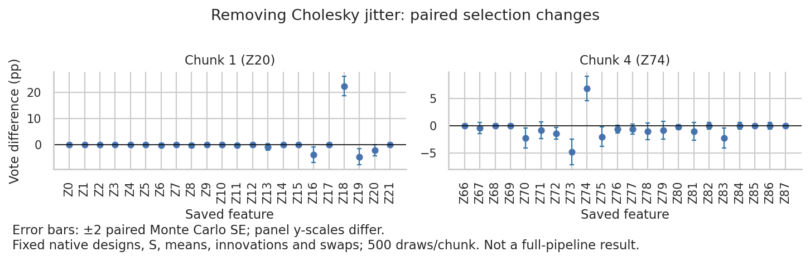

# Cholesky jitter on the native Z20/Z74 chunks

## Result

**Jitter contributes to Z74's preliminary exclusion on this saved design,
but removing it does not remove Z20.** This is a conditional replay, not
a full-pipeline rerun or a production fix.

Seed label 42, delta 0.01, lambda 0.1; native chunks 1 and 4; 500 draws each.
Rust's unregularized Cholesky fails in both chunks. The first retry succeeds
after adding 1e-10 to every diagonal of the conditional covariance.

| Factor | Native jitter | No jitter | Vote change | Preliminary selection |
| --- | ---: | ---: | ---: | --- |
| Z20 | 74/500 | 64/500 | −2.0 pp ± 1.06 pp MC SE | Included in both |
| Z74 | 38/500 | 72/500 | +6.8 pp ± 1.13 pp MC SE | Excluded → included |

The frequency cutoff is 50 votes. Both the frequency and findOptIter sets
retain Z20. Chunk 1's findOptIter remains iteration 13 (zero-based);
chunk 4's changes from 28 to 195 and adds Z74. No other factor enters
or leaves either chunk's selected set.

The no-jitter factor is an exact positive-semidefinite block factor: zero
rows/columns for zero-S features, Cholesky on the positive-S block. Merely
removing Rust's retry would fail; R's direct chol also rejects a singular
target. This counterfactual is not a claim that R's generator uses block
factorization.

## Controls and verification

- Extended only the existing ignored sampler audit in slide-knockoff:
  optional base seed (default remains 42), native S and pre-factorization
  covariance output, and initial Cholesky success reporting.
  No production behavior changed.
- Audit job 11958141 and replay job 11958144 completed with exit 0.
  The audit's emit_diag_s test passed for both chunks.
- Native draws match the saved native draws bitwise for all 1,000 draws.
  Chunk seeds are 42 and 1542; original swap masks are unchanged.
- Measured UᵀU − target is 1e-10 I. Maximum off-diagonal residual is
  6.94e-18 (chunk 1) and 1.73e-18 (chunk 4).
- Zero-S factors: chunk 1 Z0/Z3/Z7/Z12/Z14/Z15/Z18/Z21;
  chunk 4 Z74/Z80/Z84. Thus jitter directly perturbs Z74's exact-copy column;
  Z20 has nonzero S.
- Rebuilding the jittered factor in NumPy changes draws by at most
  2.22e-16 and changes no selections. This controls for factorization-library
  differences in the no-jitter comparison.
- The no-jitter factors reconstruct the unregularized targets to within
  1e-13. Zero-S knockoff columns equal their original columns bitwise.
- Native selections reproduce the saved R-fitter selections exactly.
- Independent R-fitter check job 11958149 completed with exit 0:
  R and Rust agree on every no-jitter per-draw selected set, all votes,
  frequency sets and findOptIter results across both chunks.
- Removing jitter changes 163/500 complete per-draw selected sets in chunk 1
  and 80/500 in chunk 4. Maximum knockoff-entry changes are 4.85e-5 and 4.43e-5.
- Inspected the vote-difference figure for labels, clipping and table agreement.



The earlier October 6 jitter decomposition used a different saved design.
Its result must not be substituted for this exact-cell result.

## Reproduction

Existing implementations: emit_diag_s sampler audit,
benchmarks/replay_paired_xtilde.py fit_draw and paired_vote_summary,
and benchmarks/analyze_paired_xtilde.py aggregate_selection.
The small driver in tmpfiles/2026-10-16_native-chunk-jitter/replay_jitter.py
uses those helpers. The full replay CLI requires a different fixture/manifest
layout; this driver consumes the already captured native chunks directly.

Raw data: .tmpfiles/2026-10-16_native-chunk-jitter/.
Original inputs: .tmpfiles/2026-10-13_preliminary-selection-diagnosis/numerical/.
Fitter: .tmpfiles/2026-10-16_gaussian-arithmetic/final-paired-xtilde,
the verified Gaussian arithmetic fitter; production source c4726e3.

Set RUN and OUT to fresh dated directories under .tmpfiles/ and benchmark_results/,
ENV to /vast/djishnu/Aaron/.tmpfiles/20260902_knockoff-generator-parity/project/.pixi/envs/dev.
Copy each original chunk's z.raw, y.raw, a.raw, lf_names.txt and swaps.raw
into RUN/chunk_1 and RUN/chunk_4. Generate sigma.csv with installed R cov(z)
and r_s.csv with knockoff::create.solve_asdp(sigma). Keep the input names file
unchanged; the driver maps local indices to global Z labels in its reports.

For each chunk c=1,4, set:
SLIDE_S_SIGMA_CSV=$RUN/chunk_$c/sigma.csv,
SLIDE_S_OUT=$RUN/chunk_$c/rust_s.csv,
SLIDE_S_AUDIT_DIR=$RUN/chunk_$c,
SLIDE_S_AUDIT_DRAWS=500,
SLIDE_S_AUDIT_BASE_SEED=42 or 1542,
SLIDE_KNOCKOFF_MATCH_R_COV=1.

Run cargo test --release --locked -p slide-knockoff emit_diag_s -- --ignored --nocapture
through scripts/with-rust-blas-env.sh. Use project-local TMPDIR/TMP/TEMP,
system cc/c++/ar/ranlib, PATH=$HOME/.cargo/bin:/usr/bin:/bin and
CARGO_TARGET_X86_64_UNKNOWN_LINUX_GNU_LINKER=/usr/bin/cc on HTC.
The diagnostic source contains the only Rust changes.

Then:
```bash
"$ENV/bin/python" tmpfiles/2026-10-16_native-chunk-jitter/replay_jitter.py \
 "$RUN" "$PWD/.tmpfiles/2026-10-16_gaussian-arithmetic/final-paired-xtilde" "$OUT"
```

The driver checks reconstruction, covariance residuals, exact-copy columns,
and native selections against saved R. Its paired_votes.csv and summary.json
contain all 44 factors, not just Z20/Z74. chunk_*_scores.npz stores all fitted W.

For the independent R check, write the no-jitter arm as xt_no_jitter.raw
in each chunk directory and invoke the existing helper:
```bash
"$ENV/bin/Rscript" -e 'library(knockoff); source("benchmark_results/2026-10-13_s-zero-handling/r_stat.R")' \
 "$RUN/chunk_$c" no_jitter 500 24 22 0.1
```

Render paired_votes.csv's no_jitter-native rows with the existing
plot_sampler_votes helper, renaming factor to feature and labeling
design as Chunk 1 (Z20) / Chunk 4 (Z74). The figure uses ±2 paired MC SE.

## Limits and next decision

One seed, two fixed chunks, unchanged S and innovations. No final-stage union
rebuild, interactions, full benchmark, or Python/R-hybrid timeout fix was run.
The conditional MC SEs do not measure across-dataset uncertainty.
Exact copies can still receive nonzero entry statistics numerically; R and Rust
agree here, but removing jitter is not a general guarantee of zero W.

A production change would need a validated semidefinite factorization path,
not simply deleting error handling. The Z20 discrepancy remains unresolved.
