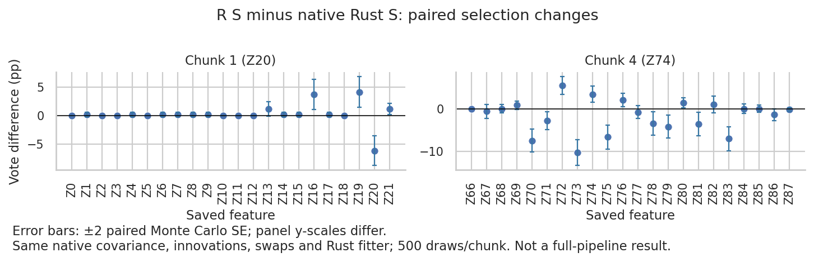

# R S substitution on the exact native Z20/Z74 chunks

Completed: job 11958158, exit 0, 1m25s. No production behavior changed.

## Result

Replacing Rust's S with R's S moves both focus factors across the preliminary
selection cutoff in the R-like direction on these saved designs.

| Factor | Native S | R S | Change ± paired MC SE | Preliminary selection |
| --- | ---: | ---: | ---: | --- |
| Z20 | 74/500 | 43/500 | −6.2 ± 1.31 percentage points | Included → excluded |
| Z74 | 38/500 | 55/500 | +3.4 ± 0.95 percentage points | Excluded → included |

The frequency cutoff is 50 votes. Both frequency and findOptIter selections
change in these directions. The R-S chunk-4 set also adds Z77; all factor
votes and selections are in summary.json and paired_votes.csv.

This is an S-only intervention: the covariance input is bitwise identical
for the two S solvers. Rust's conditional-mean/factor construction and
sampler remain unchanged, as do the saved Gaussian innovations, swaps, fitter,
and aggregation. The conditional mean and factor themselves change as a
consequence of changing S.

| Factor | Native S entry | R S entry |
| --- | ---: | ---: |
| Z20 | 4.51981692433e-8 | 5.65734145114e-9 |
| Z74 | 0 | 1.18011536538e-8 |

All R S entries are positive. With R S, the reconstructed factor covariance
matches the unregularized conditional covariance within 6.31e-15 (chunk 1)
and 1.26e-15 (chunk 4), rather than adding the native 1e-10 diagonal jitter.
The intervention changes the entire S vector, not just Z20 and Z74 entries,
and includes any resulting change in the regularization path.

**Conclusion:** S construction and its downstream numerical effects are a
demonstrated contributor for both factors on these exact chunks. This
supports testing reference-compatible S construction, not arbitrary epsilon
replacement or a new knockoff algorithm. It does not establish that a solver
replacement will reproduce the full R pipeline.

## Design and verification

- Seed label 42, delta 0.01, lambda 0.1; native chunks 1 and 4;
  24 rows, 22 columns and 500 draws each. Chunk seeds 42 and 1542.
- Native covariance read from the prior Rust audit's binary rust_sigma.raw.
  R's installed knockoff::create.solve_asdp computes S on that matrix.
  Sigma and S use 17 significant digits when passed back to Rust.
- The existing emit_diag_s sampler audit produces native and shared-S draws.
  The driver asserts that its input sigma.csv equals native rust_sigma.raw
  bitwise and that draws use the same saved innovations.
- Native draws reproduce the saved native draws bitwise.
- Native, reconstructed-jitter and no-jitter controls reproduce all prior
  vote counts, frequency sets and findOptIter results exactly.
- R's fitter agrees with Rust on every R-S per-draw selected set across
  all 1,000 draws. Thus all votes and aggregate selections also agree.
- Both audit test invocations pass, along with the driver's covariance,
  reconstruction and saved-R-selection checks.
- Inspected vote_deltas.png: labels are legible, unclipped and agree with
  the numerical tables. Intervals are ±2 paired Monte Carlo SE.



## Reproduction

Reuse the extended driver, rather than creating another replay implementation:
tmpfiles/2026-10-16_native-chunk-jitter/replay_jitter.py --r-s.
The flag adds the existing Rust sampler audit's shared-S arm; default
jitter-replay behavior is unchanged.

Staging: .tmpfiles/2026-10-16_native-chunk-r-s/.
Prior audit: .tmpfiles/2026-10-16_native-chunk-jitter/.
Original captures: .tmpfiles/2026-10-13_preliminary-selection-diagnosis/numerical/.
Production source: c4726e3; sampler diagnostic extension: a1c5b34.
Fitter: .tmpfiles/2026-10-16_gaussian-arithmetic/final-paired-xtilde.
R dependencies are the same as the five-arm benchmark (knockoff 0.3.6).

From the repository root, choose fresh RUN and OUT directories:
```bash
ENV=/vast/djishnu/Aaron/.tmpfiles/20260902_knockoff-generator-parity/project/.pixi/envs/dev
export TMPDIR="$RUN/scratch"
export TMP="$TMPDIR" TEMP="$TMPDIR" PYTHONDONTWRITEBYTECODE=1
export PYTHONPATH="$PWD/src" OPENBLAS_NUM_THREADS=1 OMP_NUM_THREADS=1 RAYON_NUM_THREADS=1
export R_LIBS="/vast/djishnu/Aaron/.tmpfiles/20260902_r-generated-knockoff-backend-evaluation/R-library:$ENV/lib/R/library"
export SLIDE_KNOCKOFF_MATCH_R_COV=1 SLIDE_KNOCKOFF_MATCH_R_LAMBDA=1
```

Copy each prior chunk's z.raw, y.raw, a.raw, lf_names.txt, swaps.raw and
rust_sigma.raw to RUN/chunk_1 and RUN/chunk_4. Generate sigma.csv and r_s.csv:
```bash
for c in 1 4; do
 "$ENV/bin/Rscript" -e 'd<-commandArgs(TRUE)[1]; sig<-matrix(readBin(file.path(d,"rust_sigma.raw"),"double",22*22,endian="little"),22,22,byrow=TRUE); write.table(matrix(sprintf("%.17g",sig),22,22),file.path(d,"sigma.csv"),quote=FALSE,sep=",",row.names=FALSE,col.names=FALSE); writeLines(sprintf("%.17g",knockoff::create.solve_asdp(sig)),file.path(d,"r_s.csv"))' "$RUN/chunk_$c"
 export SLIDE_S_SIGMA_CSV="$RUN/chunk_$c/sigma.csv" SLIDE_S_OUT="$RUN/chunk_$c/rust_s.csv"
 export SLIDE_S_AUDIT_DIR="$RUN/chunk_$c" SLIDE_S_AUDIT_DRAWS=500 SLIDE_S_AUDIT_BASE_SEED=$((42+500*(c-1)))
 bash scripts/with-rust-blas-env.sh target/release/deps/slide_knockoff-3b28efba8069aae9 emit_diag_s --ignored --nocapture
done
bash scripts/with-rust-blas-env.sh "$ENV/bin/python" tmpfiles/2026-10-16_native-chunk-jitter/replay_jitter.py \
 "$RUN" "$PWD/.tmpfiles/2026-10-16_gaussian-arithmetic/final-paired-xtilde" "$OUT" --r-s
for c in 1 4; do
 "$ENV/bin/Rscript" -e 'library(knockoff); source("benchmark_results/2026-10-13_s-zero-handling/r_stat.R")' \
 "$RUN/chunk_$c" r_s 500 24 22 0.1
done
```

The test executable above is the existing build of the diagnostic at a1c5b34.
If rebuilding, use cargo test --release --locked -p slide-knockoff emit_diag_s
-- --ignored --nocapture under the same environment and system toolchain.

For the independent R check, compare the first 22 columns of w_r_r_s.csv
against column 23 (its threshold). These Boolean selections must equal
thresholded r_s scores in chunk_*_scores.npz. The check passed for every draw.

Render paired_votes.csv's r_s-native rows with the existing plot_sampler_votes
helper, renaming factor to feature and mapping chunk to design labels.
See the prior jitter report for the control-arm construction.

## Limits

One seed and two fixed preliminary chunks; no rebuilt stage-two union,
interaction analysis, full-pipeline rerun or across-dataset inference.
Z20 has only seven votes below the cutoff and Z74 only five above it.
Neither the full-pipeline selection probabilities nor equivalence to native R
are established. This swaps all S entries together and does not separate
solver tolerance, feasibility adjustment and individual-coordinate effects.
The excluded Python/R-hybrid performance issue was not investigated here.
