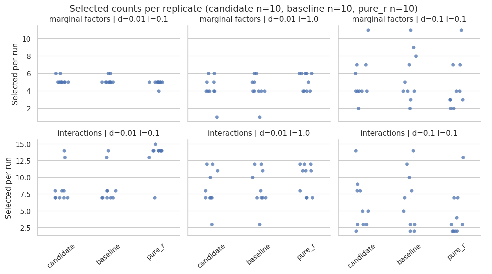
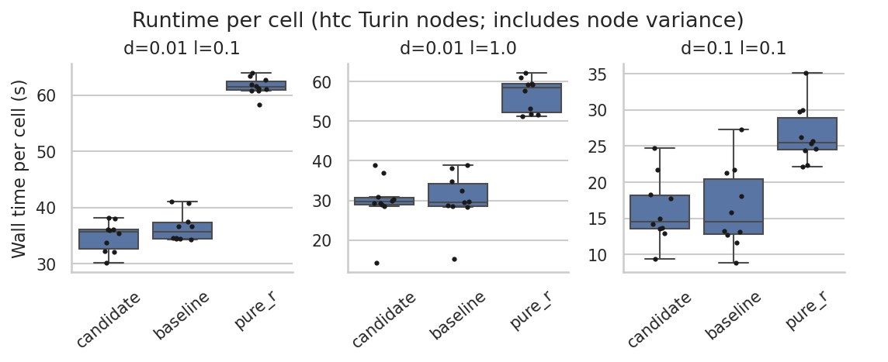
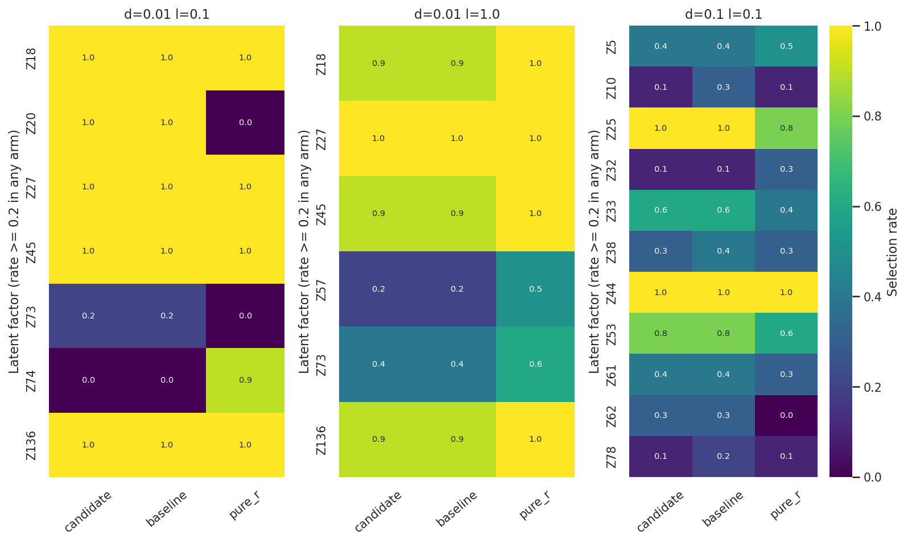

# Full Rust benchmark: reject tighter feasibility

**Keep Clarabel at effective tol_feas=1e-6.** The 1e-8 candidate fails all
ten replicates at delta=0.1, lambda=1.0; the matching baseline succeeds in
all 40 cells. No production-setting change is justified.

The [bounded validation](../2026-10-16_tol-feas-validation/README.md) passed:
all 50 solves returned Solved, corr3/cov4 residuals improved 19×/65×, and
the two native controls retained 74/500 and 38/500 votes. Those local benefits
do not outweigh the new full-benchmark failures.

## Configuration and reproduction

Source snapshot: `5e73884`. Working-tree production defaults remain unchanged.
Candidate staging applies `candidate.patch` (one effective Clarabel `tol_feas` field:
1e-6 to 1e-8). `SdpSettings` and `reduced_tol_feas` retain their baseline values.
`instrumentation.patch` adds one stderr status/residual/gap/timing line per solve
and adjusts a test-only diagnostic assertion for the changed staged default.
The historical effective-settings dump is the independent comparison.

Reuses `run.sbatch` and frozen inputs/extensions/R library from
`.tmpfiles/2026-10-16_backend-replicates-all-arms/`, source `c4726e3`. Existing manifest
passes unchanged. No old outputs are replaced. Baseline source is recoverable
from git and its unpatched SDP module is saved in staging `baseline/`.
Only source changes since the reference are the equivalent SDP wrapper
extraction and test-only diagnostics; staging
`source-changes-since-reference.diff` records them. Benchmark harness, fitter,
sampler production logic, settings, seeds, data, CLI and `Cargo.lock` are unchanged.

The commands run from the repository root:

```bash
RUN="$PWD/.tmpfiles/2026-10-16_tol-feas-benchmark"
ENV=/vast/djishnu/Aaron/.tmpfiles/20260902_knockoff-generator-parity/project/.pixi/envs/dev
R_DEPS=/vast/djishnu/Aaron/.tmpfiles/20260902_r-generated-knockoff-backend-evaluation/R-library
```

Source snapshots, builds, and complete outputs live under `$RUN`; this result
directory retains patches, settings, scheduler scripts, per-seed summaries,
all cell logs, and analysis.

Build:

```bash
sbatch --output="$RUN/logs/build-%j.out" "$RUN/build.sbatch" "$RUN"
```

Build uses system compiler/binutils and fresh `build-target`. `TMPDIR`/`TMP`/`TEMP`
are project-local scratch. Job 11958629.

After settings verification, the submitted benchmark command was:

```bash
sbatch --array=0-9%10 --output="$RUN/logs/%A_%a.out" "$RUN/run.sbatch" "$RUN" "$ENV" "$R_DEPS"
```


Ten seeds: 42,1000,2000,3000,4000,5000,6000,7000,8000,9000.
Four cells per seed: delta 0.01/0.1 by lambda 0.1/1.0; 500 iterations;
specificity 0.1; parity; SLIDE selection; four workers, one BLAS thread.
HTC/Turin, 4 CPUs, 4 GB, 20 minutes per task. No other arms rerun.
Full candidate status lines are retained in each cell's `rust.log`.

## Build and bounded production-path checks

Build 11958629 completed 0:0 in 2m04s. Diagnostic uses the patched production
settings with no `SDP_DIAG_TOL_FEAS` override. The entire `effective_settings.txt`
matches the saved bounded baseline except tol_feas: 1e-6 -> 1e-8;
reduced_tol_feas stays 1e-7 (baseline binary64 multiplication unchanged).
corr3 returns Solved, 7 iterations, primal residual 4.1700011455394689e-9,
dual residual 3.2268955791075452e-9, absolute gap 7.0067992075095731e-8.

Tests 11958634 completed 0:0 in 5s: five ordinary SDP and four integration
tests pass; fourteen ordinary knockoff tests pass. The existing ignored
diagnostics remain ignored. Only `feasibility_experiment_changes_only_effective_tol_feas`
was filtered: it explicitly asserts the production effective default is 1e-6,
which intentionally is false in the staging-only candidate. It is not modified;
the independent complete settings comparison above verifies this experiment.

The historical Rust reference has all ten matching seeds/configurations and
40 successful cells. Source/input manifest checks passed.
One diagnostic stderr line per SDP solve is additional instrumentation; its
timing overhead is not separately measured. Baseline logs do not expose solver
statuses, so baseline AlmostSolved counts cannot be recovered from those logs.

## Full benchmark outcome: reject candidate

Coordinator verified staging and authorized submission. Array 11958697
used `run.sbatch` unchanged with `--array=0-9%10`. All ten tasks started
2026-10-16 10:41:26 America/New_York and terminated FAILED, exit 1:0,
after 69–97 seconds. All 40 cells were attempted; 30 succeeded and 10 failed.
No task remains queued/running. No retry or alternative setting was run.
Exact per-task times/nodes are in `scheduler-accounting.txt`.

Every seed fails at delta=0.1, lambda=1.0. The other three configurations
complete in all ten seeds. The run wrapper correctly fails each task rather
than accepting the harness's partial report.
Historical matching baseline: 40/40 successful cells, 0 failed, all ten seeds.
Candidate SDP status lines total 575: 565 Solved, 10 NumericalError,
0 AlmostSolved. Solves in failed cells before the failure are included.
No AlmostSolved acceptance or equi-correlated substitution occurred.

Representative failure:
`runs/seed_42/0.1_1.0_out.log`

NumericalError at iteration 9, primal residual 9.53223654253800441e-9,
dual residual 1.68974635658366512e-8, absolute objective gap
9.28850735704145336e-6. CLI reports "SLIDE optimization failed",
caused by "SDP solver failed with status NumericalError; consider falling
back to equi-correlated". That suggestion was NOT acted on.
All ten failures occur at the solver stage. All individual logs and partial
selection outputs are retained under `$RUN/results/rust/seed_*`; committed `runs/seed_*` retain summaries
and all four logs, including failures.

Observed wall seconds, median [minimum, maximum] over ten replicates:

| Delta | Lambda | Baseline | Candidate | Candidate outcome |
| --- | --- | --- | --- | --- |
| 0.01 | 0.1 | 35.66 [34.35, 41.03] | 35.71 [30.21, 38.20] | 10/10 success |
| 0.01 | 1.0 | 29.61 [15.19, 38.84] | 29.65 [14.33, 38.99] | 10/10 success |
| 0.1 | 0.1 | 14.49 [8.86, 27.24] | 14.55 [9.37, 24.70] | 10/10 success |
| 0.1 | 1.0 | 14.23 [10.83, 20.74] | 8.01 [7.40, 10.67] | 10/10 failed |

Failed-cell duration is time to failure, NOT a speed improvement. Timing
includes host/load differences and candidate status logging. Successful-cell
medians are similar but do not rescue the hard failure gate.

Recommendation: REJECT tol_feas=1e-8 and retain effective baseline 1e-6.
The bounded fixture benefit does not justify ten new full-benchmark failures.
No production settings were changed; no push/merge, broad sweep, extra arms,
or excluded Python/R hybrid investigation. Statistical comparisons cannot
treat the failed cell as absent or use only successes to claim overall benefit.

## Successful-cell comparisons (conditional, not overall success)

The standard `analyze_seed_replicates.py` CLI requires four complete cells.
It would correctly reject this candidate. The run-specific
`analysis-command.sh` reuses its existing `load`, `check_z`, `summarize`,
`compare`, and `plot` functions on the three configurations completed by
both Rust arms and the saved pure-R reference. It records all 80 attempted
baseline/candidate cell outcomes first. The ten failed candidate cells remain
in `cell_status.csv` and `paired_cells.csv`; their selections and scores are
missing, not zero. Failed duration ratios have a separate time-to-failure
field, not the successful runtime-ratio field.

No source-analysis implementation or statistical method changed. All
statistical outputs below are conditional on these three completed
configurations and cannot establish an overall candidate benefit.

| Delta | Lambda | Identical same-seed marginal / interaction sets | Baseline → candidate median marginal count [Q1,Q3] | Baseline → candidate median interaction count [Q1,Q3] |
| --- | --- | --- | --- | --- |
| 0.01 | 0.1 | 10/10 / 10/10 | 5 [5,5] → identical | 7.5 [7,8] → identical |
| 0.01 | 1.0 | 10/10 / 10/10 | 4 [4,5] → identical | 7.5 [7,10.75] → identical |
| 0.1 | 0.1 | 6/10 / 6/10 | 4.5 [4,7.75] → 4 [4,6.75] | 6 [3,9.5] → 5 [3,8] |

At delta=0.1, lambda=0.1, seeds 2000, 4000, 7000 and 9000 change both
selection sets. Their marginal Jaccards are 0.8333, 0.7778, 0.7500 and 0.5000;
interaction Jaccards are 0.8750, 0.7500, 0.6667 and 0.5000. Different sets
alone did not trigger rejection. The ten new solver failures did.

Existing reported Rust `score`, median [Q1,Q3]:

| Delta | Lambda | Baseline | Candidate |
| --- | --- | --- | --- |
| 0.01 | 0.1 | 0.957991 [0.945209,0.970772] | identical |
| 0.01 | 1.0 | 0.967055 [0.966296,0.982269] | identical |
| 0.1 | 0.1 | 0.942240 [0.921805,0.965821] | 0.942240 [0.923303,0.946961] |

First-two-cell scores match per seed, not just in aggregate. The four changed
third-cell score differences are +0.005993, −0.013716, +0.050088 and −0.074926.
All 30 included R scores are unavailable in the existing exports.

The existing 10,000-sample bootstrap gives candidate/baseline median runtime
ratios of 1.0017 [0.8789,1.0474], 1.0015 [0.8373,1.0941] and
1.0038 [0.6849,1.3904] (95% intervals, table order). Candidate runs used four
nodes; the historical Rust baseline used one. These are wall-time comparisons
with host/load differences, not isolated tolerance costs. None of the Rust
logs contains the stage-timing marker used by the existing loader; the analysis
records unavailable knockoff-stage time as missing, not its zero placeholder.

Candidate-versus-baseline selection-count BH q-values and per-factor Fisher
BH q-values are 1 throughout these three configurations. That is not evidence
of equivalence: ten seeds have limited power, and the inherited independent-arm
tests/bootstraps do not exploit the pairing between Rust seeds. Count tests
also use the inherited exact Mann–Whitney treatment despite discrete ties.
The analysis retains the existing 10,000 permutations and bootstrap samples,
random seed 0; count adjustment covers all 18 count tests in this report and
factor adjustment covers all factors × three comparisons within each cell.
Permutation p-values remain exploratory and unadjusted.

The pure-R comparisons remain diagnostic. For delta=0.01, lambda=0.1,
candidate and baseline select Z20 in 10/10 runs and Z74 in 0/10, versus
0/10 and 9/10 in R. No R-agreement target guided the candidate. K and Z pass
the existing 1e-8 agreement check; maximum absolute Z discrepancy is 4.532e-11.
R seed labels do not establish paired random streams across backends.
One dataset and ten seeds do not measure ground-truth FDR or power.

### Figures

These figures show **only the three completed configurations**. The omitted
fourth configuration has ten failed candidate runs, not zero selections.
All three renders were inspected: labels are legible without clipping and
agree with the tables. Plotting reuses the existing analysis implementation.





## Retained evidence and analysis command

- `cell_status.csv`: all 80 baseline/candidate outcomes and durations.
- `solver_events.csv`: all 575 candidate solver events, including failures.
- `paired_cells.csv`: 40 matched seed/configuration pairs; failed metrics blank.
- `runs/seed_*/`: candidate environments, summaries, timings and all four logs.
- `baseline-effective-settings.txt`, `candidate-effective-settings.txt`,
  `candidate-settings-check.txt`: complete settings and production-path check.
- `candidate.patch` and `instrumentation.patch`: staged-only changes. The
  candidate patch fixes effective feasibility for this experiment; it is not
  a proposal to ignore public settings in production.
- `analysis/`: summary, tests, factor rates, per-replicate timings/selections,
  Z checks and rendered figures.
- `build.sbatch`, `tests.sbatch`, `run.sbatch`: submitted build/test workflow
  and unchanged benchmark wrapper. Use `--array=0-9%10` to run only Rust.

Baseline inputs, binaries, full results, and the frozen source remain in
`.tmpfiles/2026-10-16_backend-replicates-all-arms/` (source `c4726e3`). Candidate
staging remains in `.tmpfiles/2026-10-16_tol-feas-benchmark/` (source `5e73884`
plus the two recorded patches). The source comparison confirms no change to
the harness, fitter, production sampling, data, configuration or aggregation.
No reference arm was rerun, and no excluded Python/R timeout was investigated.

The final analysis ran as job `11958724`, exit 0, four seconds. Its command
reuses the existing functions and makes the successful-cell restriction
explicit. Original placeholder-timing outputs remain archived in staging.
To reproduce against these retained inputs:

```bash
sbatch --output=.tmpfiles/2026-10-16_tol-feas-benchmark/logs/analysis-%j.out \
  benchmark_results/2026-10-16_tol-feas-benchmark/analysis-command.sh
```

Choose a fresh output path before rerunning to preserve this report.
Coordinator checks independently matched all 40 attempted cells, ten failures,
four changed successful selection pairs and all 575 solver events against the
retained raw summaries/logs. The working-tree settings regression still passes
with production `tol_feas=1e-6`; no production-setting patch was adopted.
