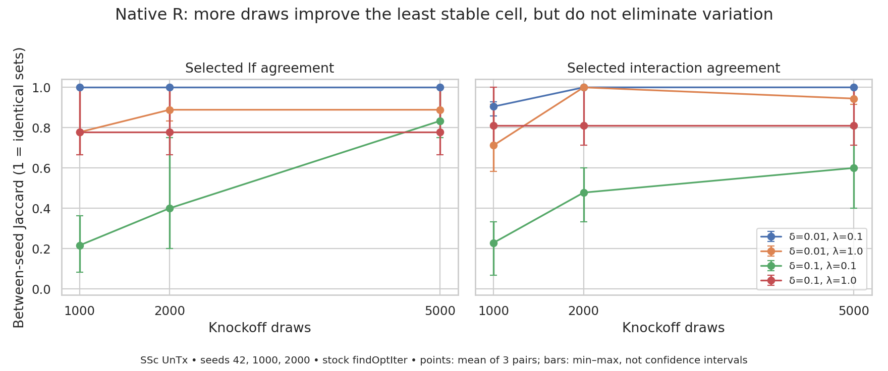

# Native-R selection stability

Native R is not uniformly stable across runs. In the September 12 three-seed
sweep, the low-delta, low-lambda cell selects identical LFs across seeds, while
the high-delta, low-lambda cell varies substantially. More draws improve overlap
in that difficult cell but do not yield identical selections.

## Controlled seed sweep

SLURM array 11232664 completed all nine tasks with exit 0:0. All 36 timing rows
report success and all 36 selection records are present. Each draw count has
seeds 42, 1000, and 2000, giving three seed pairs per grid cell.
Inputs, frozen source/package, thresholds and worker settings are shared within
the sweep. See [launch provenance](../../docs/2026-09-12-r-stability-submission.md).
This uses stock `findOptIter`, not the experimental frequency-only selection rule.

Mean between-seed selected-LF Jaccard (1 means identical sets):

| Delta | Lambda | 1,000 draws | 2,000 draws | 5,000 draws |
|---:|---:|---:|---:|---:|
| 0.01 | 0.1 | 1.000 | 1.000 | 1.000 |
| 0.01 | 1.0 | 0.778 | 0.889 | 0.889 |
| 0.1 | 0.1 | 0.216 | 0.400 | 0.833 |
| 0.1 | 1.0 | 0.778 | 0.778 | 0.778 |

At delta 0.1, lambda 0.1, LF counts span 2–11 at 1,000 draws, versus 3–4
at 5,000. Only one LF is common to all three seeds at 1,000 draws, versus
three at 5,000. Interaction agreement in this cell also improves, from mean
Jaccard 0.229 to 0.600, but remains below marginal-LF agreement.

Bars show the observed minimum and maximum over three pairs, not confidence
intervals. The pairs share runs and are not independent replicates. Three seeds
provide preliminary evidence, not a precise stability estimate or a guarantee
that increasing draws will monotonically improve agreement.

## Historical same-nominal-seed comparison

The September 3 grid (consolidated September 7) and September 12 rebenchmark
both used 500 draws and seed 42. Native-R LF Jaccards between those runs are:

| Delta | Lambda | Previous count | Current count | Jaccard |
|---:|---:|---:|---:|---:|
| 0.01 | 0.1 | 5 | 5 | 0.667 |
| 0.01 | 1.0 | 6 | 4 | 0.667 |
| 0.1 | 0.1 | 10 | 3 | 0.300 |
| 0.1 | 1.0 | 4 | 2 | 0.500 |

These are not identical-environment reruns: the rebenchmark enables the R
interaction optimization and uses a different source snapshot. The comparison
shows historical variability, not an isolated cause or a same-build determinism
test. Load-balanced worker RNG assignment is a documented possible contributor,
not an established explanation for these differences. See the
[optimization verification caveat](../../docs/2026-09-12_r-knockoff-performance.md#verification).
Neither these two runs nor the seed sweep measures repeated execution of an
unchanged build at an unchanged seed. Earlier archives include different draw
counts, source/configuration changes, and other datasets; do not pool them as
exchangeable replicates.

## Reproduction and verification

`selections.json` preserves the source paths, loaded selected sets and successful
sweep timings. Run `python analyze.py` in an environment with pandas, seaborn,
and matplotlib. It reuses the repository's Jaccard and interaction-normalization
helpers and writes 72 pairwise rows, per-factor selection rates, overlap summaries,
the historical comparison and the figure. Set TMPDIR and MPLCONFIGDIR to a
project-local `.tmpfiles/` directory when running.

Verified the 36-run grid and seed mapping, successful timings, pairwise row count,
metric bounds, and agreement with a separate direct aggregation. Rendered and
visually inspected the figure for labels, ranges, legibility and clipping.
No new benchmark was launched and no backend implementation was changed.
