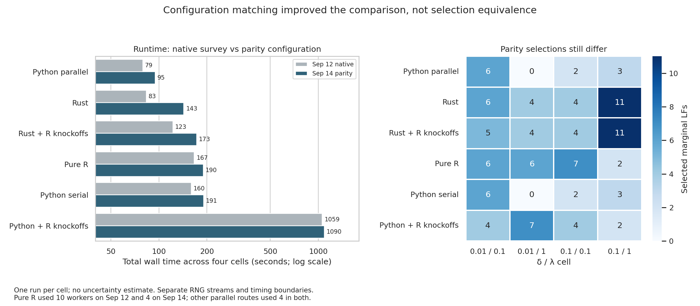

# Gaussian parity backend benchmark

Submitted as **SLURM job 11241717** on cluster `htc` at 08:49 EDT, September 14.
Completed on `htc-n70` in 31 min 34 sec, exit code 0. Frozen source: `a74c521`.
All 24 cells succeeded; saved outputs contain 24 results and 60 comparisons.
Live job metadata confirmed parity settings and four workers.

- Same SSc UnTx inputs and four-cell grid as September 12:
  delta {0.01, 0.1} × lambda {0.1, 1.0}.
- Six routes: rust, rust_r_knockoffs, python_serial, python, r_knockoffs, pure_r.
- `--configuration parity`: 500 Gaussian lambda points, tolerance 1e-7,
  iteration cap value 100000, fixed lambda ratio 1/2000, and positive-definite-only
  raw covariance gate. Four workers, except serial Python uses one; BLAS=1.
- 500 knockoff draws, seed 42, spec/FDR 0.1, findOptIter, interaction fitting enabled.
- Installed SLIDE with `SLIDE_R_OPTIMIZE=1`; the updated runner enforces its worker budget.
- One pass per cell, fixed backend order, sequential in one four-CPU Turin job.
  Request: 64 GB, 12 hours on cluster htc. No builds inside the timing job.

Rust release CLI rebuilt from `a74c521` with Clarabel Faer enabled; SHA256:
`a3ea14f001c5c520c5f6a296731a52e10c217fe5a6e8b9d1d57674a7d1652b3c`.
The frozen Python 3.11 glmnet extension retains the verified September 12 O3 build.
The existing Python/R environment and R dependencies remain shared; source, CLI,
inputs, and installed SLIDE package are frozen in the run directory.

Preflight passed: release build, CLI startup and lambda override marker,
release cached/uncached lambda test under parity settings, compiled Python
500-point Gaussian path, R package/default checks, and installed R worker
regressions with optimization off/on. Shell syntax and all 321 manifest hashes pass.

Run directory:
`/vast/djishnu/Aaron/1_general_use/omni-SLIDE/.tmpfiles/2026-09-14_all-backend-parity/`

`manifest.sha256` uses paths relative to that directory. Logs and runtime results
stay there. The job checks hashes before running, rejects failed/missing cells,
and requires 24 results plus 60 within-cell comparisons. Each backend retains its
own environment metadata, including executed source revision `a74c521`.

Submission from the repository root:

```bash
RUN="$PWD/.tmpfiles/2026-09-14_all-backend-parity"
ENV=/vast/djishnu/Aaron/.tmpfiles/20260902_knockoff-generator-parity/project/.pixi/envs/dev
R_DEPS=/vast/djishnu/Aaron/.tmpfiles/20260902_r-generated-knockoff-backend-evaluation/R-library
sbatch --output="$RUN/logs/slurm-%j.out" "$RUN/run.sbatch" "$RUN" "$ENV" "$R_DEPS"
```

This matches configurations, not stochastic work or achieved convergence. RNG
streams/swaps differ. Rust caps iterations per lambda/refit; Fortran counts sweeps
across the path. Python excludes imports from timing; Rust/R include subprocess
startup. No repeated or randomized-order cells. Interpret comparisons accordingly.


## Results readout

The run completed, but selected-model agreement remains unresolved. Named latent
factor columns match across routes to numerical precision (minimum column
correlation 0.9999999999999994). Python serial and parallel select identical LF
and interaction sets in all four cells, also unchanged from September 12.

| Backend | Sep 12 native survey, s | Sep 14 parity, s | New/old |
| --- | ---: | ---: | ---: |
| Python parallel | 79.15 | 94.82 | 1.20 |
| Rust | 83.31 | 143.42 | 1.72 |
| Rust + R knockoffs | 122.62 | 172.64 | 1.41 |
| Pure R | 166.75 | 189.87 | 1.14 |
| Python serial | 159.66 | 190.55 | 1.19 |
| Python + R knockoffs | 1059.07 | 1089.63 | 1.03 |

These are totals over the same four grid cells, with one measurement per cell;
there is no uncertainty estimate. Parallel Python took 66% of native Rust's time
and roughly half of serial Python's time. The Python + R knockoffs route remains
the runtime outlier; the previous run was similarly slow.

Rust's 72% increase does not measure tolerance cost alone: lambda count/range,
covariance behavior, and selected downstream workload changed together. Unchanged
Python results took about 20% longer on this run, demonstrating run-to-run timing
variation. These results do not yet justify changing Rust's solver dependency.

The clearest selection concern is delta=0.1, lambda=1:

| Backend | Selected marginal LFs | Selected interactions |
| --- | ---: | ---: |
| Rust | 11 | 42 |
| Rust + R knockoffs | 11 | 44 |
| Python serial/parallel | 3 | 6 |
| Python + R knockoffs | 2 | 5 |
| Pure R | 2 | 5 |

Native Rust previously selected 2 LFs and 15 interactions in that cell; the new
configuration moves it toward Rust + R knockoffs, not toward pure R. Using R as
the knockoff generator therefore does not by itself resolve the discrepancy.
That observation does not isolate a solver defect: draw streams, swaps, and the
single-draw findOptIter choice remain confounded.

Rust/pure-R interaction Jaccard improves from 0.286 to 0.813 in the first cell,
but decreases from 0.875 to 0.583 in the second and from 0.176 to 0.119 in the
last (third stays 0.250). These comparisons normalize colon/dot delimiters and
unordered pair orientation. Pure R's selected sets changed in the first three
cells, so old/new agreement is not against a fixed reference selection.

Run-health caveat: pure R logs contain warnings. Low-delta cells report at least
50 warnings without detail; displayed high-delta warnings concern plotting.
Successful exit status and absence of explicit convergence warnings do not
prove convergence, especially given Rust's silent cap exhaustion behavior.

Next useful check: replay the high-delta/high-lambda saved design with identical
knockoffs and swaps, compare lambda-entry W statistics and convergence, and only
then compare final selection. Separately profile the Python + R-knockoff route
before assigning its overhead to R itself. No additional jobs submitted here.



The figure was rendered and visually inspected. `cell_readout.csv` contains 48
before/after cell records, including counts and times. Regenerate from repository
root in the benchmark Python environment (set TMPDIR and MPLCONFIGDIR under
project `.tmpfiles/`):

```bash
python benchmark_results/2026-09-14_all-backend-parity/summarize_results.py \
  --before .tmpfiles/2026-09-12_all-backend-rebenchmark/results/benchmark_summary.json \
  --after .tmpfiles/2026-09-14_all-backend-parity/results/benchmark_summary.json \
  --out-dir benchmark_results/2026-09-14_all-backend-parity
```
