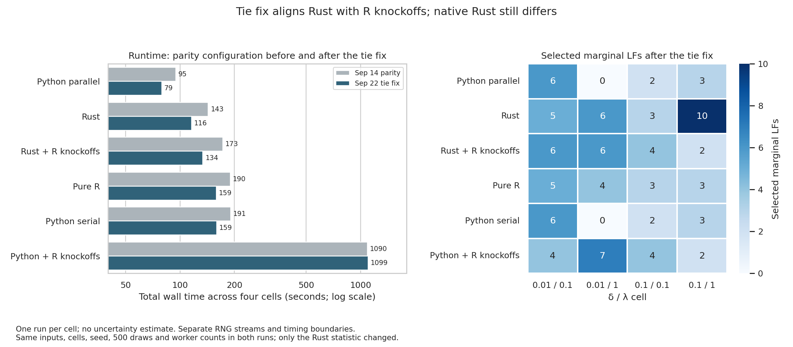

# Gaussian parity backend benchmark after the tied-entry statistic fix

Submitted as **SLURM job 11422548** on cluster `htc` at 11:45 EDT, September 22,
2026. Completed on `htc-n86` in 29 min 21 sec, exit code 0. Frozen source:
`605557c`, whose Rust tree equals the fix commits `b1d0129` and `4a18274`.
All 24 cells succeeded; the job verified 24 results and 60 within-cell
comparisons. See the results readout at the end of this file.

## Purpose

Isolate the production fix. Commit `b1d0129` zeroes the knockoff signed-max
statistic when the original and knockoff entry lambdas tie exactly, matching
R/Python `sign(0)`. The [replay record](../2026-09-22_tie-fix-replay/README.md)
shows the fix reproduces the tie-zero counterfactual on all 5,000 saved paired
draws. This run asks what the fix does to the full six-backend pipeline.

Everything else copies the [September 14 parity run](../2026-09-14_all-backend-parity/README.md):

- Same SSc UnTx `X.csv`/`Y.csv` inputs, byte-identical to the September 14 copies.
- Same four cells: delta {0.01, 0.1} × lambda {0.1, 1.0}.
- Same six routes in the same order: rust, rust_r_knockoffs, python_serial,
  python, r_knockoffs, pure_r.
- `--configuration parity`: 500 Gaussian lambda points, tolerance 1e-7,
  iteration cap 100000, lambda ratio 1/2000, positive-definite-only covariance gate.
- 500 knockoff draws, seed 42, spec/FDR 0.1, findOptIter, interaction fitting.
- Four workers, except serial Python; BLAS threads 1, Rayon threads 4.
- Same installed SLIDE R package (built September 3, `SLIDE_R_OPTIMIZE=1`),
  same Python/R environment and R dependency library.
- 64 GB, 12 hours, one Turin node on cluster htc; no builds inside the job.

The only source difference from `a74c521` besides the fix is documentation and
benchmark tooling committed since then. Draw counts and the paired diagnostic
(1,000 draws per design) are unchanged. `run.sbatch` differs from the
September 14 script in one token, `--source-revision 605557c`.

## Frozen run directory

`/vast/djishnu/Aaron/1_general_use/omni-SLIDE/.tmpfiles/2026-09-22_all-backend-parity-tiefix/`

- `source/`: 300 tracked files from `605557c` (`src/`, `benchmarks/`,
  `crates/`, `scripts/`, `Cargo.toml`, `Cargo.lock`, and the two frozen test
  files); two more than September 14 because of `benchmarks/prepare_paired_cell.py`
  and `benchmarks/replay_paired_xtilde.py`.
- `bin/slide`: release CLI rebuilt from the fixed source. SHA256
  `62c498014cb320cc0454458015a348a43217507aab486b314def71c0cc477169`.
- `inputs/`, `R-library/`: copied from the September 14 run directory.
- `manifest.sha256`: 323 hashes, paths relative to the run directory. The job
  verifies them before running.

Preflight, logged under `logs/`: all 323 hashes pass, `bash -n run.sbatch`,
`bin/slide --help`, the installed R package loads from the frozen library,
`tests/tests/test_knockoff_glmnet_defaults.py` passes against the frozen source,
and the Rust fixed-ratio lambda parity test passes. The full Rust test suites
for `slide-glmnet` and `slide-rs` passed before the freeze, except the
pre-existing `compare_python_lasso` integration test, which fails only because
its `/tmp` CSV fixture is absent; that failure is independent of this change.

## Submission

```bash
RUN="$PWD/.tmpfiles/2026-09-22_all-backend-parity-tiefix"
ENV=/vast/djishnu/Aaron/.tmpfiles/20260902_knockoff-generator-parity/project/.pixi/envs/dev
R_DEPS=/vast/djishnu/Aaron/.tmpfiles/20260902_r-generated-knockoff-backend-evaluation/R-library
sbatch --output="$RUN/logs/slurm-%j.out" "$RUN/run.sbatch" "$RUN" "$ENV" "$R_DEPS"
```

The job rejects failed or missing cells and requires 24 results and 60
within-cell comparisons. Expect roughly 30 minutes based on September 14.

## What this run can and cannot show

Compare its `delta=0.1, lambda=1` Rust selections against the September 14
values (11 marginal LFs, 42 interactions for Rust; 2 or 3 LFs for R and Python).
Movement toward R/Python there is consistent with the paired evidence. RNG
streams and swaps still differ across backends, findOptIter picks a single
draw, and the union design in the replay still disagrees with R on one
near-threshold feature. Residual per-draw differences from coefficient
convergence or entry ordering remain unexplained. Do not claim full-pipeline
parity or complete selection stability from this run alone.

## Results readout

Each cell ran once, so timings carry no uncertainty estimate. Every backend
finished faster than on September 14 except Python + R knockoffs, which was
within 1%. Python's selections are identical in all four cells, as its seeds
are deterministic, so the timing drop there is run-to-run variation on the
node, not a code effect. Read the Rust speedups with that in mind.

| Backend | Sep 14 parity, s | Sep 22 tie fix, s |
| --- | ---: | ---: |
| Python parallel | 94.82 | 79.20 |
| Rust | 143.42 | 116.08 |
| Rust + R knockoffs | 172.64 | 133.87 |
| Pure R | 189.87 | 158.93 |
| Python serial | 190.55 | 159.42 |
| Python + R knockoffs | 1089.63 | 1099.27 |

Selections in the cell that motivated the paired study, delta 0.1 and
lambda 1.0 (marginal LFs / interactions):

| Backend | Sep 14 parity | Sep 22 tie fix |
| --- | --- | --- |
| Rust | 11 / 42 | 10 / 21 |
| Rust + R knockoffs | 11 / 44 | 2 / 5 |
| Python serial and parallel | 3 / 6 | 3 / 6 |
| Python + R knockoffs | 2 / 5 | 2 / 5 |
| Pure R | 2 / 5 | 3 / 6 |

Rust with R-generated knockoffs now selects the same LF set as Python with
R-generated knockoffs in that cell: LF Jaccard rose from 0.182 to 1.000, and it
is 1.000 in the delta 0.1, lambda 0.1 cell as well. In the two low-delta cells
the two routes still differ (Jaccard 0.667 and 0.625). With the knockoff
generator held fixed, the tie fix removed the high-delta, high-lambda
solver-side discrepancy that the paired study isolated.

Native Rust, which generates its own knockoffs, still selects 10 LFs in that
cell against 3 for Python and pure R, and its LF Jaccard with Python fell from
0.273 to 0.083. The remaining gap therefore sits in Rust's knockoff generation
or draw stream, not in the statistic. Matching counts do not mean matching
sets: Python and pure R both select 3 LFs there but share none (Jaccard 0.000).
Pure R's selections moved in three of four cells between the two runs with no
code change on its side, so it is not a fixed reference either. Its logs
contain no warnings this time.

The figure was rendered and visually inspected. `cell_readout.csv` holds 48
records; `summarize_results.py` is the September 14 script with label and
title arguments added. Regenerate from the repository root in the benchmark
Python environment with `TMPDIR` and `MPLCONFIGDIR` under project `.tmpfiles/`:

```bash
python benchmark_results/2026-09-22_all-backend-parity-tiefix/summarize_results.py \
  --before .tmpfiles/2026-09-14_all-backend-parity/results/benchmark_summary.json \
  --after .tmpfiles/2026-09-22_all-backend-parity-tiefix/results/benchmark_summary.json \
  --out-dir benchmark_results/2026-09-22_all-backend-parity-tiefix \
  --before-label "Sep 14 parity" --after-label "Sep 22 tie fix"
```



Next useful check: run native Rust against R-generated knockoffs on the paired
designs, or compare Rust's knockoff sampler output to R's for one saved
covariance, before attributing the remaining native-Rust gap.
