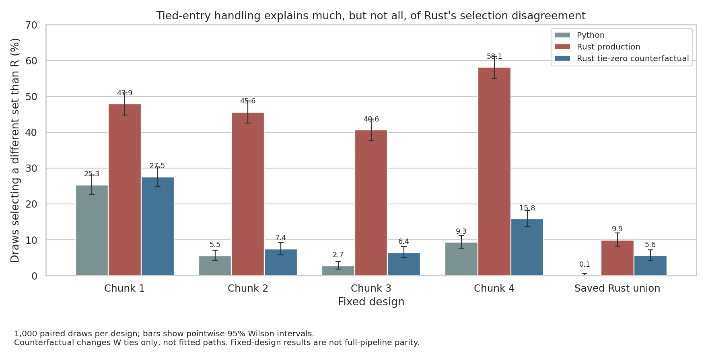

# Paired convergence results

Array `11242920_0–4` completed successfully on September 14, 2026. Each task
finished in 1m28s–2m51s. Verified five 1,000-draw summaries and input-hash checks.
This September 22 readout uses frozen source `550d2ea`; production is unchanged.

## Main finding

Tied-entry handling explains much of the Rust marginal-selection discrepancy.
Raising the iteration cap does not explain it. When original and knockoff entry
lambdas tie at a positive value, production Rust's floating-point `signum`
produces a nonzero W where R/Python produce zero. The tie-zero counterfactual
changes only those statistics and recomputes selection, without refitting.

| Fixed design | Python vs R disagreement | Rust vs R | Rust tie-zero vs R |
| --- | ---: | ---: | ---: |
| Marginal chunk 1 | 25.3% | 47.9% | 27.5% |
| Marginal chunk 2 | 5.5% | 45.6% | 7.4% |
| Marginal chunk 3 | 2.7% | 40.6% | 6.4% |
| Marginal chunk 4 | 9.3% | 58.1% | 15.8% |
| Saved Rust stage-two union | 0.1% | 9.9% | 5.6% |

These percentages count draws selecting different sets, out of 1,000 paired
draws per design. The figure shows pointwise 95% Wilson intervals. They are not
full-pipeline error rates or simultaneous confidence bounds.

At 1,000 draws, tie-zero Rust's final findOptIter set matches R and Python in
**all four marginal chunks**, unlike production Rust. Per-draw differences
remain, including Python/R differences. This is not proof of numerical parity.

On the same fixed 11-column Rust stage-two union, R, Python, and production Rust
all finally select 11; tie-zero Rust selects 10. R does not simply select two
when forced to fit this same union. The original full-pipeline 11-versus-2 result
therefore cannot be interpreted independently of how stage one chose candidates.

## Solver iterations

- Raising Rust's cap from 100,000 to 1,000,000 changes **zero selections and zero
  vote frequencies across all 5,000 draws**. KKT audit summaries also match.
- Tightening tolerance from 1e-7 to 1e-9 at the higher cap reduces the pooled median
  per-draw maximum absolute KKT residual from 0.00339 to 0.000359. R's median is
  0.00307. KKT residuals measure stationarity, not the update-based stop rule.
- Baseline-versus-tight selections differ on 380/5,000 draws (7.6%), but maximum
  per-feature vote-frequency changes are only 0.2–1.1 percentage points by design.
  Tighter fits are not identical fits; changing tolerance is not a tie-handling fix.
- Saved audits show no nonzero R solver error codes or Python fit warnings.
  This does not assert that execution logs contain no R deprecation warnings.

## Was 1,000 draws adequate?

**Adequate for the diagnostic conclusion; not enough to declare every selection
stable.** All four marginal chunks retain the same findOptIter set and chosen
iteration between 500 and 1,000 draws for R, Python, baseline Rust, and tie-zero
Rust. Their largest per-feature frequency movement is 2.7 percentage points.
Some marginal features still have pointwise intervals crossing the 10% vote cutoff.

The stage-two union changes its selected set for all four routes between 500 and
1,000. At 1,000, intervals still cross the cutoff for 3 R features, 3 Python
features, 1 baseline Rust feature, and 5 tie-zero Rust features. Maximum frequency
movement is 1.8–2.0 percentage points. More draws may help borderline frequencies,
but do not guarantee stability of findOptIter's single-draw choice.

Next: fix the shared Rust tie behavior with a regression test, then replay these
same saved fixtures. Only after that assess remaining solver differences and
whether the union needs more draws. No production fix, new submission, or
interaction replay was performed during this readout.



## Reproduction

Inputs: `.tmpfiles/2026-09-14_paired-convergence/results/<design>/`:
`pairwise_draw_jaccard.csv`, `solver_sensitivity.json`, `convergence.csv`,
`prefix_stability.json`, and `attribution_summary.json`. Study preparation and
hash manifest: `benchmark_results/2026-09-14_paired-convergence/`.

Run from the repository root in the existing benchmark Python environment, with
TMPDIR and MPLCONFIGDIR under project `.tmpfiles/`:

```bash
python benchmark_results/2026-09-22_paired-convergence-readout/plot_readout.py \
  .tmpfiles/2026-09-14_paired-convergence/results \
  benchmark_results/2026-09-22_paired-convergence-readout
```

`disagreement.csv` preserves the 15 counts, denominators, and Wilson intervals.
The figure was rendered and inspected for clipping, labels, and data fidelity.
