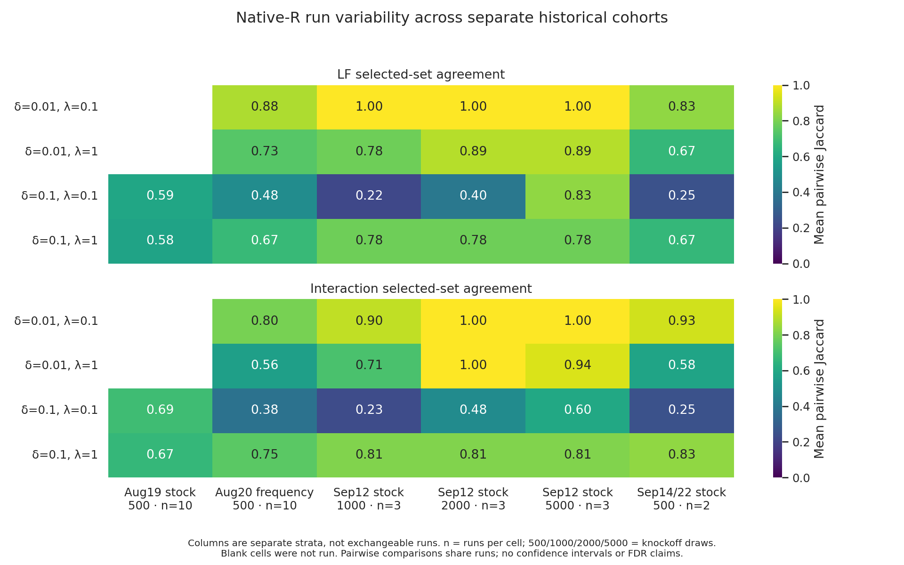

# Native-R variability in selected historical cohorts

Native R does not supply a single stable reference selection in these runs.
At δ=0.1, λ=1, the ten-run August stock cohort selects 1–4 LFs per
execution (median 3), with mean pairwise LF Jaccard 0.581. The two matched
September executions select 2 and 3 LFs, sharing two (Jaccard 0.667).
These R results do not support treating one three-factor output as fixed truth,
but none of those stock executions selects ten factors in this cell.

At δ=0.1, λ=0.1, the ten-run August stock cohort selects 2–10 LFs per
run, with one LF present in all ten and eleven present at least once.
Two September executions with identical frozen R inputs, package and runner,
and the same nominal seed, have LF and interaction Jaccard 0.250 in this cell.

This analysis covers **31 run bundles and 104 full-pipeline cell executions**.
It does not pool different algorithms or draw counts. A bundle contains two or
four separate parameter-cell executions; neither those cells nor the hundreds
of within-run knockoff draws count as extra independent seeds.

## Included cohorts

| Cohort | Bundles | Cells | Executions per fixed cell/draw count | Draws | Selection rule |
|---|---:|---:|---:|---:|---|
| August 19 stock | 10 | 20 | 10 | 500 | findOptIter |
| August 20 experiment | 10 | 40 | 10 | 500 | frequency-only |
| September 12 sweep | 9 | 36 | 3 | 1000, 2000, 5000 | findOptIter |
| September 14/22 repeats | 2 | 8 | 2 (nominal seed 42) | 500 | findOptIter |

August nominal seeds are 42, 1000, …, 9000; September sweep nominal seeds
are 42, 1000, 2000. These labels identify executions, not verified independent
worker RNG streams. The upstream parallel setup does not establish that
master-process `set.seed` seeds its PSOCK worker streams. A separate small
worker probe found different draws after repeated master seeding; explicit
worker seeding reproduced draws in that probe. This is not proof of full-pipeline
determinism or a sole explanation of the historical differences.
All use SSc UnTx, spec/FDR 0.1 and interactions. The first cohort covers only
δ=0.1 with λ=0.1/1; the others also include δ=0.01.

The August experiment uses the directory named `20260819_stability-rule-seeds`
but ran the altered frequency-only rule. The script checks each cell log for
`SLIDE_R_SOURCE=vendor` and `SLIDE_OPT_ITER=0`. See the
[August provenance and disposition](../../docs/backend-benchmark.md#2026-08-20-stability-rule-seed-sweep).
Do not combine its selections with stock `findOptIter` results.

August YAMLs specify ten workers. September sweep YAMLs request four workers;
its launch documentation records four allocated CPUs, but we have not verified
that its installed upstream package honored that worker budget. A subsequent
September 12 full-backend run used ten workers despite requesting four.
The September 14/22 runner enforces four workers. See the
[sweep provenance](../../docs/2026-09-12-r-stability-submission.md),
[worker-count correction](../2026-09-12_all-backend-rebenchmark/README.md), and
[matched-rerun configuration](../2026-09-22_all-backend-parity-tiefix/README.md).
These cohort differences prevent a pooled 500-to-5000-draw dose-response claim.

## Results

For **δ=0.1, λ=1**, the cell behind the original large Rust/R count mismatch:

| Cohort / draws | LF count median [min, max] | LF overlap | Interaction overlap |
|---|---:|---:|---:|
| August stock / 500 | 3 [1, 4] | 0.581 | 0.665 |
| August frequency-only / 500 | 3 [1, 4] | 0.672 | 0.745 |
| September sweep / 1000 | 2 [2, 3] | 0.778 | 0.810 |
| September sweep / 2000 | 3 [2, 3] | 0.778 | 0.810 |
| September sweep / 5000 | 2 [2, 3] | 0.778 | 0.810 |
| September same-seed repeats / 500 | 2.5 [2, 3] | 0.667 | 0.833 |

The August stock LF counts are 1, 2, 2, 2, 3, 3, 3, 3, 3, 4. Z44 occurs in
all ten; the union is Z25, Z33, Z44, Z69. These are descriptive frequencies,
not calibrated probabilities of selection under independent seeded streams.

Mean pairwise selected-set Jaccard at **δ=0.1, λ=0.1**:

| Cohort / draws | LF count median [min, max] | LF overlap | Interaction overlap |
|---|---:|---:|---:|
| August stock / 500 | 2.5 [2, 10] | 0.590 | 0.690 |
| August frequency-only / 500 | 4.5 [2, 10] | 0.481 | 0.375 |
| September sweep / 1000 | 4 [2, 11] | 0.216 | 0.229 |
| September sweep / 2000 | 3 [2, 4] | 0.400 | 0.478 |
| September sweep / 5000 | 4 [3, 4] | 0.833 | 0.600 |
| September same-seed repeats / 500 | 5 [3, 7] | 0.250 | 0.250 |

In the controlled September sweep, more draws accompany greater agreement in
this difficult cell. Three seeds cannot establish monotonic improvement or a
precise population stability estimate. At δ=0.01, λ=0.1, those three seeds
select identical LF sets at each draw count. Variability depends on the cell.



`summary.csv` contains 44 strata: cohort, draw count, selection rule, δ, λ and
LF/interaction kind. It reports run count, selected-count median/min/max,
all-run intersection and union sizes, and pairwise Jaccard mean/min/max.
`selection_rates.csv` gives k/n for each member of the **observed union**, not
for the full candidate universe. An absent row does not establish that a
factor was unavailable. `pairwise_jaccards.csv` preserves all 620 pair rows.
The convention for two empty selected sets is Jaccard 1.

Pairwise observations share runs: ten runs yield 45 dependent pairs, not 45
independent replicates. No confidence intervals, p-values, causal attribution,
or FDR guarantees follow from these descriptive summaries. Cross-run frequency
is not the within-run frequency table used by `findOptIter`.

## Identity, provenance and duplicate checks

`manifest.json` records canonical source paths, original output paths, full
saved YAML parameters, per-run environment metadata, timing status, and SHA-256 hashes of each raw selected
set, Z matrix, YAML, log and source summary. The manifest separates requested workers from verified effective counts and
records cohort source/optimization evidence. Saved environment seeds match all
31 nominal bundle labels; this validates recorded master-seed settings, not
worker RNG streams. Each September 14/22 cell log confirms four effective
workers, installed SLIDE and `SLIDE_R_OPTIMIZE=1`.

The script rejects duplicate
canonical cell paths and repeated original YAML output paths, including the
`/ix` versus `/vast` aliases used by copied archives. It retains identical
selected sets from distinct executions. This is a guard for the selected
cohorts, not a universal copy detector for arbitrary rewritten metadata.

For each fixed cohort/draw-count/δ/λ stratum, all Z matrices are byte-identical.
Thus LF labels identify the same matrix columns within each reported stratum;
we do not compare or pool factor IDs across different strata. The script also
checks all 19 frozen R-package files, both inputs and both R-runner/harness
source files for exact September 14/22 agreement. Those matched repeats use
the same R code; the intervening Rust tie fix does not alter their R algorithm.
Different cluster nodes and potentially scheduling-sensitive worker RNG remain
possible contributors. These two executions do not isolate the cause.

## Exclusions

This is not a complete historical census. We exclude:

- September 3/7 singleton grid: September 7 is a consolidation copy, not a new
  replicate; see [its provenance](../../docs/2026-09-07-r-generated-grid.md).
- September 12 full-backend singleton: different actual worker count and source.
- Saved `2026-09-12_r-stability-analysis/selections.json`: copied records, not
  additional executions.
- Earlier SSc archives with unverified configuration comparability; the
  `lfcompare_tolfix_20260617_233303/pure_r` outputs copy the June 14
  `allbackends_turin_20260614_214931` outputs and must not count twice.
- CD4 runs: different dataset. Aborted runs, microbenchmarks and paired-draw
  replays: not comparable complete-pipeline replications.

## Reproduce and verify

From the repository root, use an environment with pandas, seaborn and matplotlib:

```sh
/vast/djishnu/Aaron/.tmpfiles/20260902_knockoff-generator-parity/project/.pixi/envs/dev/bin/python \
  benchmark_results/2026-09-28_r-history/analyze.py \
  --out benchmark_results/2026-09-28_r-history
```

The script creates a fresh project-local `.tmpfiles/2026-09-28_r-history-*`
directory for TMPDIR and the matplotlib cache. No backend runs or scheduler
jobs launch. Rerunning writes the five generated data/figure artifacts; source
benchmark files remain untouched. Archived raw outputs must remain available.

Verification: embedded identical/disjoint/empty-set metric checks; complete
expected grids; 104 successful timings; parameter and experimental-rule checks;
raw text selections versus saved summaries; within-stratum Z hashes; matched
September source/package/input hashes; and independent raw-file spot checks.
The figure was rendered and inspected for readable labels, scale accuracy and
clipping. Empty August low-delta cells denote missing experiments, not zeros.
