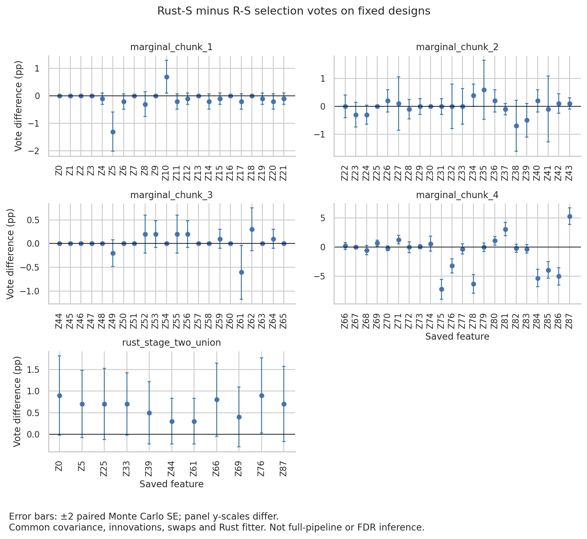

# Selection effects of changing S alone

**The small Rust/R S differences are not selection-neutral.** With covariance,
Gaussian innovations, swap masks and fitter settings fixed, changing S changed
24.8% of per-draw selected sets in marginal chunk 4. Its final findOptIter set
contains seven factors with Rust S and eight with R S: Z85 crosses the 10%
vote cutoff. The other four saved designs retain the same final sets.

Both arms select ten factors on the fixed stage-two union. This experiment
therefore does not explain the full-pipeline ten-versus-two/three-factor gap.
It also does not exclude an indirect S effect through changed stage-one
selections and a rebuilt stage-two design.

## Controls

We replayed 1,000 paired draws for each of the five designs from the
[sampler audit](../2026-09-28_sampler-audit/README.md), using the existing
`benchmarks/replay_paired_xtilde.py` entrypoint with `--sampler-audit`.

- **Rust-S arm:** `rust_shared_sigma_draws.raw`, with the Rust ASDP solution
  computed on the saved R covariance.
- **R-S arm:** `rust_shared_s_draws.raw`, with R's saved ASDP solution on that
  same covariance. This is not an R fitter or R RNG arm.
- Both arrays came from Rust's sampler with identical innovations, reseeded
  at 42 through 1041. The same seed range across designs does not make them
  five independent replications.
- Both arms use the same saved A, Z, y, feature ordering and per-draw swap masks
  from the September paired fixtures. We do not regenerate swaps or equate
  their original RNG schedule with the sampler audit's schedule.
- Both use the previously verified tie-corrected `paired_xtilde` binary,
  SHA256 `2812a73861084df76bbca270d1d4e0476da721ddcaab5df5c2d623b1b95f0286`.
  Its fitter/CLI sources have not changed since the September verification.
  Settings: Gaussian, cached preparation, 500 lambda points, tolerance 1e−7,
  cap 100,000, R-compatible lambda ratio, FDR parameter 0.1, offset 0 and
  vote specification 0.1. Both arms use the existing aggregation/findOptIter.
- Existing S clipping and Cholesky regularization remain in place. The Rust-S
  marginal draws include approximately 1e−10 diagonal jitter. This comparison
  does not separate SDP solution differences, clipping and resulting jitter.
- All five designs use sample covariance. We do not test shrinkage,
  interactions, alternative fitter tolerances or adaptive stage-two designs.

No production behavior changed. The run used one fitter process at a time,
one BLAS/Rayon thread, and the existing allocation; no new SLURM job was submitted.

## Results

Each row contains 1,000 paired draws. Differences are Rust S minus R S.
W uses the fitter's entry-lambda scale; it is not a probability.

| Fixed design | Draws with a changed selected set | W RMS difference | Largest absolute vote-frequency difference | Final factors, Rust S / R S |
| --- | ---: | ---: | ---: | ---: |
| Marginal 1 | 27 (2.7%) | 0.194 | 1.3 percentage points | 2 / 2 |
| Marginal 2 | 89 (8.9%) | 0.346 | 0.7 percentage points | 4 / 4 |
| Marginal 3 | 16 (1.6%) | 0.141 | 0.6 percentage points | 4 / 4 |
| Marginal 4 | 248 (24.8%) | 0.288 | 7.2 percentage points | 7 / 8 |
| Fixed stage-two union | 24 (2.4%) | 0.064 | 0.9 percentage points | 10 / 10 |

The largest marginal-4 frequency change is Z75: **27.1% with R S versus
19.9% with Rust S**, a −7.2-point difference with paired Monte Carlo SE
0.854 points. Z75 remains selected in both arms.

The final-set difference is **Z85: 115 R-S votes versus 76 Rust-S votes**,
against a minimum of 100. The paired difference is −3.9 points, with SE
0.704 points. Rust S selects Z66, Z69, Z75, Z76, Z78, Z84 and Z86; R S also
selects Z85. The seven-versus-eight distinction is present at both 500 and
1,000 draws, but this is not proof of asymptotic stability. Z85's pointwise
Wilson interval spans the 10% cutoff for R S (9.67–13.63%); Rust S gives
6.11–9.41%.

On the fixed union, both arms select Z5, Z25, Z33, Z39, Z44, Z61, Z66, Z69,
Z76 and Z87. Z0 receives 97 Rust-S votes and 88 R-S votes, below 100 in both
arms. Several union frequencies remain near the cutoff. At the 250- and
500-draw prefixes Rust S includes Z0, whereas R S does not; equality at
1,000 draws does not establish selection stability.



Error bars show ±2 paired Monte Carlo SE, calculated from the per-draw
difference of selection indicators. They describe simulation variation under
this fixed coupling, not biological uncertainty, simultaneous intervals,
p-values or FDR guarantees. A zero observed SE is not proof of zero population
variation. Do not pool these designs or compare their aggregate counts
directly with the [historical full-pipeline R cohorts](../2026-09-28_r-history/README.md).

## Verification

- Nine targeted Python tests pass, including a regression for paired vote
  direction, zero difference under identical pairing and the SE calculation.
- A two-draw smoke check passes on all five designs. The default tie-fix replay
  still matches all 1,000 saved marginal-1 counterfactual fits and aggregates.
- Before fitting, the new mode verifies fixture hashes and reconstructs both
  arms from the same innovations. Conditional means/covariances match the
  saved covariance and each arm's S, allowing the existing Cholesky jitter.
- All 10,000 arm fits pass input-hash, tie-zero and threshold checks. The first
  fit in each arm/design repeats exactly apart from elapsed time.
- An independent readback reconstructs every saved selection from W and the
  threshold rule, recomputes votes/findOptIter, checks entry-statistic values
  on draws 0, 199 and 999, and rechecks source hashes.
- A second full marginal-4 replay reproduces all 2,000 fitted outputs exactly
  except elapsed time; its summary, votes and per-draw selection CSV are
  byte-identical. This repeats the same draws, not an independent simulation.
- We rendered and inspected the figure for labels, clipping and correspondence
  with the vote CSV; shortened axis labels avoid overlap.

## Artifacts and reproduction

`summary.csv` contains the five design-level comparisons and named final sets;
`votes.csv` contains 99 feature-level paired comparisons. `summary.json` retains
prefix summaries, settings and source hashes. Per-draw swap hashes remain in
the hashed original `xtilde_manifest.csv`; the full run summary also lists them.
`manifest.sha256` covers the driver, binary, compact outputs and verification logs.
Raw draws, fit JSON, W arrays and full manifests remain under
`.tmpfiles/2026-10-05_s-selection/{full,repeat_chunk4,smoke,legacy_regression}/`.

From the repository root:

```bash
ENV=/vast/djishnu/Aaron/.tmpfiles/20260902_knockoff-generator-parity/project/.pixi/envs/dev
export TMPDIR="$PWD/.tmpfiles/2026-10-05_s-selection"
export MPLCONFIGDIR="$TMPDIR/matplotlib"
export PYTHONPATH="$PWD/src:$PWD" PYTHONNOUSERSITE=1
export OPENBLAS_NUM_THREADS=1 OMP_NUM_THREADS=1 RAYON_NUM_THREADS=1
export LD_LIBRARY_PATH="$ENV/lib:${LD_LIBRARY_PATH:-}"
mkdir -p "$TMPDIR"
"$ENV/bin/python" benchmarks/replay_paired_xtilde.py \
  --fixtures .tmpfiles/2026-09-14_paired-convergence/results \
  --sampler-audit .tmpfiles/2026-09-28_sampler-audit/run_5 \
  --designs marginal_chunk_1 marginal_chunk_2 marginal_chunk_3 marginal_chunk_4 rust_stage_two_union \
  --rust-bin target/release/paired_xtilde --out "$TMPDIR/reproduction"
```

Use a fresh output directory. The runner refuses to overwrite a sampler run.
For the repeat check, use only `--designs marginal_chunk_4` and another new
output directory. All source data for the compact tables and figure comes
from `sampler_summary.json` and the per-design `votes.csv` in the run output;
`plot_sampler_votes()` in the same driver regenerates the figure.

## Next bounded experiment

Focus on marginal chunk 4: separate the S solution/zero-clipping effect from
Cholesky regularization using the same covariance, innovations, swaps and
fitter. Then test whether the confirmed stage-one changes alter a rebuilt
stage-two design. Retain the worker-seeding gap as a separate unresolved
full-pipeline issue; neither fix production defaults nor attribute the
historical ten-factor discrepancy to S alone from this result.

**October 6 follow-up:** the [clipping/jitter decomposition](../2026-10-06_s-clip-jitter/README.md)
attributes the marginal-4 change to the nonzero S entries. Zero clipping and
Cholesky jitter each move votes by at most 0.4 points and leave the final set unchanged.
