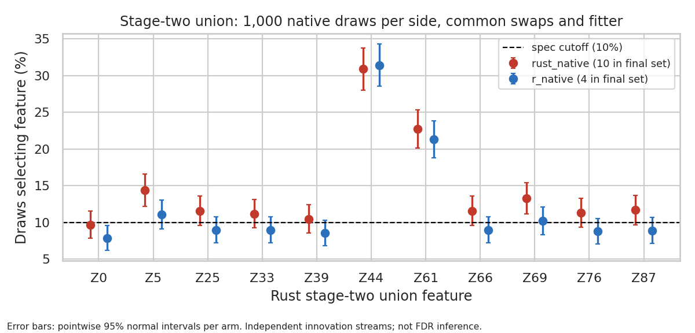

# Rust-native versus R-native knockoff draws on the saved designs

**Rust's and R's full knockoff streams give the same final sets on marginal
chunks 1–3. They differ only where a feature sits at the 10% vote cutoff.** On
chunk 4 that is Z85 again (7 vs 8). On the Rust stage-two union the outcome is
10 factors for Rust's stream versus 4 for R's. Neither difference is evidence of
a sampler defect:

- On the union, the knockoff filter is close to all-or-nothing. In 68% of draws
  on both sides it selects nothing.
- It selects 9 or more of the 11 columns in 11.6% of Rust draws and 8.9% of R
  draws (Fisher p = 0.055). Both 95% intervals (9.8–13.7% and 7.3–10.8%)
  contain the 10% cutoff.
- Seven factors ride on those near-all draws, so they cross the cutoff
  together or not at all.

The paired seed replicates in `2026-10-06_seed-replicates` show the same thing
at pipeline level: Rust 2–10 and R 1–6 factors at δ=0.1, λ=1.0, with no
detectable difference.

## Design

`benchmarks/replay_paired_xtilde.py --sampler-audit ... --native-draws` (commits
`c9fc64f` and `cf7449a`). Each side contributes its own saved draws from the
September 28 sampler audit (`.tmpfiles/2026-09-28_sampler-audit/run_5`):

| Arm | S | Mean and factor | Innovations |
| --- | --- | --- | --- |
| `rust_native` | Rust (zero-clipped) | production `prepare_knockoff_cache` | Rust `StdRng`, seeds 42+i |
| `r_native` | R ASDP | `create.gaussian` formulas | R `rnorm`, `set.seed(42+i)` |

- Both sides use R's sample covariance (`sigma.csv`). Rust's native covariance
  equals it to ≤6e−14 under `SLIDE_KNOCKOFF_MATCH_R_COV=1`.
- Shared: the saved swap masks for draws 0–999, the Rust `paired_xtilde` fitter
  (hash unchanged) and the tie-zero rule.
- 1,000 draws per side on five designs: marginal chunks 1–4 (24 × 22) and the
  Rust stage-two union (24 × 11). SLURM jobs 11612320 and 11612440.
- The two innovation streams are independent. Vote differences therefore
  include ordinary Monte Carlo variation. The paired SE in `votes_*.csv` is
  still valid because the swaps are shared.

## Results

| Design | Rust final set | R final set | Largest vote change (pp, ± SE) | Empty draws, Rust / R |
| --- | --- | --- | --- | --- |
| chunk 1 | Z0 Z10 | same | 1.8 | 656 / 670 |
| chunk 2 | Z25 Z32 Z33 Z38 | same | 1.7 | 525 / 505 |
| chunk 3 | Z44 Z52 Z55 Z62 | same | 3.5 ± 1.7 (Z62) | 610 / 619 |
| chunk 4 | 7: … without Z85 | 8: with Z85 | Z75 −10.0 ± 1.9 | 413 / 387 |
| union | 10: Z5 Z25 Z33 Z39 Z44 Z61 Z66 Z69 Z76 Z87 | 4: Z5 Z44 Z61 Z69 | 3.3 ± 1.5 (Z5) | 682 / 682 |

- **Chunk 4:** the shift has the same direction and features as the
  tiny-S result in `2026-10-06_s-tiny-substantive`. It is larger here (Z75
  −10.0 versus −7.0) because the two streams are independent.
- **Union:** no feature's vote rate differs by more than 3.3 points, yet the
  final sets differ by six factors.

`vote_deltas.png` shows the per-feature vote differences for every design.

## A numerical difference found on the way

Production Rust does not hit the closed-form mean and Σₖ exactly on the
ill-conditioned chunks. It deviates by up to 1.2e−5 (mean) and 1.7e−6 (Σₖ) on
chunk 4, and 7e−8 / 5e−9 on chunk 2. R matches to ≤1.4e−14 (`summary.json`,
`formula_deviation`).

The September 28 shared-Σ arms, which the S-only replays used, follow the formula
to 1e−10. So production's native draws differ from them by up to 2e−3 on chunk 2
and 8e−4 on chunk 4, for the same Σ, S and innovations. The source is likely
`prepare_knockoff_cache` solving Σ⁻¹ differently from `build_knockoff_cache`;
this run did not trace it. Its effect is folded into the comparison above and is
not separated from S and stream effects.

## Verification

- The default S-only mode is byte-identical to the October 6 smoke outputs on all
  five designs; 11 tests pass.
- Every arm reproduces its saved draws exactly as mean + innovations × factor.
  All 10,000 fits pass the driver's hash, tie-zero and first-fit repeat checks.
- The second complete run (11612440) matches all 10,000 fits of the first
  (11612320) apart from elapsed time. Its vote values are identical. The first
  run's `votes.csv` used the old `rust_s`/`r_s` column labels, fixed in
  `cf7449a`. This repeats the same draws; it is not independent evidence.
- `readback.py` recomputes the final sets and the near-all rate from the fit
  JSON (`readback.log`, `final_sets.csv`).
- We rendered and inspected `union_votes.png`.

## Limits

- One saved design per chunk and one stream per side. The union design is Rust's
  stage-two union, so it is not what R's pipeline would build.
- The near-all threshold (≥ p − 2 = 9 features) is a description, not a
  pre-registered test.

Raw fits: `.tmpfiles/2026-10-06_native-draws/{full,full_2}/`.
