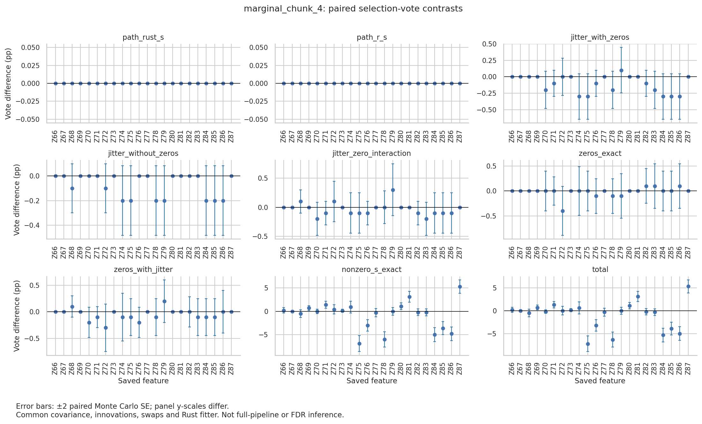

# S zero-clipping versus Cholesky jitter on marginal chunk 4

**Chunk 4's selection change comes from the nonzero S entries, not from zero
clipping or Cholesky jitter.** With covariance, Gaussian innovations, swap
masks and fitter fixed, removing jitter or replacing Rust's five exact-zero S
entries with R's values moves no vote by more than 0.4 percentage points and
never changes the final findOptIter set. Changing the remaining S entries from
Rust's to R's values reproduces the whole October 5 difference: seven versus
eight factors, with Z85 at 79 versus 115 votes.

This is a fixed-design, single-stream result. It does not explain the
full-pipeline ten-versus-two/three-factor discrepancy.

## Mechanism traced

- `slide-sdp/src/lib.rs:194` clips each Clarabel SDP coordinate to [0, 1]; the
  marginal chunks have p = 22 ≤ the ASDP block size, so this is the full SDP.
  `enforce_feasibility` scales S only if `2Σ − diag(S)` falls below 1e−10.
- On chunk 4 this gives exact zeros for Z68, Z70, Z72, Z79 and Z82; R's ASDP
  gives 1.1e−9 to 6.5e−9 there. Eleven further Rust entries are tiny
  (4.9e−9 to 3.6e−6) and 6–41 times R's values. The six substantive entries
  (Z75, Z76, Z78, Z84, Z85, Z86) agree to within 5e−5; Z85 is 0.14847 versus
  0.14846.
- `build_knockoff_cache` forms `Σₖ = 2S − S Σ⁻¹ S`. Exact zero S entries make
  exactly zero rows, so the Cholesky fails and `regularized_cholesky`
  (`slide-knockoff/src/lib.rs:1130`) adds 1e−10·I to every diagonal on its
  first retry. R S gives a positive-definite Σₖ (smallest eigenvalue 1.5e−9)
  that needs no jitter.
- A valid exact factor exists without jitter: zero rows for zero-S features
  and an ordinary Cholesky of the positive block (smallest eigenvalue 9.7e−9).
  This is the ε → 0 limit of the jittered factor in the same feature order, so
  the coupling of innovations to features is unchanged. With it, zero-S
  knockoff columns are bitwise copies of the originals.

## Arms and contrasts

All arms use the saved R covariance, the September 28 Rust innovations
(seeds 42–1041), the September 14 swap masks for draws 0–999, and the same
`paired_xtilde` fitter. Production code and defaults are unchanged.

| Arm | S | Factor | Built by |
| --- | --- | --- | --- |
| `rust_s` | Rust | production (jittered) | saved Rust draws |
| `r_s` | R | production (exact) | saved Rust draws |
| `rust_s_jitter` | Rust | + 1e−10·I | Python |
| `rust_s_exact` | Rust | zero rows + positive-block Cholesky | Python |
| `r_zero_values_jitter` | Rust, with R values on the five zeros | + 1e−10·I | Python |
| `r_zero_values_exact` | same | exact Cholesky | Python |
| `r_s_exact` | R | exact Cholesky | Python |

Each contrast changes one factor. Rust minus R for the total:

| Contrast | Isolates | Changed per-draw sets | W RMS Δ | Largest vote Δ (pp, ±SE) | Z85 Δ (pp) | Final set |
| --- | --- | ---: | ---: | --- | ---: | --- |
| `path_rust_s` | Python vs Rust construction | 0 | ≤1.3e−15 max | 0 | 0 | same |
| `path_r_s` | Python vs Rust construction | 0 | 0 | 0 | 0 | same |
| `jitter_with_zeros` | jitter, Rust S | 8 | 0.009 | −0.3 ± 0.17 | −0.3 | same |
| `jitter_without_zeros` | jitter, no zeros | 3 | 0.009 | −0.2 ± 0.14 | −0.2 | same |
| `jitter_zero_interaction` | difference of the two above | — | — | +0.3 ± 0.22 (Z79) | −0.1 | — |
| `zeros_exact` | 0 vs R values on the zero set, no jitter | 14 | 0.022 | −0.4 ± 0.24 (Z72) | 0.0 | same |
| `zeros_with_jitter` | same, with jitter | 9 | 0.022 | −0.3 ± 0.22 (Z72) | −0.1 | same |
| `nonzero_s_exact` | Rust vs R on the other 17 entries | 247 | 0.288 | −6.9 ± 0.85 (Z75) | −3.6 ± 0.70 | 7 vs 8 |
| `total` | Rust S + jitter vs R S exact | 248 | 0.288 | −7.2 ± 0.85 (Z75) | −3.9 ± 0.70 | 7 vs 8 |

Per-draw selection indicators telescope exactly:
`total = jitter_with_zeros + zeros_exact + nonzero_s_exact`
(−0.3 + 0.0 − 3.6 = −3.9 points for Z85).

Final findOptIter sets: all four Rust-S/zero-set arms select Z66, Z69, Z75,
Z76, Z78, Z84 and Z86. Both R-S arms also select Z85. Z85 votes: 76
(`rust_s_jitter`), 79 (`rust_s_exact`), 77 and 79 (`r_zero_values` with and
without jitter), 115 (`r_s_exact`); the minimum is 100. Z85 is the only
feature within 15 votes of the cutoff in any arm. Its pointwise 95% Wilson
interval for R S, 9.67–13.63%, spans 10%. The other arms' upper bounds are
9.41–9.74%.

Besides Z85, `nonzero_s_exact` moves Z78 (−6.0 ± 0.80), Z87 (+5.3 ± 0.71),
Z84, Z86 and Z76. Z87 and Z81 are tiny-S features; the others are substantive.

The zero-set features behave alike in every arm. About 59–60% of their W values
are zero after tie correction, and the rest split roughly evenly between
positive and negative. Exact copies and 1e−5-scale near copies therefore act
as near-null features here, not as forced ties or forced positive statistics.
Across arms these five features receive 58–67 total votes.



Error bars are ±2 paired Monte Carlo SE for the per-draw contrast of selection
indicators. They describe simulation variation under this fixed coupling. They
are not simultaneous intervals, p-values or FDR statements. A zero SE in the
path panels means no draw changed, not that population variation is zero.

## What remains coupled

- `nonzero_s_exact` changes 17 entries at once: 11 tiny entries where Rust is
  6–41 times R, and 6 substantive entries that differ by at most 5e−5.
  This run does not separate them.
- One common innovation stream and one swap-mask set. Same-draw repeatability is
  not independent simulation evidence. A different stream could move Z85 by
  several votes, and R S places it 15 votes above the cutoff.
- Saved fixed design with sample covariance; no stage-two rebuild, shrinkage,
  interactions or alternative fitter settings. R worker seeding is a separate
  open issue and is not tested here.
- R S is not treated as ground truth. Both solutions are feasible; they differ
  in how the solver resolves nearly degenerate coordinates.

## Verification

- 11 Python tests pass, including two new regression tests: exact zero-row
  factors, the jitter limit, infeasible-S rejection, and contrast
  telescoping/cancellation.
- Before fitting, the run checks S ≥ 0, `2Σ − diag(S)` positive definite, an
  exact zero Σₖ row for every zero S, and `UᵀU` against the target (≤1e−14).
  It also checks that zero-S knockoff columns equal the originals bitwise.
  Python rebuilds match the saved Rust draws within 1.1e−10 for Rust S and
  4.7e−11 for R S. That difference is LAPACK versus faer Cholesky on targets
  with condition numbers of 1e8–1e9; the saved draws equal saved mean +
  noise·factor exactly.
- Default `--sampler-audit` smoke outputs on all five designs are byte-identical
  to the October 5 smoke run.
- All 7,000 fits pass input-hash, tie-zero and threshold checks; first fits
  repeat exactly. An independent readback recomputes the selections, votes and
  findOptIter sets from fit JSON.
- The saved `rust_s` and `r_s` arms reproduce all 2,000 October 5 fits exactly
  apart from elapsed time.
- A second complete run reproduces all 7,000 fits except elapsed time. Its
  `arms.csv`, `contrasts.csv`, `draws.csv` and `votes.csv` are byte-identical.
  This repeats the same draws; it is not an independent simulation.
- We rendered and inspected the figure.

## Artifacts and reproduction

`summary.json` holds per-arm sets, contrast summaries, path differences,
settings, the fitter hash (`2812a738…`, unchanged) and source hashes.
`contrasts.csv` has 9 contrasts × 22 features; `arms.csv` has per-arm votes and
positive-tie counts. `probe_s_geometry.py` prints the S, Σₖ and factor checks
above; `readback.py` and `readback.log` hold the independent readback.
`manifest.sha256` covers these, the driver (commit `3f85a1a`), runner and binary. Raw fits, W, ties and logs are under
`.tmpfiles/2026-10-06_s-clip-jitter/{full,repeat,smoke_decomp,smoke_default}/`.

```bash
tmpfiles/run_s_decomposition.sh <new-output-dir> --designs marginal_chunk_4 --s-decomposition
```

The runner sets the frozen environment and single-threaded BLAS/Rayon. It
refuses an existing output directory.

## Next bounded experiment

Split `nonzero_s_exact` into its tiny and substantive entries. Add one arm that
uses R values on the zero and tiny sets and Rust values on the six substantive
entries, with the same exact factor, innovations, swaps and fitter. If the tiny
set carries the shift, solver resolution of nearly degenerate S coordinates
drives selection. That would argue for stream-replicated evidence before
changing solver tolerances.

Propagation through a rebuilt stage-two design is warranted only as a separate
experiment. Chunk 4 is the only marginal design whose final set changed, by one
near-cutoff factor. The fixed union selects ten factors under both S solutions.
A rebuilt union would add Z85 at most. A ten-versus-two/three gap is unlikely
to follow from this alone. Test it with controlled streams, and keep R worker
seeding as the leading separate candidate.
