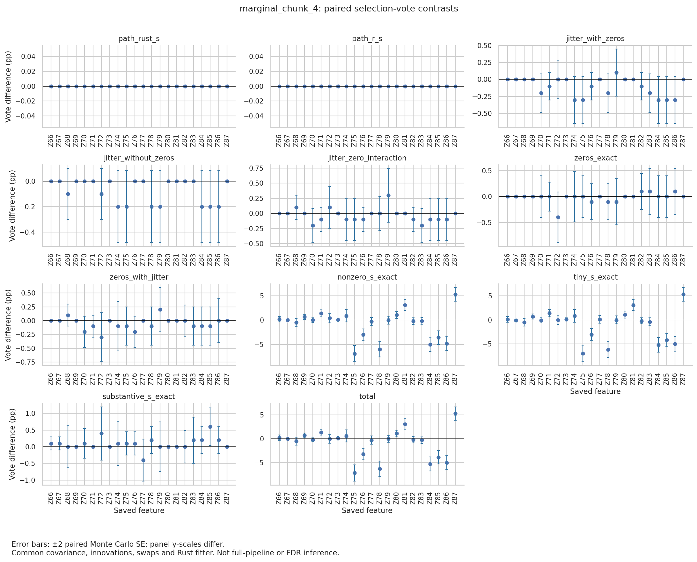

# Tiny versus substantive S entries on marginal chunk 4

**Rust's 11 tiny nonzero S entries cause chunk 4's seven-versus-eight change.
The six substantive entries do not.** This follows up
`2026-10-06_s-clip-jitter`, which traced the change to the 17 nonzero S entries
but changed them all at once. Here one new arm keeps Rust's substantive values
and takes R's values on the zero and tiny entries:

- Swapping only the tiny entries reproduces the whole nonzero-S effect, Z85
  included.
- Swapping only the substantive entries moves Z85 by +0.6 points and leaves the
  final set unchanged.

This is still one fixed design with one innovation and swap stream. It does not
explain the full-pipeline ten-versus-two/three-factor discrepancy.

## Split

Rust S on chunk 4 has a three-order-of-magnitude gap: tiny entries run from
4.9e−9 to 3.6e−6 and substantive ones from 9.1e−3 to 0.149. The driver labels
entries below `SMALL_S = 1e−4` as small (zero or tiny). It refuses to run if any
entry lies within a factor of 10 of that split.

| Group | Features | Rust vs R |
| --- | --- | --- |
| Zero (5) | Z68, Z70, Z72, Z79, Z82 | 0 vs 1.1e−9 to 6.5e−9 |
| Tiny (11) | Z66, Z67, Z69, Z71, Z73, Z74, Z77, Z80, Z81, Z83, Z87 | 6–41× R |
| Substantive (6) | Z75, Z76, Z78, Z84, Z85, Z86 | agree to 5e−5 |

New arm `r_small_values_exact`: R values on the zero and tiny entries, Rust
values on the substantive ones, exact factor (no jitter). The mixed S is
feasible: `2Σ − diag(S)` has a smallest eigenvalue of 1.45e−7, and the
positive block of Σₖ has 1.55e−9. The new contrasts add up exactly:
`nonzero_s_exact = tiny_s_exact + substantive_s_exact`.

## Results

1,000 pairs. Covariance, innovations, swaps and fitter are fixed. Values are
Rust-side minus R-side in percentage points, ± paired Monte Carlo SE.

| Contrast | Changed per-draw sets | W RMS Δ | Z85 | Z75 | Z78 | Z87 | Final set |
| --- | ---: | ---: | ---: | ---: | ---: | ---: | --- |
| `nonzero_s_exact` (17 entries) | 247 | 0.288 | −3.6 ± 0.70 | −6.9 ± 0.85 | −6.0 ± 0.80 | +5.3 ± 0.71 | 7 vs 8 |
| `tiny_s_exact` (11 entries) | 250 | 0.288 | −4.2 ± 0.71 | −7.0 ± 0.87 | −6.2 ± 0.83 | +5.3 ± 0.71 | 7 vs 8 |
| `substantive_s_exact` (6 entries) | 51 | 0.042 | +0.6 ± 0.28 | ≤0.4 | ≤0.4 | ≤0.4 | same (8) |

Z85 votes against a minimum of 100:

| Arm | Z85 votes | Final set size |
| --- | ---: | ---: |
| `r_zero_values_exact` | 79 | 7 |
| `r_small_values_exact` | 121 | 8 |
| `r_s_exact` | 115 | 8 |

The substantive step's largest vote change is 0.6 points. In the
`substantive_s_exact` panel no feature's error bar sits clearly away from zero
except Z85's, which barely clears it.

The tiny entries mostly belong to other features: none of Z75, Z76, Z78, Z84,
Z85 or Z86 is tiny. Their votes still move by 3–7 points. Changing how close
the tiny-S knockoffs are to their originals changes the lasso path that the
substantive features compete on. Z87 and Z81, both tiny-S features, gain votes
(+5.3 and +3.1).



Error bars are ±2 paired Monte Carlo SE under this fixed coupling. They are not
simultaneous intervals, p-values or FDR statements.

## What this does and does not settle

- On this design, the selection change traces to how the SDP solver resolves
  near-zero coordinates (≤3.6e−6). It does not trace to the substantive S
  values, zero clipping or Cholesky jitter.
- Neither S is ground truth. Both are feasible. The result says marginal
  selection here is sensitive to solver tolerance on near-degenerate entries,
  and Z85 sits near the cutoff (95% interval 9.67–13.63% under R S).
- The 11 tiny entries are still swapped as a block. This run does not identify
  single entries.
- One design, one stream, no stage-two rebuild. R worker seeding is untested
  here and remains the separate candidate for the ten-versus-two/three gap.

## Verification

- 11 Python tests pass. The contrast test now also checks that
  `tiny_s_exact + substantive_s_exact = nonzero_s_exact`.
- All 8,000 fits pass the driver's input-hash, tie-zero, threshold and
  first-fit repeat checks. The mixed arm passes the same S, Σₖ and factor checks
  as the other exact arms.
- The independent readback (`readback.py`, `readback.log`) recomputes
  selections, votes and findOptIter sets from the fit JSON.
- The seven arms shared with `2026-10-06_s-clip-jitter` reproduce all 7,000 of
  its fits exactly apart from elapsed time. The saved `rust_s` and `r_s` arms
  reproduce all 2,000 October 5 fits. These are the same draws, not independent
  simulations.
- The fitter hash is unchanged (`2812a738…`).
- We rendered and inspected the figure; it matches `contrasts.csv`.

## Artifacts and reproduction

```
tmpfiles/run_s_decomposition.sh <new-dir> --designs marginal_chunk_4 --s-decomposition
python readback.py <new-dir> .tmpfiles/2026-10-06_s-clip-jitter/full .tmpfiles/2026-10-05_s-selection/full
```

Driver at commit `cde0dc3`. `summary.json` holds per-arm sets, contrast
summaries, settings and source hashes. `contrasts.csv` has 11 contrasts × 22
features; `arms.csv` has per-arm votes and tie counts. `manifest.sha256` covers
these files, the driver, the runner and the binary. Raw fits, W, ties and logs
are under `.tmpfiles/2026-10-06_s-tiny-substantive/run_1/`.
