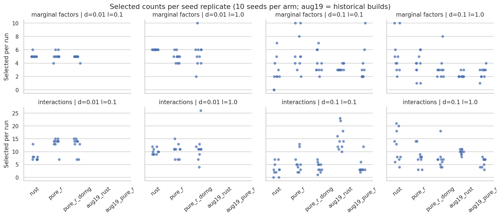

# Rust and R seed replicates under the parity settings

**At δ=0.1, λ=1.0, the "Rust ten versus R two/three" gap is a seed-42 draw, not
a systematic difference.** Across ten seeds per arm, Rust selects 2–10 marginal
factors (median 4.5) and stock R selects 1–6 (median 4). The count
distributions do not differ detectably (exact Mann–Whitney p = 0.35). Seed 42
happens to be one of Rust's two ten-factor runs. Seeding R's workers with
doRNG does not shift R's distribution.

There is a real, reproducible difference at **δ=0.01, λ=1.0**:
- Rust selects Z20 in 10/10 runs and Z21 in 8/10. R selects neither in 20 runs.
- R selects Z73 in 13/20 runs; Rust selects it in 1/10.

That is the lead for the next investigation.

## Design

| Arm | Implementation | Seeding |
| --- | --- | --- |
| `rust` | native Rust, frozen September 22 binary (`62c49801…`) | `--knockoff-base-seed` |
| `pure_r` | installed SLIDE R package (stock) | main process only; PSOCK workers unseeded |
| `pure_r_dorng` | same package | `SLIDE_R_DORNG_SEED`: doRNG per-task streams (`benchmarks/run_slide_r.R`, commit `b6325d0`) |

All arms used the same settings, matching the September 22 parity run
(`2026-09-22_all-backend-parity-tiefix`):
- SSc UnTx inputs, four cells (δ ∈ {0.01, 0.1} × λ ∈ {0.1, 1.0}).
- `--configuration parity`, 500 draws, spec/FDR 0.1, findOptIter.
- 4 workers, `SLIDE_KNOCKOFF_MATCH_R_COV=1`, `SLIDE_R_OPTIMIZE=1`.

Seeds: 42, 1000, 2000, …, 9000. One SLURM task per arm and seed (array
11612299, htc Turin nodes). Every task verified the 362-file run manifest and
all four cells, and the doRNG tasks confirmed the hook ran (`task_checks.log`).

All arms started from the same latent factors in every run: k = 88 at δ=0.1 and
172 at δ=0.01.

The `aug19_*` rows come from `benchmark_results/20260819_high-delta-seeds`
(δ=0.1 only, older builds, 10 workers). They are context, not part of the
tests.

## Results

Selected marginal factors per seed (sorted):

| Cell | rust | pure_r | pure_r_dorng |
| --- | --- | --- | --- |
| δ=0.01 λ=0.1 | 5 5 5 5 5 5 5 5 5 6 | 4 5 5 5 5 5 5 5 6 6 | 4 5 5 5 5 5 5 5 5 5 |
| δ=0.01 λ=1.0 | 6 ×10 | 4 4 4 5 5 5 5 5 6 6 | 2 4 4 5 5 6 6 6 6 10 |
| δ=0.1 λ=0.1 | 0 0 2 2 2 2 3 4 5 7 | 2 3 4 4 5 5 5 8 10 10 | 2 3 3 3 3 4 4 6 6 7 |
| δ=0.1 λ=1.0 | 2 3 3 4 4 5 5 6 10 10 | 1 1 3 3 4 4 4 5 6 6 | 2 2 2 3 3 3 3 3 4 8 |

At δ=0.1, λ=1.0, by seed (marginal/interactions):
- **Rust:** 42: 10/21, 1000: 3/7, 2000: 10/20, 3000: 3/6, 4000: 4/8, 5000: 4/8, 6000: 2/4, 7000: 5/18, 8000: 5/13, 9000: 6/14.
- **Stock R:** 1–6 marginal factors.

Rust is deterministic: seed 42 reproduces September 22's 10/21 exactly. Stock R's
seed-42 run gave 5/9 here, against 2/5 (Sep 14) and 3/6 (Sep 22), as expected for
unseeded workers.



Exact two-sided Mann–Whitney tests, 10 versus 10 runs (`tests.csv`). There are
24 tests, so the Bonferroni threshold is 0.0021.

| Cell | Kind | rust vs pure_r | rust vs pure_r_dorng | pure_r vs pure_r_dorng |
| --- | --- | ---: | ---: | ---: |
| δ=0.01 λ=0.1 | marginal | 1.0 | 0.53 | 0.53 |
| δ=0.01 λ=0.1 | interaction (7 vs 14) | **0.0007** | 0.0068 | 0.74 |
| δ=0.01 λ=1.0 | marginal (6 vs 5) | **0.0015** | 0.14 | 0.48 |
| δ=0.01 λ=1.0 | interaction | 0.63 | 0.44 | 0.85 |
| δ=0.1 λ=0.1 | marginal | 0.019 | 0.11 | 0.25 |
| δ=0.1 λ=0.1 | interaction | 0.14 | 0.44 | 0.48 |
| δ=0.1 λ=1.0 | marginal | 0.35 | 0.052 | 0.35 |
| δ=0.1 λ=1.0 | interaction | 0.28 | 0.063 | 0.31 |

- **Headline cell (δ=0.1, λ=1.0):** per-factor rates agree. Z44 is selected
  10/10 in every arm. Z25 is 7/8/6 and Z33 9/8/8 (rust/pure_r/dorng), and every
  per-factor Fisher p is ≥ 0.35. Rust's larger union (14 vs 6 factors) comes
  from its two ten-factor runs.
- **Stock vs doRNG R:** no test is close to significant. Unseeded workers make R
  irreproducible; they do not bias it.
- **δ=0.01, λ=1.0:** a factor-level difference that survives multiple testing.
  Z20 is selected in 10/10 Rust runs and 0/20 R runs (Fisher p = 1.1e−5 against
  stock). Z21 is 8/10 against 0/20 (p = 7e−4 against stock). Z73 is 1/10 against 13/20.
  Rust's within-arm Jaccard there is 0.89, so this is stable, not noise.
- **δ=0.01, λ=0.1:** Rust selects about half as many interactions (median 7 vs
  14).

## Limits

- Ten runs per arm gives low power. A null result means no difference large
  enough to detect, not equivalence.
- The p-values are not adjusted, except that the table names the Bonferroni
  threshold.
- One dataset and the frozen September 22 builds.
- The August 19 cohorts used older builds and 10 workers. They are not pooled.

## Reproduction

```bash
RUN=.tmpfiles/2026-10-06_replicates   # frozen source (b6325d0), bin, inputs, R libraries, manifest
ENV=/vast/djishnu/Aaron/.tmpfiles/20260902_knockoff-generator-parity/project/.pixi/envs/dev
R_DEPS=/vast/djishnu/Aaron/.tmpfiles/20260902_r-generated-knockoff-backend-evaluation/R-library
sbatch --output="$RUN/logs/preflight-%j.out" preflight.sbatch "$RUN" "$ENV" "$R_DEPS"
sbatch --output="$RUN/logs/%A_%a.out" run.sbatch "$RUN" "$ENV" "$R_DEPS"
python analyze.py "$RUN/results" <out> benchmark_results/20260819_high-delta-seeds
```

- `R-dorng/` holds doRNG 1.8.6.3 and rngtools 1.5.2, installed from CRAN.
- **Preflight** (`preflight.log`): two doRNG runs give identical selection
  outputs, and two stock runs differ.
  - The first version also compared plots, `yaml_params.yaml` and post-selection
    cross-validation output, which change on every run. It failed on those, so
    the check was narrowed and re-run on the saved outputs.
- `analysis.log` holds the full printed tables.
- Raw per-seed outputs are under `$RUN/results/<arm>/seed_<k>/`.
