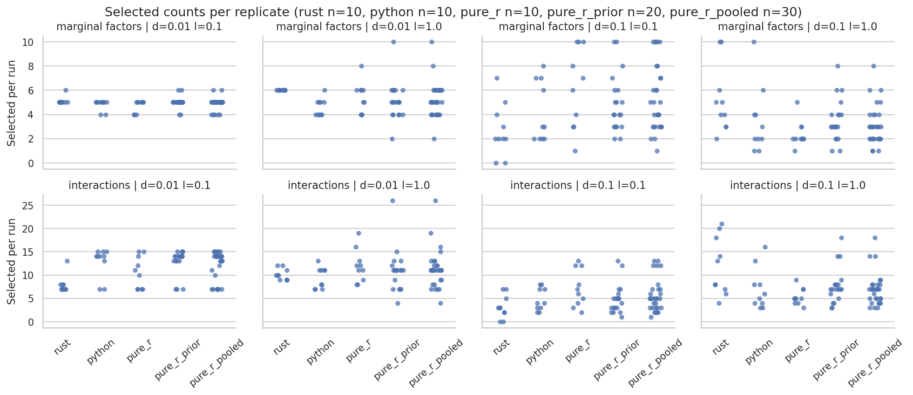
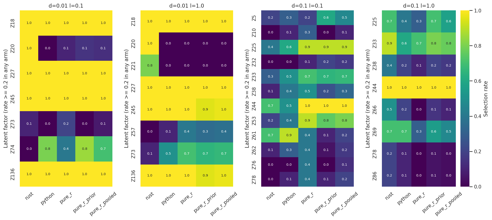
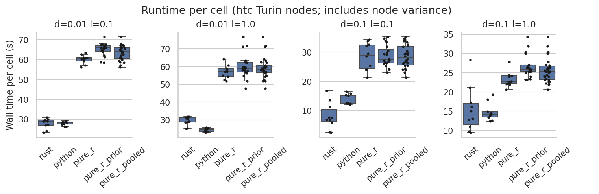

# R vs Rust vs Python SLIDE: seed replicates at 05271b4

**Python now matches R's selection distribution in three of four cells, and Rust still
differs reproducibly at δ=0.01.** The cell where Python does not match is δ=0.1, λ=0.1,
where Python selects Z61 too often. Rust selects Z20 (and Z21 at λ=1.0), which R almost
never selects, and it rarely selects Z74/Z73. At δ=0.1, λ=0.1, Rust's lower count
(median 2 vs R's 4.5–6.5) does not pass multiple testing. Rust and Python each run in
about 0.45× R's wall time at δ=0.01.

## Purpose and design

This run is the replicate experiment fixed in advance in
`.agent-handoff/2026-10-12_backend-replicate-experiment.md`. It extends the
[2026-10-06 seed replicates](../2026-10-06_seed-replicates/README.md) by adding Python
and running every arm at source commit `05271b4`, which contains the R-parity fixes
([parity-fixes](../2026-10-12_parity-fixes/README.md),
[sdp-parity](../2026-10-12_sdp-parity/README.md)).

| Arm | What | Runs |
| --- | --- | --- |
| `rust` | native Rust, `bin/slide` sha256 `cf20fafd…` (built from `05271b4`) | 10 seeds |
| `python` | Python, 4 workers, bundled DSDP extension | 10 seeds |
| `pure_r` | stock installed SLIDE, unseeded PSOCK workers | 10 seeds (new) |
| `pure_r_prior` | the 20 R runs from 2026-10-06 (stock + doRNG; same package and harness path) | 20 |
| `pure_r_pooled` | `pure_r` + `pure_r_prior` | 30 |

- **Inputs:** SSc UnTx `X.csv`/`Y.csv`. They match the 2026-10-06 manifest.
- **Cells:** δ ∈ {0.01, 0.1} × λ ∈ {0.1, 1.0}. The primary cells are δ0.01 λ0.1 (easy),
  δ0.01 λ1.0 (largest disagreement) and δ0.1 λ0.1 (most variable). δ0.1 λ1.0 is
  secondary.
- **Seeds:** 42 and 1000–9000. **Settings:** `--configuration parity --niter 500 --spec
  0.1 --slide-selection --threads 4`, `SLIDE_OPT_ITER=1`, knockoff tol 1e-7 / max_iter
  1e5, `MATCH_R_COV`/`MATCH_R_LAMBDA`, BLAS threads 1, `RAYON_NUM_THREADS=4`. These are
  the same as the 2026-10-06 run.
- **Gates:** each task verified the 323-file manifest and got 4/4 successful cells. The
  Python tasks also asserted that the knockoff SDP solver is DSDP. In the analysis, every
  run's K (172 at δ=0.01, 88 at δ=0.1) and Z match the first new R run within 1e-8 (max
  4.7e-11; `z_check.csv`).
- **Jobs (htc, Turin):** build 11920341; preflight 11920366 and 11920460 (archived, see
  below); full array **11920495** (30 tasks). Elapsed was 1:05–3:00 and MaxRSS ≤ 1.3 GB
  (`sacct.txt`). Request: 4 CPUs, 4 GB, 20 min.

## Results

Exact two-sided Mann–Whitney tests: 48 selection-count tests, so Bonferroni is 0.05/48 =
**0.0010**. `mannwhitney_bh_q` in `tests.csv` holds the BH q-values. Per-factor Fisher
tests are BH-adjusted within each cell across all factor × comparison pairs. Factors
with |Δrate| ≥ 0.5 are flagged (`factor_rates.csv`). Not significant does not mean
equivalent: 10 runs per arm detects only large differences.




### δ=0.01, λ=0.1 (easy)
- **Core set:** every arm selects R's core set Z18 Z27 Z45 Z136 in 10/10 runs (core
  recall 1.0).
- **Rust:**
  - Adds Z20 in 10/10 runs, against R's 4/30 (q = 5e-5).
  - Never selects Z74 (0/10, against R's 21/30, q = 0.001).
  - Rust's sets differ from R's (permutation p = 1e-4 for between < within).
  - Interactions: median 7 vs pooled R's 14 (p = 0.0019, q = 0.046). This is above the
    Bonferroni threshold.
- **Python:** selects Z74 in 8/10 runs and Z20 in 0/10. Its sets do not separate from
  pooled R (permutation p = 0.92).

### δ=0.01, λ=1.0 (largest disagreement)
- **Rust:** differs from R in three factors.

  | Factor | Rust | Pooled R | q |
  | --- | --- | --- | --- |
  | Z20 | 10/10 | 0/30 | 1e-7 |
  | Z21 | 8/10 | 0/30 | 2.5e-5 |
  | Z73 | 1/10 | 20/30 | 0.034 |

  Rust vs Python marginal count: 6 vs 4.5, p = 0.0002 (passes Bonferroni).
- **Python:** the earlier "45 96 136" deviation is gone.
  - It selects the R core in every run and never selects Z20 or Z21.
  - It selects Z73 in 5/10 runs (R: 20/30, not flagged).
  - Its sets do not separate from pooled R (permutation p = 0.89).

### δ=0.1, λ=0.1 (most variable)
- **Within-arm Jaccard:** 0.33 for Rust, 0.33 for Python and 0.47 for new R.
- **Marginal counts:**

  | Comparison | Medians | p | q |
  | --- | --- | --- | --- |
  | Rust vs new R | 2 vs 6.5 | 0.019 | 0.089 |
  | Rust vs pooled R | 2 vs 4.5 | 0.0076 | 0.060 |
  | Python vs new R | 3 vs 6.5 | 0.14 | — |
  | Python vs pooled R | 3 vs 4.5 | 0.21 | — |

  None of these passes Bonferroni.
- **Both Rust and Python separate from pooled R at the set level** (permutation p =
  1e-4 for Rust and 3e-4 for Python).
- **Python's Z61 outlier is confirmed:** 9/10 runs against pooled R's 6/30 (q = 0.015).
  New R alone selected Z61 in 4/10, and Rust in 7/10.
- **Python under-selects Z44:** 5/10 against R's 30/30 (q = 0.018).
- **Rust under-selects Z53:** 2/10 against 24/30 (q = 0.039).

### δ=0.1, λ=1.0 (secondary)
- **Python matches R:** marginal p = 0.91 against pooled R.
- **Rust selects more than new R:** median 4.5 vs 2 (p = 0.0039, q = 0.06). Against
  pooled R the medians are 4.5 vs 3 (p = 0.017).
- **No per-factor difference reaches q < 0.1.** Z44 is selected in 10/10 runs in every
  arm.

### R against itself
- **No count test separates new R from prior R.** The smallest p is 0.055.
- **Some factor rates shift between batches.**

  | Cell | Factor | New R | Prior R | p | q |
  | --- | --- | --- | --- | --- | --- |
  | δ0.01 λ0.1 | Z74 | 4/10 | 17/20 | 0.03 | 0.21 |
  | δ0.1 λ0.1 | Z76 | 4/10 | 0/20 | 0.008 | 0.11 |

  At δ0.01 λ0.1, the set-level permutation p is 0.012.
- **The R harness path did not change** between `b6325d0` and `05271b4`, and the
  package and environment are the same. Two explanations remain: unseeded R varies
  across batches more than 10 runs show, or chance across many factors. Pool the R
  reference, and read 10-run R arms with this in mind.

### Runtime

`timings.csv` holds per-run wall seconds and the node. Ratios are of median wall time
per cell, with bootstrap 95% CIs. Tasks ran on different Turin nodes, so the timings
include node variance.

| Cell | Rust/R | Python/R | Rust/Python |
| --- | --- | --- | --- |
| δ0.01 λ0.1 | 0.48 (0.43–0.50) | 0.47 (0.45–0.48) | 1.03 (0.93–1.07) |
| δ0.01 λ1.0 | 0.52 (0.48–0.57) | 0.43 (0.40–0.46) | 1.21 (1.12–1.31) |
| δ0.1 λ0.1 | 0.25 (0.16–0.41) | 0.43 (0.38–0.59) | 0.57 (0.37–0.91) |
| δ0.1 λ1.0 | 0.62 (0.47–0.80) | 0.63 (0.57–0.71) | 0.99 (0.76–1.28) |



- **The knockoff stage dominates.** In Rust it takes 26 of 29 s at δ0.01 (LOVE about
  1.5 s, from `[SLIDE timing]`). In R it takes 99% of the wall time (`optimizeSLIDE
  elapsed`). Python logs no stage timings.
- **Rust at δ=0.01 is faster than on 2026-10-06:** about 29 s against about 51 s, from
  the HiGHS and LoveCache commits.
- **New R ran 0.88–0.97× the prior R batch.** This is node or batch variance.
- **CV score:** only Rust's `benchmark_summary.json` records one (median 0.86–0.97). The
  Python and R harness paths report none.

## Limits and caveats

- **Power:** 10 runs per new arm gives low power. The p-values are per-test, and the
  permutation tests are not adjusted. Nothing here establishes equivalence.
- **Python's SDP now matches R's** (`05271b4`), but in two of the eight δ=0.01 chunks
  the near-zero s values still differ, because the DSDP builds differ. At gaptol 1e-6
  those values are solver noise in R too. This run confirms Z61 at δ0.1 λ0.1 as the
  remaining Python outlier (9/10 vs 6/30).
- **Rust's δ=0.01 Z20/Z21/Z73 pattern most likely comes from its Clarabel SDP.**
  Clarabel's near-zero s values cannot match R's DSDP. The fitter may also contribute:
  with R-generated knockoffs, Rust still selected Z20 (2026-09-22, single seed). A
  paired replay on a δ=0.01 design (`benchmarks/prepare_paired_cell.py`,
  `paired_xtilde.py`) would separate the two causes. That is a follow-up.
- **Silent DSDP fallback (found in this run):**
  - The compiled `pydsdp5*.so` is gitignored, so `git archive` leaves it out.
    `knockoff/solve.py` then falls back to cvxpy/SCS without a warning.
  - The first Python preflight ran that way and reproduced the pre-fix selections. It is
    archived under `$RUN/archive/2026-10-12_python-without-dsdp-extension/`.
  - The frozen source now includes the extensions, and `run.sbatch` asserts the solver.
  - Earlier frozen runs (2026-10-06, parity-fix-check) did include the extension.
  - The silent fallback in `solve.py` is still in the code. It should warn or fail.
- **Optional arms not run:** the R-knockoff arms (`rust_r_knockoffs`, `r_knockoffs`).
- **Scope:** one dataset.

## Reproduction

```bash
RUN=.tmpfiles/2026-10-12_backend-replicates  # source/ (05271b4 + pydsdp5 .so), bin/, inputs/, R-library -> 2026-10-06, manifest
ENV=/vast/djishnu/Aaron/.tmpfiles/20260902_knockoff-generator-parity/project/.pixi/envs/dev
R_DEPS=/vast/djishnu/Aaron/.tmpfiles/20260902_r-generated-knockoff-backend-evaluation/R-library
# binary: (cd $RUN/source && CARGO_TARGET_DIR=../build-target cargo build --release --offline -p slide-rs)
sbatch --output="$RUN/logs/%A_%a.out" run.sbatch "$RUN" "$ENV" "$R_DEPS"
N=$RUN/results; O=.tmpfiles/2026-10-06_replicates/results
python benchmarks/analyze_seed_replicates.py benchmark_results/2026-10-12_backend-replicates \
  --arm rust=rust:$N/rust --arm python=python:$N/python --arm pure_r=pure_r:$N/pure_r \
  --arm pure_r_prior=pure_r:$O/pure_r,$O/pure_r_dorng --arm pure_r_pooled=pure_r:$N/pure_r,$O/pure_r,$O/pure_r_dorng \
  --test rust:pure_r --test python:pure_r --test rust:pure_r_pooled --test python:pure_r_pooled \
  --test rust:python --test pure_r:pure_r_prior --z-reference pure_r \
  --heatmap-cell "d=0.01 l=0.1" --heatmap-cell "d=0.01 l=1.0" --heatmap-cell "d=0.1 l=0.1" --heatmap-cell "d=0.1 l=1.0"
```

- **Analysis script:** `benchmarks/analyze_seed_replicates.py`, moved from the 2026-10-06
  `analyze.py` and generalized. On the 2026-10-06 data it reproduces that run's tables
  exactly.
- **Files here:** `analysis.log` holds the printed tables and `summary.csv` the per-arm,
  per-cell statistics. `tests.csv` holds the count tests, set agreement, core
  recall/extra rate and runtime ratios; `factor_rates.csv` the Wilson CIs and Fisher
  p/q; `timings.csv` the per-run rows.
- **Preflight:** the outputs of jobs 11920366/11920460 are in
  `$RUN/archive/2026-10-12_preflight/`. The full array reran seed 42 for every arm.
