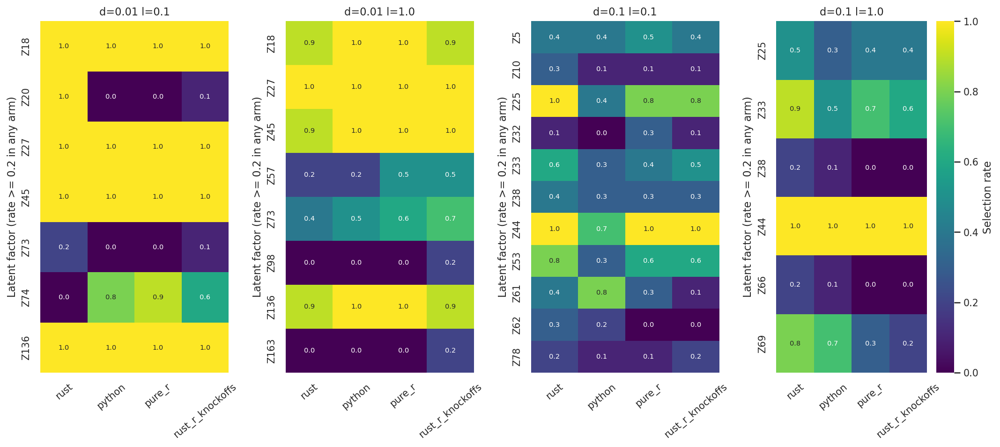
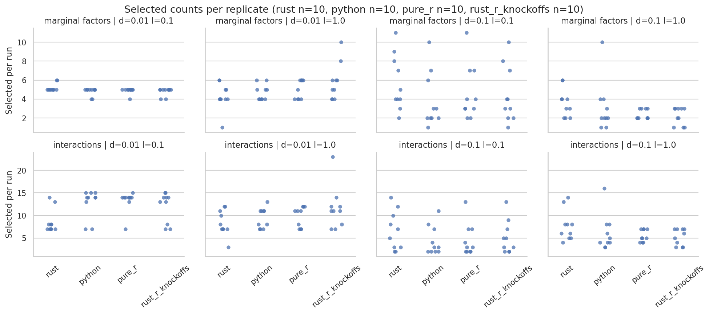
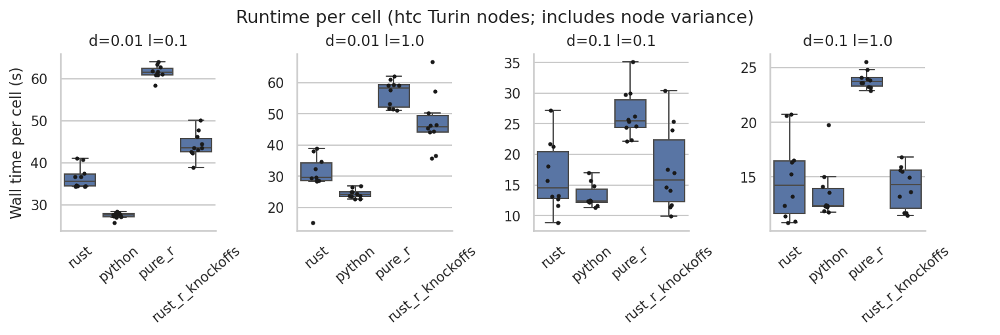

# Four-arm backend statistical analysis

Source: `c4726e3`. Analysis job 11958124 (exit 0) covers 40 runs /
160 successful cells, ten repeats per arm and cell.
Python-with-R-knockoffs is excluded from this four-arm analysis after all ten
tasks timed out; see [completed cells and timeout coverage](SETUP.md#python-with-r-knockoffs-partial-evidence-only).

## Design and scope

Arms: Rust, Python (DSDP), pure R, Rust-with-R-knockoffs. In the harness,
`rust_r_knockoffs` means the Rust CLI with R-generated knockoffs (R SDP and Gaussian draws);
`r_knockoffs` means `slide-py` with Python LOVE and R knockoffs via `rpy2`.
These are distinct arms, as defined in
[`benchmarks/scripts/benchmark_backends.py`](../../scripts/benchmark_backends.py).
The latter arm had no completed statistical analysis and remains excluded.
Delta 0.01/0.1 × lambda 0.1/1.0; 500 iterations, specificity 0.1,
SLIDE selection, parity settings, four workers and one BLAS thread.
Seed labels: 42, 1000 through 9000 by 1000. Fresh pure R is the reference.
See [run setup](SETUP.md)
for the frozen environment, inputs and build.

K and Z agree with R in every completed cell: maximum absolute Z
difference 4.69e-11 (check threshold 1e-8).

## Main findings

At delta 0.01, lambda 0.1, native Rust selects different factors:

| Factor | Rust | Python | Pure R | Rust with R knockoffs |
| --- | ---: | ---: | ---: | ---: |
| Z20 | 10/10 | 0/10 | 0/10 | 1/10 |
| Z74 | 0/10 | 8/10 | 9/10 | 6/10 |

Rust versus R: Fisher BH q=0.000189 for Z20 and 0.001042 for Z74.
Rust versus Python also differs on both factors; Rust versus its R-knockoff
hybrid differs on Z20. No other factor/comparison passes q<0.05 in this
analysis. Neither Python nor the Rust hybrid has a significant per-factor
difference from R. This is not evidence of equivalence.

At that same cell, mean cross-run marginal-set Jaccard with R is 0.660
for Rust, 0.948 for Python and 0.888 for the Rust hybrid. Rust's exploratory
set-permutation p=0.000100; Python p=0.292 and hybrid p=0.305.
The other three Rust-versus-R cells have permutation p>0.05.

No marginal/interaction count comparison passes BH q<0.05 across the
40 count tests. Counts alone miss the Z20/Z74 identity differences.
At delta 0.01, lambda 0.1, median marginal/interaction counts are
5/7.5 (Rust), 5/14 (Python), 5/14 (R), and 5/13.5 (Rust hybrid).

### Runtime

Median wall seconds per cell (ten repeats; per-run values are in
[`timings.csv`](timings.csv)):

| Delta | Lambda | Rust | Python | R | Rust with R knockoffs |
| --- | --- | ---: | ---: | ---: | ---: |
| 0.01 | 0.1 | 35.66 | 27.64 | 61.43 | 43.53 |
| 0.01 | 1.0 | 29.61 | 24.13 | 58.36 | 45.86 |
| 0.1 | 0.1 | 14.49 | 12.35 | 25.49 | 15.85 |
| 0.1 | 1.0 | 14.23 | 12.40 | 23.76 | 14.28 |

Median runtime ratios to R range from 0.51–0.60 for Rust, 0.41–0.52 for
Python, and 0.60–0.79 for the Rust hybrid. All corresponding bootstrap
95% intervals lie below 1; full intervals are in tests.csv.
These are the harness's wall times, not equal-work solver timings.

### Complete Rust-with-R-knockoffs marginal selections

Each entry is the number of the ten runs selecting that marginal factor.
A zero means an estimated factor was never selected; a dash means that index
was not estimated (K=172 at delta=0.01, K=88 at delta=0.1). Factor labels
are local to each delta/lambda cell, not matched identities across deltas. The
CSV contains the full rates, Wilson intervals and adjusted tests.

| Factor | 0.01 / 0.1 | 0.01 / 1.0 | 0.1 / 0.1 | 0.1 / 1.0 |
|---|---:|---:|---:|---:|
| Z5 | 0/10 | 0/10 | 4/10 | 0/10 |
| Z10 | 0/10 | 0/10 | 1/10 | 0/10 |
| Z18 | 10/10 | 9/10 | 0/10 | 0/10 |
| Z20 | 1/10 | 0/10 | 0/10 | 0/10 |
| Z22 | 0/10 | 1/10 | 0/10 | 0/10 |
| Z25 | 0/10 | 0/10 | 8/10 | 4/10 |
| Z26 | 0/10 | 1/10 | 0/10 | 0/10 |
| Z27 | 10/10 | 10/10 | 0/10 | 0/10 |
| Z32 | 0/10 | 0/10 | 1/10 | 0/10 |
| Z33 | 0/10 | 0/10 | 5/10 | 6/10 |
| Z38 | 0/10 | 0/10 | 3/10 | 0/10 |
| Z44 | 0/10 | 0/10 | 10/10 | 10/10 |
| Z45 | 10/10 | 10/10 | 0/10 | 0/10 |
| Z53 | 0/10 | 0/10 | 6/10 | 0/10 |
| Z54 | 0/10 | 1/10 | 0/10 | 0/10 |
| Z57 | 0/10 | 5/10 | 0/10 | 0/10 |
| Z61 | 0/10 | 0/10 | 1/10 | 0/10 |
| Z66 | 0/10 | 0/10 | 1/10 | 0/10 |
| Z69 | 0/10 | 0/10 | 0/10 | 2/10 |
| Z73 | 1/10 | 7/10 | 0/10 | 0/10 |
| Z74 | 6/10 | 0/10 | 0/10 | 0/10 |
| Z76 | 0/10 | 0/10 | 1/10 | 0/10 |
| Z78 | 0/10 | 0/10 | 2/10 | 0/10 |
| Z84 | 0/10 | 0/10 | 1/10 | 0/10 |
| Z98 | 0/10 | 2/10 | — | — |
| Z136 | 10/10 | 9/10 | — | — |
| Z141 | 0/10 | 1/10 | — | — |
| Z163 | 0/10 | 2/10 | — | — |

The ten Rust-hybrid summaries retained in the all-arms run directory match
these frequencies and the per-run values in `timings.csv`.

## Five-arm descriptive heatmap

The [additional heatmap](../2026-10-17_hybrid-selection/README.md) includes
both R-knockoff hybrids, with completed-run denominators and missing-cell
labels. It does not change the four-arm statistical analysis below.

## Outputs

- summary.csv: counts, within-arm overlap and runtime summaries.
- tests.csv: count tests, set comparisons and runtime ratios/intervals.
- factor_rates.csv: selection rates, Wilson intervals, Fisher p/q values.
- timings.csv: per-run measurements and marginal selections.
- z_check.csv: latent-factor alignment check.
- analysis.log: full analysis output.





## Reproduction

These recorded commands require the frozen staging tree and environment below.
Set `OUT` to a new directory before rerunning from the repository root.
For source lookup, see the [revision mapping](../../README.md#source-revisions-after-history-cleanup):

```bash
RUN="$PWD/.tmpfiles/2026-10-16_backend-replicates-all-arms"
OUT="$PWD/benchmarks/results/2026-10-16_backend-replicates"
ENV=/vast/djishnu/Aaron/.tmpfiles/20260902_knockoff-generator-parity/project/.pixi/envs/dev
export TMPDIR="$RUN/scratch" TMP="$RUN/scratch" TEMP="$RUN/scratch"
export MPLCONFIGDIR="$RUN/scratch/mpl" PYTHONDONTWRITEBYTECODE=1
export OPENBLAS_NUM_THREADS=1 OMP_NUM_THREADS=1
"$ENV/bin/python" "$RUN/source/benchmarks/analyze_seed_replicates.py" "$OUT" \
 --arm rust=rust:"$RUN/results/rust" --arm python=python:"$RUN/results/python" \
 --arm pure_r=pure_r:"$RUN/results/pure_r" \
 --arm rust_r_knockoffs=rust_r_knockoffs:"$RUN/results/rust_r_knockoffs" \
 --test rust:pure_r --test python:pure_r --test rust_r_knockoffs:pure_r \
 --test rust:python --test rust:rust_r_knockoffs \
 --z-reference pure_r > "$OUT/analysis.log" 2>&1
```

## Limits

One dataset and ten independent repeats per arm cannot establish equivalence
or FDR control. R PSOCK random streams are not paired by seed label.
The analysis uses 10,000 permutations and bootstrap samples. Per-factor
Fisher BH adjustment covers all five comparisons within each cell; the count
BH correction covers all 40 count tests. Permutation p-values are unadjusted.
The inherited count test uses exact Mann–Whitney despite discrete ties;
treat those p-values cautiously.

Backend timing boundaries differ and include machine/load variation.
The script does not extract knockoff-stage timing for the Rust hybrid;
total wall timing is available. Solver warnings were not exhaustively audited.
The excluded Python hybrid was neither retried nor diagnosed further.
