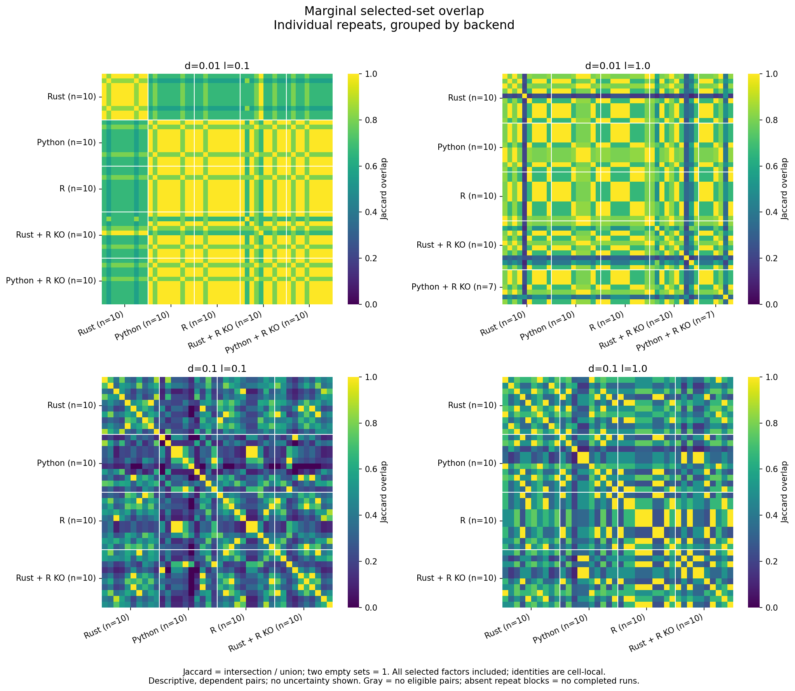

# Backend repeat overlap

Replots the October 16 five-arm SSc campaign, source `c4726e3`, without rerunning
backends. Compared with the October 17 hybrid-selection figure, this run adds
all-selected-set Jaccard comparisons, rather than only factor frequencies.




Each pixel in the repeat view compares two completed runs, ordered as in the
retained inputs and grouped by backend. White lines separate backends; repeat
self-pairs remain on this matrix's diagonal. The backend overview excludes
self-pairs from within-backend averages. [overlap.csv](overlap.csv) records
means, completed-run counts, eligible-pair counts and both-empty-pair counts.
Jaccard is intersection size / union size, with two empty sets defined as 1.
All selected marginals contribute, with no frequency threshold.

Missing backend cells have no repeat block and gray overview entries, not zero
overlap. Python with R knockoffs completed 10/7/0/0 runs; the seven-run cell is
completion-biased. Pairwise values reuse runs, so they are not independent
samples; these figures show no uncertainty or equivalence test. Compare factor
identities within each aligned parameter cell only. Historical SSc positional
sample pairing does not verify biological sample identity.

The saved four-arm timings retain marginal identities but not interaction
sets, so this saved-results view covers marginals only. Full `--arm` analyses
produce separate marginal and interaction overlap figures. No datasets or
parameter cells are pooled. See the original
[campaign and alignment evidence](../2026-10-16_backend-replicates/README.md)
and [Python-hybrid coverage](../2026-10-16_backend-replicates/SETUP.md#python-with-r-knockoffs-partial-evidence-only).

## Reproduce

From the repository root, with NumPy, pandas, SciPy, matplotlib and seaborn:

```bash
python benchmarks/scripts/analyze_seed_replicates.py \
  benchmarks/results/2026-10-19_backend-overlap \
  --saved-selection-results benchmarks/results/2026-10-16_backend-replicates
```

Inputs: retained `timings.csv` plus successful Python-hybrid timing shards and
`sig_LFs.txt` files. The extended-limit rerun is not included.
`factor_rates.csv` retains pointwise Wilson intervals for the frequency plot;
those intervals do not describe uncertainty in Jaccard overlap.
