# SSc/CD4 backend report
Generated 2026-11-02 from the completed production campaign. Backends: pure checked-in R, native Python and native Rust.

## Findings

- **CD4 is consistent at the marginal-selection and prediction level.** Every full fit selects the same marginal factor. Median sampleCV Spearman is about 0.507 for all backends; saved-factor final-CV medians are 0.440 (R), 0.441 (Python), and 0.453 (Rust). Interaction sets are not identical.
- **SSc requires a cell-specific assessment.** At δ=0.01, λ=0.1, R–Python marginal overlap is 0.939 versus R–R overlap 0.907; R–Rust overlap is 0.684. Interaction overlaps are 0.886, 0.850, and 0.493 respectively. These are descriptive means, not independent pairwise observations.
- **The SSc difference is not just factor naming.** All production factor matrices match their cell's R reference within 4.69 × 10⁻¹¹, with identical column names/order. At δ=0.01, λ=0.1, Z20 is selected in 4/20 R, 0/20 Python, and 20/20 Rust fits; Z74 in 18/20, 19/20, and 0/20. The source of those selection differences remains unresolved.
- **SSc 0.1/0.1 is unstable even within R.** R–R marginal Jaccard is 0.433; R–Python and R–Rust are 0.358 and 0.348. Cross-backend overlap alone would overstate the difference without the R repeat baseline.
- **Runtime improves, but the winner depends on the workflow.** Rust has the fastest SSc full fits; Python has the fastest CD4 full fits. Rust has the fastest saved-factor CV jobs except SSc 0.1/0.1, where Python and Rust take about seven minutes.
- **Process success is not score availability.** All 300 full-fit cells and 15 final-CV jobs succeeded. Only 272/300 sampleCV scores are defined: 25 models are too large and three have no selected marginals. Final CV has 450/450 finite branch/repeat scores and no reported imputed predictions.

## Design and denominators

| Experiment | Repetitions | What varies |
|---|---|---|
| Full fitting | 20 seeds × 5 dataset/parameter cells × 3 backends = 300 fits | Selection randomness; each fit includes sampleCV |
| sampleCV | 500 holdouts, K=4, within each full fit | Holdout allocation; selected raw terms stay fixed |
| Saved-factor final CV | 15 repeats × 5 folds × 2 branches per backend/cell | Folds and selection randomness; observed and training-response-permuted branches |
| Final-CV jobs | 5 cells × 3 backends = 15 jobs | One timed job contains all 15 repeats and both branches |

SSc has 24 subjects; CD4 has 2,482. The SSc grid is δ={0.01,0.1}, λ={0.1,1.0}; CD4 uses 0.1/0.1.
Thus **SSc 0.1/0.1 has 20 full-fit runs per backend**, plus 15 final-CV repeats per backend.

Final CV uses one predetermined R pilot factor matrix (seed 42) per cell, shared by backends. It does not evaluate all 20 fitted factor sets. Equal numeric full-fit seeds do not match cross-language random draws; final-CV folds are independent across backends. Neither experiment supplies independent biological replication.

The full-fit sampleCV scores condition on terms selected using the full dataset. Final CV conditions on a fixed full-data factor representation. Neither is a fully nested, end-to-end external validation estimate. Do not compare their score levels as though they evaluated the same procedure.

## 1. Latent-factor selection

Each dot in the count plots represents one full fit; zeros remain in the distribution. Counts below are medians over 20 seeds.

| dataset | cell | backend | Marginals (median) | Interactions (median) |
|---|---|---|---|---|
| SSC | d=0.01 l=0.1 | pure_r | 5.000 | 14.000 |
| SSC | d=0.01 l=1.0 | pure_r | 5.000 | 12.000 |
| SSC | d=0.1 l=0.1 | pure_r | 4.000 | 5.000 |
| SSC | d=0.1 l=1.0 | pure_r | 3.000 | 6.500 |
| SSC | d=0.01 l=0.1 | python | 5.000 | 14.000 |
| SSC | d=0.01 l=1.0 | python | 5.000 | 11.000 |
| SSC | d=0.1 l=0.1 | python | 2.500 | 3.000 |
| SSC | d=0.1 l=1.0 | python | 3.000 | 7.000 |
| SSC | d=0.01 l=0.1 | rust | 5.000 | 8.000 |
| SSC | d=0.01 l=1.0 | rust | 5.000 | 11.000 |
| SSC | d=0.1 l=0.1 | rust | 2.000 | 3.000 |
| SSC | d=0.1 l=1.0 | rust | 4.000 | 8.000 |
| CD4 | d=0.1 l=0.1 | pure_r | 1.000 | 3.000 |
| CD4 | d=0.1 l=0.1 | python | 1.000 | 2.000 |
| CD4 | d=0.1 l=0.1 | rust | 1.000 | 3.000 |

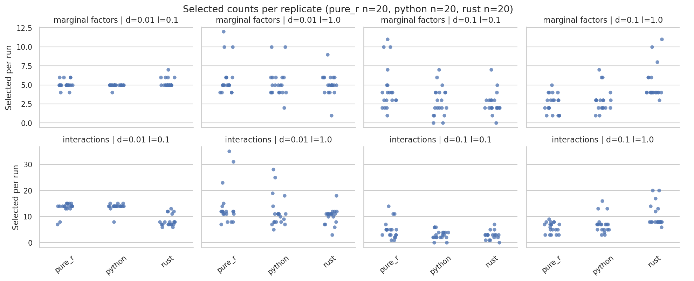

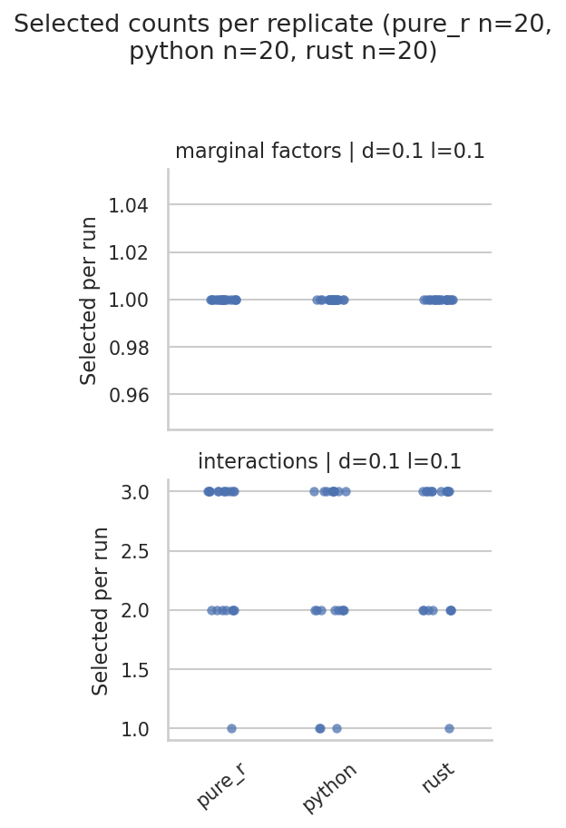

### Which factors recur?

Heatmaps show marginal factors selected in at least 20% of runs in any backend; CSV tables include every observed factor. Factor IDs are local to a cell and must not be matched across parameter settings. Rates are selected/20; pointwise Wilson 95% intervals are in each dataset's `factor_rates.csv`. Those intervals describe seed variability conditional on this dataset, not population uncertainty.

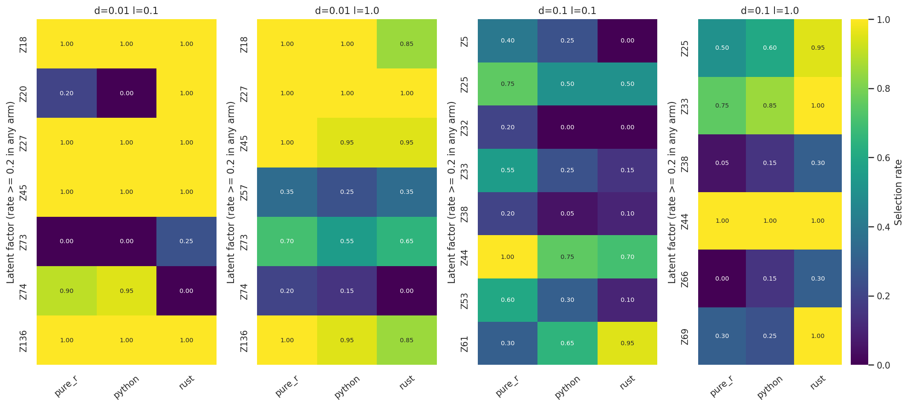

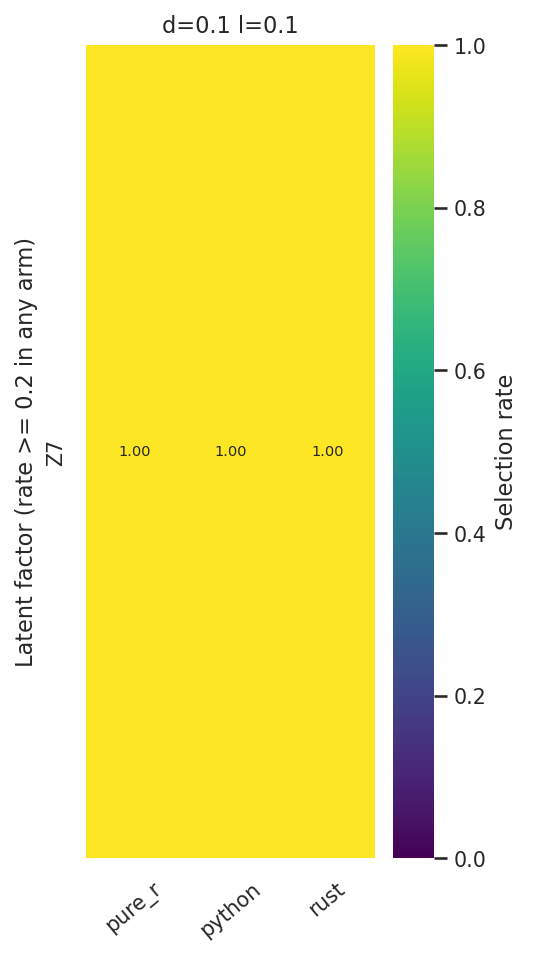

### Stability relative to R's own variability

Jaccard = intersection/union. Within-R means use 190 distinct seed pairs; cross-backend means use 400 pairs. These pairs are dependent and are not the sample size for inference. Two empty sets receive Jaccard 1; empty-pair counts are retained in `overlap.csv`.

| dataset | cell | kind | R–R | R–Python | R–Rust |
|---|---|---|---|---|---|
| CD4 | d=0.1 l=0.1 | interaction | 0.792 | 0.733 | 0.767 |
| CD4 | d=0.1 l=0.1 | marginal | 1.000 | 1.000 | 1.000 |
| SSC | d=0.01 l=0.1 | interaction | 0.850 | 0.886 | 0.493 |
| SSC | d=0.01 l=0.1 | marginal | 0.907 | 0.939 | 0.684 |
| SSC | d=0.01 l=1.0 | interaction | 0.587 | 0.585 | 0.605 |
| SSC | d=0.01 l=1.0 | marginal | 0.719 | 0.718 | 0.685 |
| SSC | d=0.1 l=0.1 | interaction | 0.425 | 0.357 | 0.338 |
| SSC | d=0.1 l=0.1 | marginal | 0.433 | 0.358 | 0.348 |
| SSC | d=0.1 l=1.0 | interaction | 0.673 | 0.664 | 0.616 |
| SSC | d=0.1 l=1.0 | marginal | 0.584 | 0.595 | 0.543 |

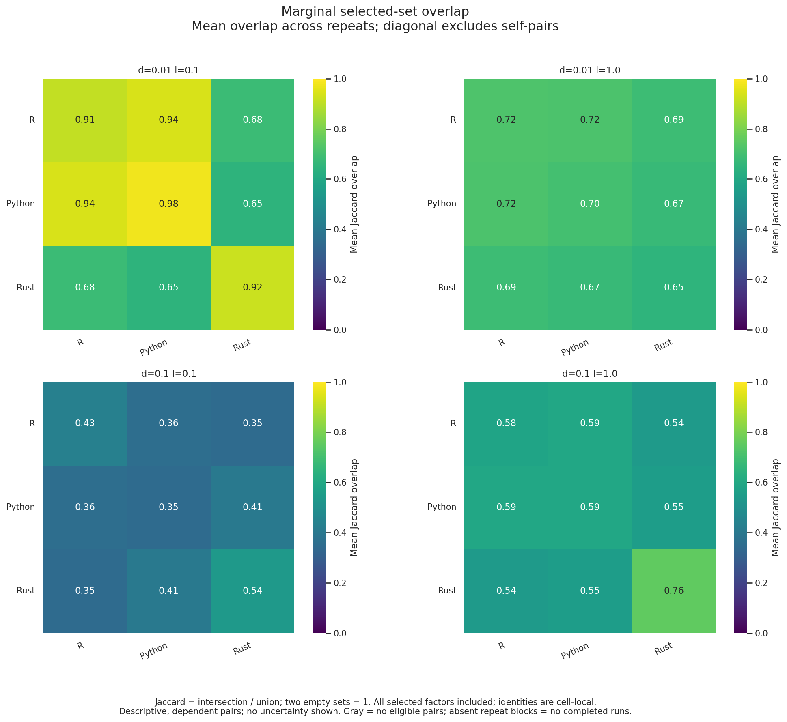

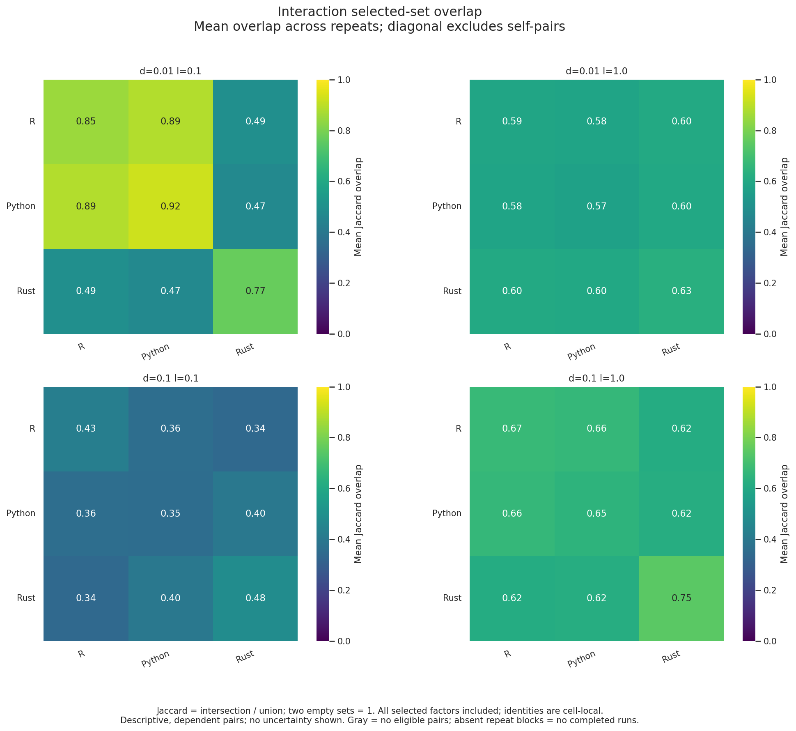

## 2. Runtime and memory

Full-fit times include fresh-process startup, imports and sampleCV. Table values are median [Q1,Q3] in seconds, not confidence intervals. Runtime plots use different y-axis ranges between cells; compare absolute values using the table.

| dataset | cell | backend | Median seconds | Q1 | Q3 |
|---|---|---|---|---|---|
| SSC | d=0.01 l=0.1 | pure_r | 61.125 | 60.187 | 63.517 |
| SSC | d=0.01 l=1.0 | pure_r | 58.244 | 54.441 | 65.528 |
| SSC | d=0.1 l=0.1 | pure_r | 23.391 | 21.427 | 25.741 |
| SSC | d=0.1 l=1.0 | pure_r | 21.445 | 19.287 | 23.544 |
| SSC | d=0.01 l=0.1 | python | 49.657 | 46.525 | 53.652 |
| SSC | d=0.01 l=1.0 | python | 47.736 | 42.368 | 52.532 |
| SSC | d=0.1 l=0.1 | python | 18.684 | 15.565 | 22.042 |
| SSC | d=0.1 l=1.0 | python | 18.793 | 17.132 | 20.455 |
| SSC | d=0.01 l=0.1 | rust | 16.296 | 15.951 | 16.987 |
| SSC | d=0.01 l=1.0 | rust | 15.571 | 14.722 | 16.392 |
| SSC | d=0.1 l=0.1 | rust | 5.058 | 4.870 | 5.658 |
| SSC | d=0.1 l=1.0 | rust | 7.218 | 6.925 | 8.306 |
| CD4 | d=0.1 l=0.1 | pure_r | 60.690 | 59.914 | 62.378 |
| CD4 | d=0.1 l=0.1 | python | 17.169 | 16.614 | 18.021 |
| CD4 | d=0.1 l=0.1 | rust | 33.542 | 29.727 | 34.869 |

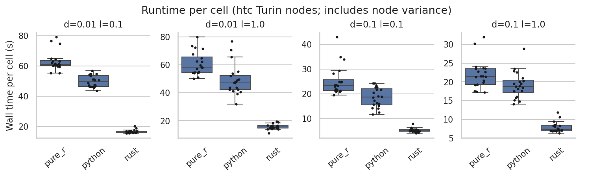

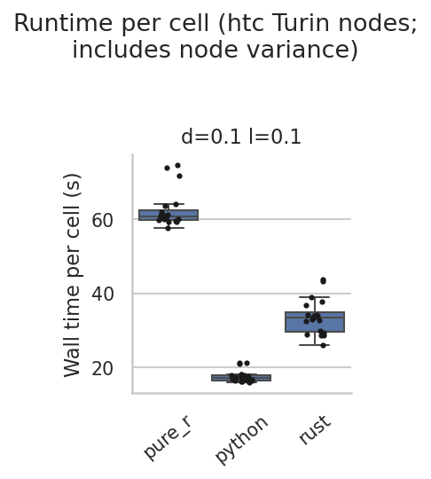

Native/R median-time ratios and exploratory 95% independent-run bootstrap intervals (10,000 resamples) are in `tests.csv`, rows with kind `runtime`; invert the ratios for speedups. SSc Rust speedups range from 2.97× to 4.62×, Python from 1.14× to 1.25×. CD4 speedups are 3.53× for Python and 1.81× for Rust.

R full fitting also constructs upsilon submodels that the exported sampleCV terms do not use. Timing therefore compares implementations and their work, not equal instruction counts. Node and system variance remain in the measurements.

### Final-CV whole-job runtime

One timing observation per cell/backend includes all 15 repeats and both branches. There is no between-job uncertainty estimate. Peak memory is GiB.

| dataset | cell | arm | peak_gib | minutes |
|---|---|---|---|---|
| SSC | d=0.01 l=0.1 | pure_r | 2.396 | 64.374 |
| SSC | d=0.01 l=1.0 | pure_r | 2.423 | 55.330 |
| SSC | d=0.1 l=0.1 | pure_r | 3.256 | 24.102 |
| SSC | d=0.1 l=1.0 | pure_r | 2.336 | 25.548 |
| SSC | d=0.01 l=0.1 | python | 1.518 | 17.199 |
| SSC | d=0.01 l=1.0 | python | 1.542 | 17.981 |
| SSC | d=0.1 l=0.1 | python | 1.175 | 6.977 |
| SSC | d=0.1 l=1.0 | python | 1.177 | 8.474 |
| SSC | d=0.01 l=0.1 | rust | 0.124 | 16.437 |
| SSC | d=0.01 l=1.0 | rust | 0.121 | 16.155 |
| SSC | d=0.1 l=0.1 | rust | 0.093 | 7.014 |
| SSC | d=0.1 l=1.0 | rust | 0.089 | 7.037 |
| CD4 | d=0.1 l=0.1 | pure_r | 2.784 | 26.193 |
| CD4 | d=0.1 l=0.1 | python | 1.046 | 12.689 |
| CD4 | d=0.1 l=0.1 | rust | 0.341 | 9.235 |

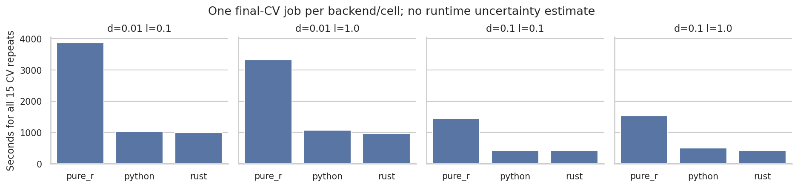

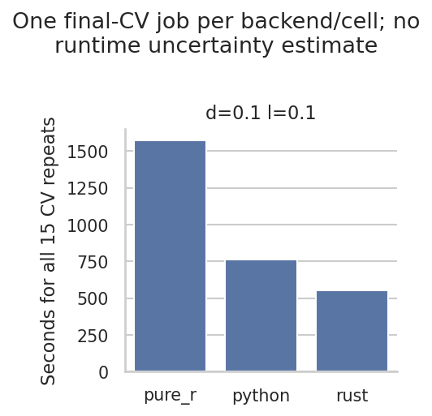

### Full-fit memory

Sampled process-group RSS can double-count shared pages and miss short peaks; it is not a cgroup peak or a stage-specific allocation. Values below are median and maximum GiB over 20 fits.

| dataset | cell | arm | median | max |
|---|---|---|---|---|
| CD4 | d=0.1 l=0.1 | pure_r | 1.660 | 1.668 |
| CD4 | d=0.1 l=0.1 | python | 1.251 | 1.264 |
| CD4 | d=0.1 l=0.1 | rust | 0.395 | 0.397 |
| SSC | d=0.01 l=0.1 | pure_r | 1.401 | 1.434 |
| SSC | d=0.01 l=0.1 | python | 1.139 | 1.150 |
| SSC | d=0.01 l=0.1 | rust | 0.125 | 0.132 |
| SSC | d=0.01 l=1.0 | pure_r | 1.415 | 1.437 |
| SSC | d=0.01 l=1.0 | python | 1.132 | 1.248 |
| SSC | d=0.01 l=1.0 | rust | 0.117 | 0.119 |
| SSC | d=0.1 l=0.1 | pure_r | 1.328 | 1.343 |
| SSC | d=0.1 l=0.1 | python | 1.058 | 1.110 |
| SSC | d=0.1 l=0.1 | rust | 0.100 | 0.105 |
| SSC | d=0.1 l=1.0 | pure_r | 1.324 | 1.346 |
| SSC | d=0.1 l=1.0 | python | 1.073 | 1.149 |
| SSC | d=0.1 l=1.0 | rust | 0.103 | 0.106 |

## 3. Performance

### Full-fit sampleCV

These are pooled held-out Spearman correlations conditional on the full-fit selected terms. Missing scores are not zeros. Medians and quartiles below describe only valid runs; the adjacent denominator is essential. In particular, SSc 0.01/0.1 has different valid-run fractions across backends, so a valid-only score ranking is selection-biased.

| dataset | cell | arm | valid/attempted | median | q1 | q3 |
|---|---|---|---|---|---|---|
| SSC | d=0.01 l=0.1 | pure_r | 13/20 | 0.162 | 0.148 | 0.183 |
| SSC | d=0.01 l=0.1 | python | 17/20 | 0.137 | 0.117 | 0.160 |
| SSC | d=0.01 l=0.1 | rust | 20/20 | 0.690 | 0.572 | 0.716 |
| SSC | d=0.01 l=1.0 | pure_r | 15/20 | 0.227 | 0.198 | 0.538 |
| SSC | d=0.01 l=1.0 | python | 15/20 | 0.725 | 0.365 | 0.753 |
| SSC | d=0.01 l=1.0 | rust | 19/20 | 0.384 | 0.242 | 0.684 |
| SSC | d=0.1 l=0.1 | pure_r | 19/20 | 0.671 | 0.517 | 0.701 |
| SSC | d=0.1 l=0.1 | python | 18/20 | 0.673 | 0.628 | 0.710 |
| SSC | d=0.1 l=0.1 | rust | 19/20 | 0.673 | 0.621 | 0.692 |
| SSC | d=0.1 l=1.0 | pure_r | 20/20 | 0.579 | 0.554 | 0.610 |
| SSC | d=0.1 l=1.0 | python | 20/20 | 0.593 | 0.553 | 0.606 |
| SSC | d=0.1 l=1.0 | rust | 17/20 | 0.529 | 0.520 | 0.535 |
| CD4 | d=0.1 l=0.1 | pure_r | 20/20 | 0.507 | 0.506 | 0.508 |
| CD4 | d=0.1 l=0.1 | python | 20/20 | 0.507 | 0.506 | 0.507 |
| CD4 | d=0.1 l=0.1 | rust | 20/20 | 0.507 | 0.506 | 0.507 |

| cell | arm | status | runs | dataset |
|---|---|---|---|---|
| d=0.01 l=0.1 | pure_r | model_too_large | 7 | SSC |
| d=0.01 l=0.1 | pure_r | ok | 13 | SSC |
| d=0.01 l=0.1 | python | model_too_large | 3 | SSC |
| d=0.01 l=0.1 | python | ok | 17 | SSC |
| d=0.01 l=0.1 | rust | ok | 20 | SSC |
| d=0.01 l=1.0 | pure_r | model_too_large | 5 | SSC |
| d=0.01 l=1.0 | pure_r | ok | 15 | SSC |
| d=0.01 l=1.0 | python | model_too_large | 5 | SSC |
| d=0.01 l=1.0 | python | ok | 15 | SSC |
| d=0.01 l=1.0 | rust | model_too_large | 1 | SSC |
| d=0.01 l=1.0 | rust | ok | 19 | SSC |
| d=0.1 l=0.1 | pure_r | model_too_large | 1 | SSC |
| d=0.1 l=0.1 | pure_r | ok | 19 | SSC |
| d=0.1 l=0.1 | python | no_marginals | 2 | SSC |
| d=0.1 l=0.1 | python | ok | 18 | SSC |
| d=0.1 l=0.1 | rust | no_marginals | 1 | SSC |
| d=0.1 l=0.1 | rust | ok | 19 | SSC |
| d=0.1 l=1.0 | pure_r | ok | 20 | SSC |
| d=0.1 l=1.0 | python | ok | 20 | SSC |
| d=0.1 l=1.0 | rust | model_too_large | 3 | SSC |
| d=0.1 l=1.0 | rust | ok | 17 | SSC |
| d=0.1 l=0.1 | pure_r | ok | 20 | CD4 |
| d=0.1 l=0.1 | python | ok | 20 | CD4 |
| d=0.1 l=0.1 | rust | ok | 20 | CD4 |

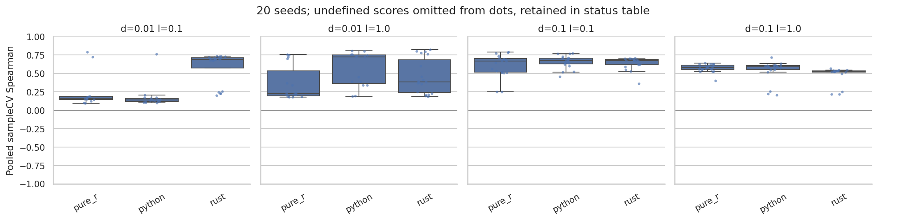

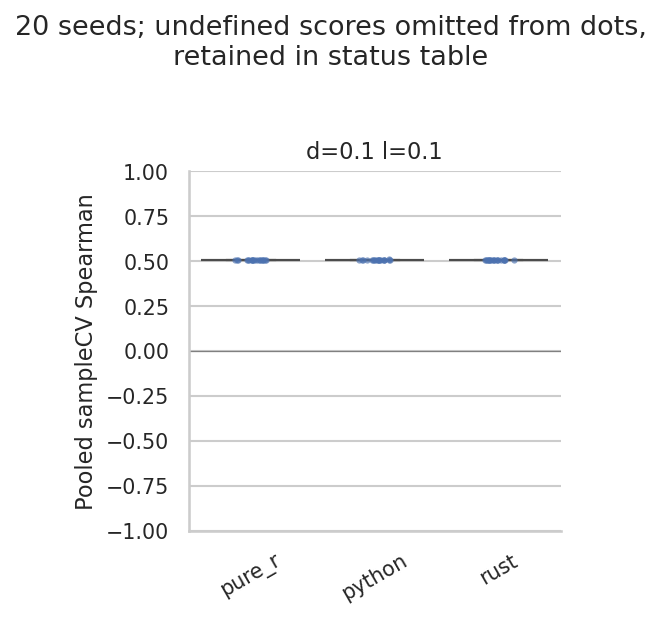

### Saved-factor final CV

Table entries are median Spearman over 15 repeats. SLIDE is observed-response training; SLIDE_y permutes the training response. Both use held-out targets for evaluation. The figures show all repeats and boxes spanning Q1–Q3, with median lines and 1.5-IQR whiskers. They are distributions of repeat variation, not confidence intervals. Correlation axes share −1 to 1.

| dataset | cell | arm | SLIDE | SLIDE_y |
|---|---|---|---|---|
| CD4 | d=0.1 l=0.1 | pure_r | 0.440 | 0.001 |
| CD4 | d=0.1 l=0.1 | python | 0.441 | 0.049 |
| CD4 | d=0.1 l=0.1 | rust | 0.453 | 0.007 |
| SSC | d=0.01 l=0.1 | pure_r | 0.466 | 0.045 |
| SSC | d=0.01 l=0.1 | python | 0.384 | 0.016 |
| SSC | d=0.01 l=0.1 | rust | 0.415 | -0.059 |
| SSC | d=0.01 l=1.0 | pure_r | 0.442 | -0.068 |
| SSC | d=0.01 l=1.0 | python | 0.415 | 0.019 |
| SSC | d=0.01 l=1.0 | rust | 0.415 | -0.126 |
| SSC | d=0.1 l=0.1 | pure_r | 0.253 | 0.068 |
| SSC | d=0.1 l=0.1 | python | 0.271 | 0.030 |
| SSC | d=0.1 l=0.1 | rust | 0.185 | -0.090 |
| SSC | d=0.1 l=1.0 | pure_r | 0.286 | 0.061 |
| SSC | d=0.1 l=1.0 | python | 0.288 | 0.026 |
| SSC | d=0.1 l=1.0 | rust | 0.344 | 0.022 |

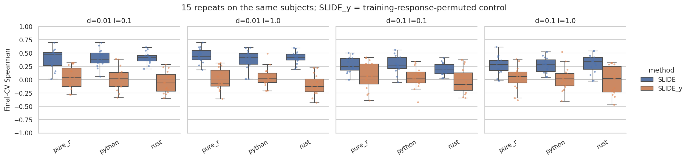

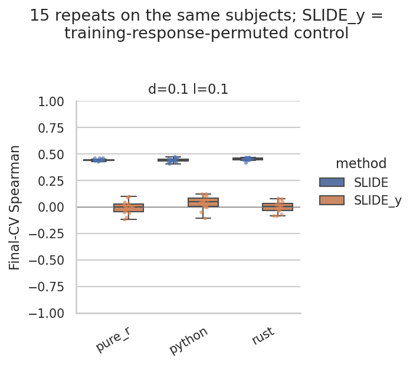

CD4 observed scores exceed the permuted-control range in every backend. SSc has much wider repeat variation and overlap with controls. The δ=0.01 SSc cells have higher median observed correlations than δ=0.1 in these runs, but selecting a preferred configuration from this comparison requires separate validation.

### Error magnitude

MSE uses fold-standardized targets. Correlation does not capture calibration: some SSc repeats have large errors despite positive rank correlation. The MSE figures use a shared logarithmic y-axis within each dataset to expose those tails. Complete summaries are in `finalcv_mse.csv`.

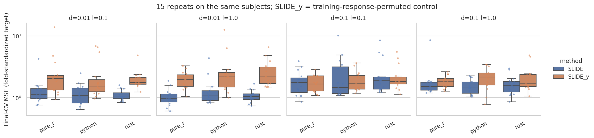

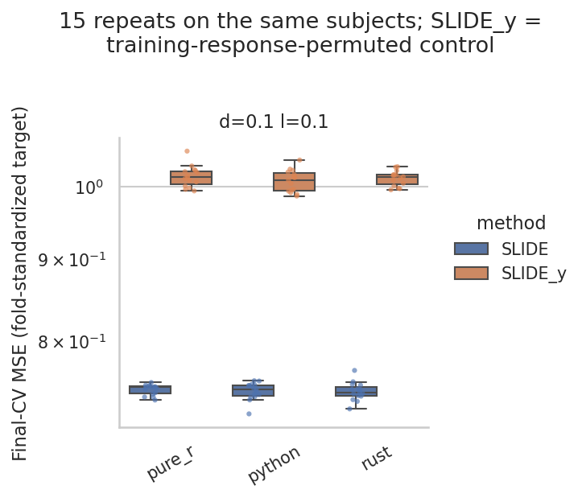

## Verification and limits

- All 300 full-fit records have successful timing status; 20 runs per backend/cell enter selection and runtime summaries.
- All factor matrices and ordered factor names match the per-cell R reference to tolerance 1e-8; observed maximum difference is 4.69 × 10⁻¹¹.
- All 15 final-CV jobs were checked against prediction CSVs. All 450 branch/repeat correlations and MSEs reproduce within absolute tolerance 1e-8; every exported sample occurs once per branch/repeat across five folds.
- All 450 repeat scores are finite, with zero reported imputed predictions. Rust does not export a per-repeat status field; it is marked `not_exported`, not invented as `ok`.
- Full-fit sampleCV scores were read from their dedicated artifacts, never from the legacy in-sample `score` column. Production sampleCV predictions were not independently rescored in this report.
- No equivalence margins were agreed. Similar medians, overlapping distributions or nonsignificant tests cannot establish interchangeability.
- Selection-count and per-factor tests from the existing analyzer are exploratory. Its exact Mann–Whitney calculation does not correct for tied counts, and its multiple-testing families do not span both datasets. This report does not use those p-values for conclusions.
- Native marginal size-limit retries reuse seeds, unlike R. Retry incidence and solver-level causes of the SSc differences have not been audited here.
- There is no known-truth experiment here, so this report makes no FDR or power claim.
- No benchmark jobs were submitted, rerun or altered for this report.

## Recommended next step

Investigate SSc δ=0.01, λ=0.1 first: the R/Python versus Rust Z20/Z74 selection reversal is large despite matching factor matrices. Compare candidate statistics, selection frequencies and retry logs before attributing it to RNG or solvers. Treat SSc 0.1/0.1 separately because the R baseline is already unstable.

## Files and reproduction

This directory is the report parent. `ssc/` and `cd4/` contain the same tables/figures for their respective datasets. In addition to linked figures, `overlap_*_repeats.png` show every seed-pair comparison; `timings.csv` retains the legacy in-sample score solely for compatibility. Use `samplecv_runs.csv` and `finalcv_repeats.csv` for held-out metrics.

Inputs are the campaign's `full-fit/` and `cv/` trees. The executed benchmark source is `d5c9d675c28ba63a7594fc8c5f1387af7459fc44`; see the parent campaign README for frozen binaries, settings and provenance. The report uses the maintained analyzer from this report's Git commit. No model fitting occurs in the commands below.

From the repository root:

```bash
source benchmarks/results/2026-11-01_ssc-cd4-backends/environment.sh
OUT="$RUN/analysis/2026-11-02_backend-report"
for DATA in ssc cd4; do
  CELLS=4; [ "$DATA" = cd4 ] && CELLS=1
  python benchmarks/scripts/analyze_seed_replicates.py "$OUT/$DATA" \
    --arm "pure_r=pure_r:$RUN/full-fit/$DATA/pure_r" \
    --arm "python=python:$RUN/full-fit/$DATA/python" \
    --arm "rust=rust:$RUN/full-fit/$DATA/rust" \
    --test python:pure_r --test rust:pure_r \
    --min-runs 20 --expected-cells "$CELLS" \
    --z-reference pure_r --cv-root "$RUN/cv/$DATA"
done
```

The commands regenerate CSVs and figures; this README supplies the interpretation and tables transcribed from those CSVs. Bootstrap seed is 0. Factor heatmaps suppress never/rarely selected rows only in the display, not in the underlying observed-factor CSV.
