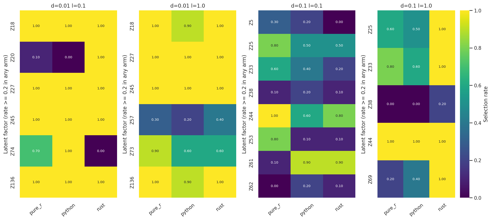
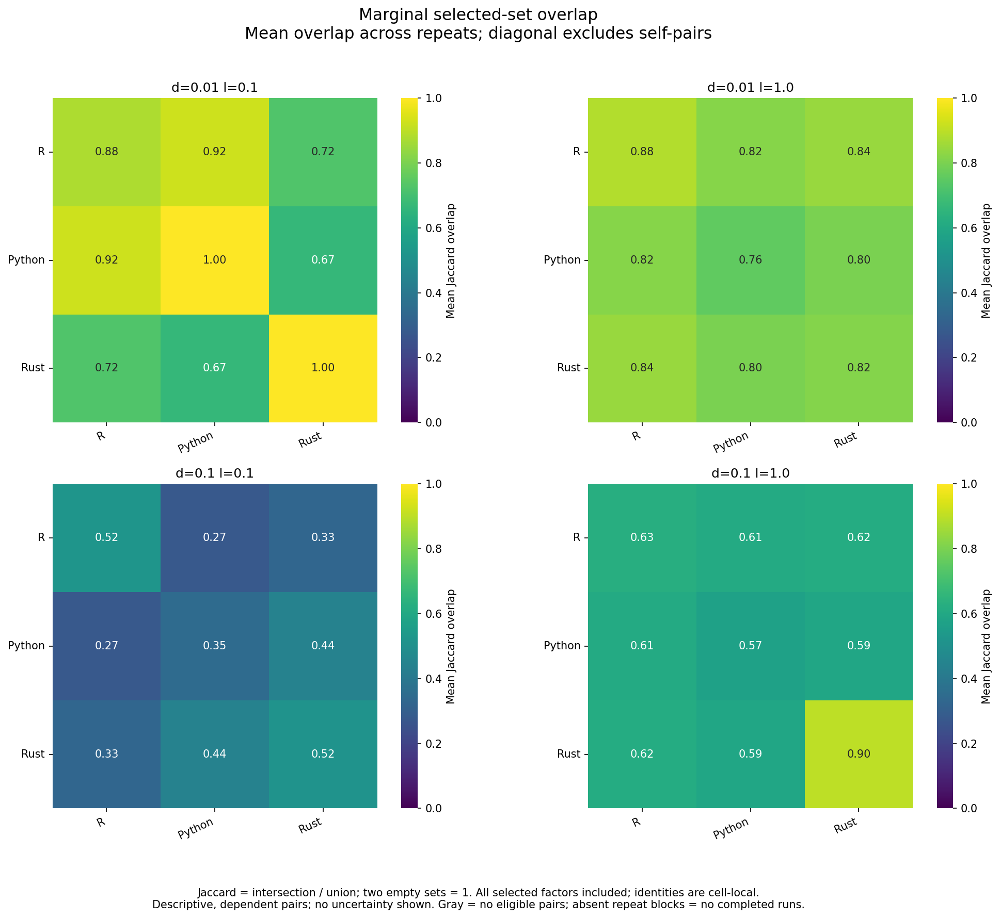
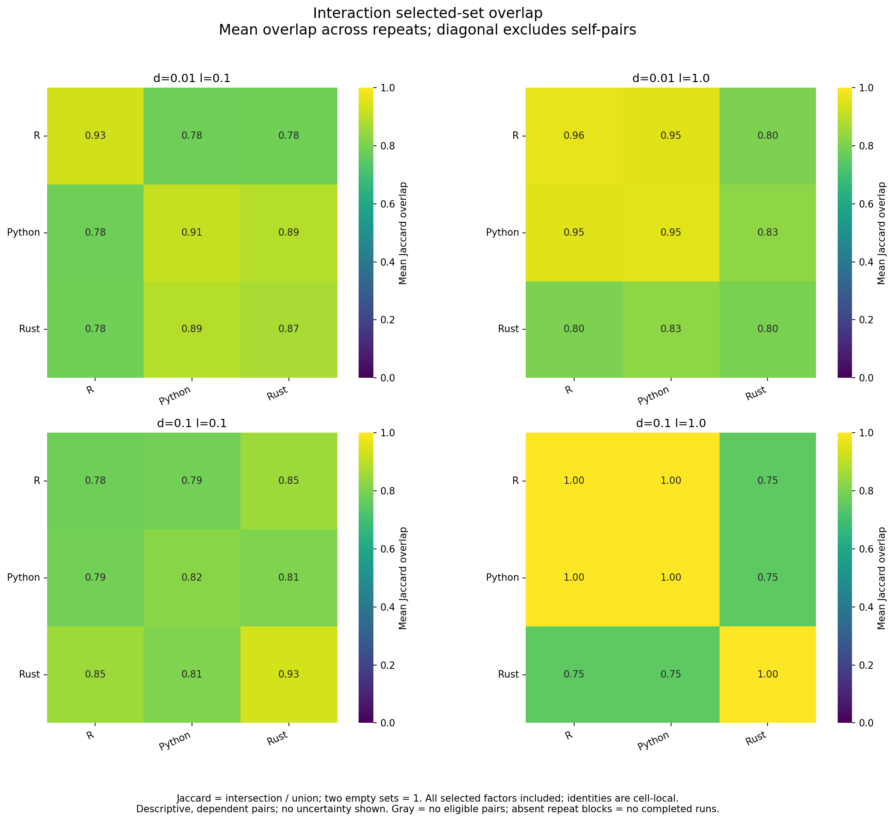
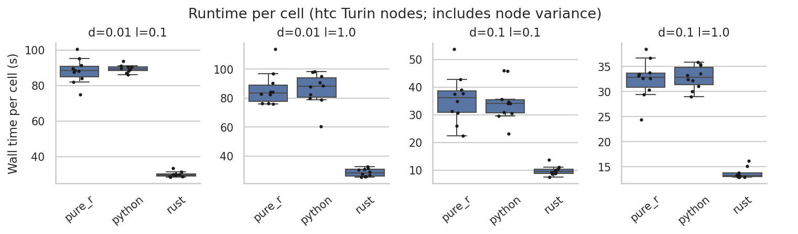
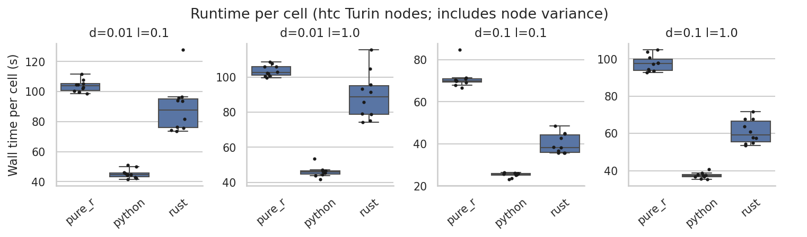

# SSc/CD4 full-fitting review

Review date: 2026-11-02. All **240/240 full-fit cells succeeded**: two datasets,
four delta/lambda settings, three backends and ten seeds. Each fit uses 1,000
knockoff-selection draws and sampleCV with 500 holdouts, K=4. **Final CV is
excluded from this review**, regardless of its scheduler progress.

## Findings

- **CD4 marginal selection agrees across all four settings.** All native/R and
  within-R marginal Jaccards are 1.000. The selected sets differ between
  parameter settings, so this is not one universal CD4 factor set.
- **CD4 interaction agreement is incomplete.** At delta=0.1, lambda=1.0, R and
  Python select the same three interactions in every run. Rust selects those
  three plus Z30–Z25 in all ten runs, giving Jaccard 0.750. This is a reproducible
  disagreement worth tracing; its mechanism is not established here.
- **SSc retains the Z20/Z74 discrepancy.** At delta=0.01, lambda=0.1, R/Python/Rust
  select Z20 in 1/0/10 runs and Z74 in 7/10/0 runs. R–Rust marginal overlap is
  0.723, compared with R–Python 0.923 and R–R 0.876.
- **SSc delta=0.1, lambda=0.1 is the weakest agreement cell.** Marginal overlap
  is 0.274 for R–Python and 0.326 for R–Rust, below R–R 0.521. R instability
  matters, but does not account for the entire descriptive overlap deficit.
- **The runtime winner depends on the dataset.** Rust is fastest in all SSc
  cells; Python is fastest in all CD4 cells. Python and R take similar time on
  SSc. These are full workflows, not equal-work solver measurements.
- **236/240 sampleCV scores are defined.** Three SSc models exceed the screening
  size limit; one Python SSc fit has no selected marginals. Missing scores stay
  in denominators and are not zeros.
- **No logged marginal size-cap retry occurred.** These fits therefore provide
  no observed exercise of the corrected marginal retry path. R/Rust logs also
  show no interaction size-cap retries; Python does not log ordinary interaction
  retries, so its interaction retry incidence is unavailable.

## Design and limits

SSc has 24 subjects and 804 features; CD4 has 2,482 subjects and 1,776 features.
Both use delta {0.01, 0.1} × lambda {0.1, 1.0}, homogeneous LOVE, continuous
responses, Spearman screening, FDR 0.1, specificity 0.1, interactions and
`findOptIter`. The runs use checked-in R, native Python and native Rust, not
hybrid backends. Each fit has four workers and one BLAS thread per worker.
The frozen fitting revision is `81e1fc9`.

The ten seeds are the first ten from the previous production schedule. Equal
numeric seeds do not pair cross-language random draws. These are repeated
computations on two fixed datasets, not independent biological replication.
SSc uses the user-confirmed positional sample mapping; CD4 IDs match by order.

All factor matrices pass the approved absolute alignment tolerance 1e-6.
The CD4 0.1/1.0 native/R difference is about 2.02e-7; the other settings agree
within about 4.7e-11. The user approved the looser tolerance after observing the
pilot difference. Acceptance is not exact equality, an equivalence margin or
proof that this numerical difference cannot affect selection.

Within-R mean Jaccards use 45 distinct run pairs; cross-backend means use 100
pairs. These pairs reuse runs and are dependent. Two empty sets count as 1;
`overlap.csv` retains empty-pair counts. All selected factors contribute to
Jaccard, including factors absent from the frequency heatmaps. Factor IDs are
local to a dataset/parameter cell.

## 1. Selected marginal factors

| Dataset | delta / lambda | R–R | R–Python | R–Rust |
|---|---|---:|---:|---:|
| SSc | 0.01 / 0.1 | 0.876 | 0.923 | 0.723 |
| SSc | 0.01 / 1.0 | 0.884 | 0.818 | 0.845 |
| SSc | 0.1 / 0.1 | 0.521 | 0.274 | 0.326 |
| SSc | 0.1 / 1.0 | 0.628 | 0.607 | 0.615 |
| CD4 | 0.01 / 0.1 | 1.000 | 1.000 | 1.000 |
| CD4 | 0.01 / 1.0 | 1.000 | 1.000 | 1.000 |
| CD4 | 0.1 / 0.1 | 1.000 | 1.000 | 1.000 |
| CD4 | 0.1 / 1.0 | 1.000 | 1.000 | 1.000 |



Heatmap values are selected/10. Factors appear when selected in at least 20%
of runs in any backend. Pointwise Wilson intervals in `factor_rates.csv`
describe seed variability conditional on this dataset, not population uncertainty.



### CD4 selected sets

Every backend selects these sets in every run within its cell:

| delta / lambda | Marginal set |
|---|---|
| 0.01 / 0.1 | Z4, Z13, Z20, Z31 |
| 0.01 / 1.0 | Z4, Z13, Z19, Z20 |
| 0.1 / 0.1 | Z7 |
| 0.1 / 1.0 | Z2, Z7, Z30 |

[CD4 factor-rate figure](cd4/factor_rates.png) and
[marginal overlap figure](cd4/overlap_marginal_backends.png) show the same
agreement. A table is more compact than an all-one heatmap for the root README.

## 2. Selected interactions

| Dataset | delta / lambda | R–R | R–Python | R–Rust |
|---|---|---:|---:|---:|
| SSc | 0.01 / 0.1 | 0.730 | 0.812 | 0.627 |
| SSc | 0.01 / 1.0 | 0.889 | 0.790 | 0.810 |
| SSc | 0.1 / 0.1 | 0.479 | 0.263 | 0.305 |
| SSc | 0.1 / 1.0 | 0.702 | 0.683 | 0.710 |
| CD4 | 0.01 / 0.1 | 0.928 | 0.779 | 0.782 |
| CD4 | 0.01 / 1.0 | 0.962 | 0.951 | 0.801 |
| CD4 | 0.1 / 0.1 | 0.778 | 0.787 | 0.853 |
| CD4 | 0.1 / 1.0 | 1.000 | 1.000 | 0.750 |



At CD4 0.1/1.0 the shared interactions are Z30–Z27, Z7–Z27 and Z7–Z9; Rust
adds Z30–Z25. Separators in raw exports differ (`.` versus `:`); the analyzer
normalizes interactions before comparing sets. This difference is not naming.

[SSc interaction overlap](ssc/overlap_interaction_backends.png) and the
[SSc](ssc/counts.png)/[CD4](cd4/counts.png) count plots provide the remaining
selection views. Counts alone do not identify which factors differ.

## 3. Full-fit runtime and memory

Median fresh-process wall seconds over ten runs; `summary.csv` includes Q1/Q3.
Times include imports, fitting, exports and sampleCV, with profiling enabled.
They are not selection-stage-only timings. Runtime panels use different y-axis
ranges; use the table for absolute cross-cell comparisons.

| Dataset | delta / lambda | R seconds | Python seconds | Rust seconds |
|---|---|---:|---:|---:|
| SSc | 0.01 / 0.1 | 88.31 | 89.38 | 29.83 |
| SSc | 0.01 / 1.0 | 83.56 | 88.32 | 28.50 |
| SSc | 0.1 / 0.1 | 36.25 | 34.22 | 9.58 |
| SSc | 0.1 / 1.0 | 32.89 | 32.85 | 13.31 |
| CD4 | 0.01 / 0.1 | 103.81 | 44.69 | 87.57 |
| CD4 | 0.01 / 1.0 | 102.57 | 45.92 | 88.66 |
| CD4 | 0.1 / 0.1 | 69.95 | 25.72 | 38.24 |
| CD4 | 0.1 / 1.0 | 97.55 | 37.47 | 59.30 |





Median process-group peak RSS ranges across the four cells, in GiB:

| Dataset | R | Python | Rust |
|---|---:|---:|---:|
| SSc | 1.333–1.437 | 1.057–1.139 | 0.091–0.115 |
| CD4 | 1.644–1.678 | 1.251–1.295 | about 0.386 |

RSS sampling can miss peaks and double-count shared pages; it is not cgroup
peak memory. Five nodes contributed runs, so node/system variation remains.
R also constructs upsilon submodels not used by the exported raw-term sampleCV;
the timing comparison includes implementation-specific work. Profiling overhead
is unmeasured and filesystem/library caches were not flushed.

## 4. Full-fit sampleCV, not final CV

Each entry is median pooled held-out Spearman **[valid/10 fits]**, read from the
exported sampleCV artifacts. Every holdout uses terms selected from the full
dataset. These scores are screening diagnostics, not fully nested external
validation. The review did not recompute metrics from prediction CSVs.

| Dataset | delta / lambda | R | Python | Rust |
|---|---|---:|---:|---:|
| SSc | 0.01 / 0.1 | 0.188 [8/10] | 0.148 [9/10] | 0.685 [10/10] |
| SSc | 0.01 / 1.0 | 0.200 [10/10] | 0.384 [10/10] | 0.293 [10/10] |
| SSc | 0.1 / 0.1 | 0.637 [10/10] | 0.653 [9/10] | 0.665 [10/10] |
| SSc | 0.1 / 1.0 | 0.592 [10/10] | 0.610 [10/10] | 0.523 [10/10] |
| CD4 | 0.01 / 0.1 | 0.554 [10/10] | 0.553 [10/10] | 0.553 [10/10] |
| CD4 | 0.01 / 1.0 | 0.568 [10/10] | 0.568 [10/10] | 0.568 [10/10] |
| CD4 | 0.1 / 0.1 | 0.507 [10/10] | 0.507 [10/10] | 0.507 [10/10] |
| CD4 | 0.1 / 1.0 | 0.539 [10/10] | 0.539 [10/10] | 0.539 [10/10] |

SSc 0.01/0.1 has two R and one Python `model_too_large` outcomes. SSc 0.1/0.1
has one Python `no_marginals` outcome. Valid-only comparisons with different
missing-score fractions can be selection-biased. Similar CD4 screening scores
do not erase interaction-selection differences or establish equivalence.

## 5. Comparison with the previous production report

The [previous November campaign](../../../2026-11-01_ssc-cd4-backends/analysis/2026-11-02_backend-report/README.md)
used 500 selection draws and 20 seeds. These tables use 1,000 draws and ten
seeds. They are not a controlled before/after test of the retry correction.

For SSc, marginal R–Rust overlap changes from 0.684 to 0.723 at 0.01/0.1,
0.685 to 0.845 at 0.01/1.0, 0.348 to 0.326 at 0.1/0.1, and 0.543 to 0.615 at
0.1/1.0. The pattern is mixed, and R's own repeat stability also changes.
R–Python overlap at 0.1/0.1 declines from 0.358 to 0.274 while R–R rises from
0.433 to 0.521; this setting deserves attention rather than an overall
"agreement improved" claim.

At the shared CD4 0.1/0.1 setting, marginal agreement stays at 1.000.
Interaction overlap changes from 0.733 to 0.787 for R–Python and 0.767 to 0.853
for R–Rust. The other three CD4 settings have no matching previous production
cells. Do not compare full-fit timings with the October figures as though they
included the same selection draws, sampleCV work or R reference.

## README replacement proposal

1. Replace the root README's October SSc factor-rate and marginal-overlap
   images with this report's SSc figures, with ten-seed/1,000-draw captions.
2. Add the CD4 interaction-overlap figure and the compact marginal-set table;
   avoid suggesting CD4 is identical at every selection level.
3. Replace the current-workflow CD4 timing row with the 1,000-draw timing table
   or figures. Keep synthetic/LS capacity measurements in a clearly historical
   section with their original settings and links.
4. Update the benchmark guide's current-results summary and stale retry-policy
   wording. Retain historical hybrid-arm results as links, not as current-run
   panels. Leave final-CV claims and figures for a separate completed-CV review.

Root README and benchmark-guide figures are not replaced in this review.

## Files and reproduction

`ssc/` and `cd4/` contain the maintained analyzer's selection/runtimes CSVs,
plots and logs. `z_check.csv` records observed numerical differences;
`overlap.csv` records pair counts. `tests.csv` contains exploratory tests, but
this review does not use their p-values for conclusions. The analyzer's exact
Mann–Whitney tests do not correct for tied counts, and its test families do not
span both datasets. Pairwise overlaps are descriptive, not independent samples.

The `score` column in `timings.csv` is the legacy in-sample control score,
**not sampleCV**. The screening table above uses
`full-fit/<dataset>/<backend>/seed_*/benchmark_summary.json` →
`cell_artifacts[].sampleCV.metric/status`; memory uses the matching
`timings[].peak_rss_bytes`. Retry counts use backend logs, not sampleCV status.

The figures and primary CSVs were generated with the maintained analyzer from
analysis parent revision `3ce8937`; the fitting source stays frozen at `81e1fc9`.
Reproduce from the repository root without invoking any backend:

```bash
source benchmarks/results/2026-11-02_ssc-cd4-retry-benchmarks/environment.sh
OUT="$RUN/analysis/2026-11-02_full-fit-report"
for DATA in ssc cd4; do
  python "$REPO/benchmarks/scripts/analyze_seed_replicates.py" "$OUT/$DATA" \
    --arm "pure_r=pure_r:$RUN/full-fit/$DATA/pure_r" \
    --arm "python=python:$RUN/full-fit/$DATA/python" \
    --arm "rust=rust:$RUN/full-fit/$DATA/rust" \
    --test python:pure_r --test rust:pure_r \
    --min-runs 10 --expected-cells 4 --z-reference pure_r --z-tol 1e-6
 done
```

No `--cv-root` is supplied. The current analyzer couples its sampleCV/resource
plot exporter to final CV; this review uses exported full-fit metrics directly
rather than importing incomplete CV results or labeling plots as 20-seed runs.
Selection-frequency, SSc marginal-overlap, CD4 interaction-overlap and runtime
figures were visually inspected for labels, clipping and agreement with tables.
No backends were rerun and no new jobs were submitted for this review.
