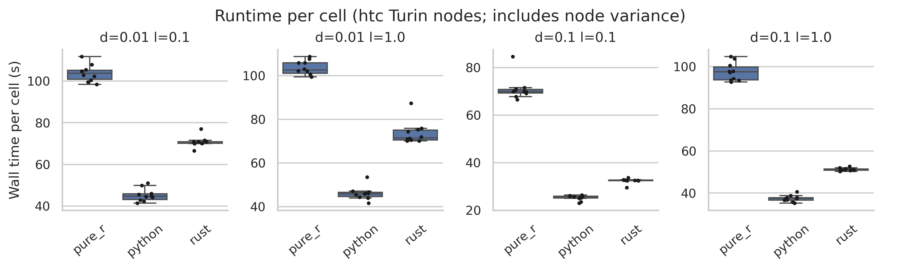
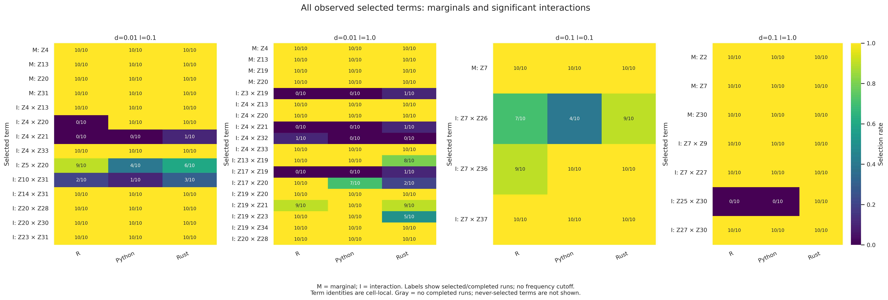

# CD4 Rust rerun

Fitting source: `1d972aa34baeffd7dc5fabe50120fa22e260a6ab` (clean tracked tree when frozen). Changes since
`81e1fc9`: buffered checkpoint I/O and saved, separately timed control reporting.

Forty Rust CD4 full fits: ten seeds × four delta/lambda settings, 1,000 selection
draws, 500 sampleCV holdouts (K=4), four workers and one BLAS thread per worker.
Fresh checkpoints include first-time control reporting and exports in every fit.
No R/Python/SSc/final-CV reruns. Inputs and native libraries use the November 2
campaign; original results remain intact.

## Reproduction

The maintained benchmark harness and manifest runner are reused. Exact fit
arguments are in `manifests/rust-cd4.json`; `source/` is a local Git archive of
this revision's Cargo files, crates, Python source and benchmark scripts.
Build is outside fit timers. `bin/`, `logs/` and patient-level `full-fit/` outputs
remain local. `analysis/` holds updated comparisons with unchanged R/Python runs.

Submit from the repository root:

```bash
sbatch --parsable --job-name=cd4-rust-rerun --cluster=htc --partition=htc --constraint=turin --cpus-per-task=4 --mem=32G --time=01:30:00 --output=/vast/djishnu/Aaron/1_general_use/SLIDE/benchmarks/results/2026-11-08_cd4-rust-rerun/logs/%j.out --wrap 'set -euo pipefail
source /vast/djishnu/Aaron/1_general_use/SLIDE/benchmarks/results/2026-11-08_cd4-rust-rerun/environment.sh
mkdir -p "$TMPDIR" "$MPLCONFIGDIR"
cd "$RUN/source"
export CC="$ENV/bin/x86_64-conda-linux-gnu-cc" CXX="$ENV/bin/x86_64-conda-linux-gnu-c++"
export CARGO_TARGET_X86_64_UNKNOWN_LINUX_GNU_LINKER="$CC" LIBCLANG_PATH="$ENV/lib" CARGO_BUILD_JOBS=2
export PKG_CONFIG_PATH="/vast/djishnu/Aaron/1_general_use/SLIDE/benchmarks/results/2026-11-02_ssc-cd4-retry-benchmarks/build/pkgconfig"
export CARGO_TARGET_DIR="$REPO/target"
toolchain="$HOME/.rustup/toolchains/1.99.1-x86_64-unknown-linux-gnu/bin"
export RUSTC="$toolchain/rustc" RUSTDOC="$toolchain/rustdoc" PATH="$toolchain:$PATH"
"$toolchain/cargo" build --release --locked -p slide-rs --bin slide
cp "$CARGO_TARGET_DIR/release/slide" "$RUN/bin/slide"
sha256sum "$RUN/bin/slide" > "$RUN/build-artifacts.sha256"
sha256sum --check --quiet /vast/djishnu/Aaron/1_general_use/SLIDE/benchmarks/results/2026-11-02_ssc-cd4-retry-benchmarks/input-files.sha256
bash benchmarks/scripts/run_backend_array.sh --manifest "$RUN/manifests/rust-cd4.json"
'
```

Status: **40/40 Rust fits succeeded**, verified from all ten manifest outcomes
and all forty cell timings. Slurm job `12153620` completed with exit `0:0`
in 39m22s on `htc-n77`. No duplicate job was submitted.

Submitted Slurm job `12153565;htc`: 4 CPUs, 32 GiB, 90-minute limit.

Job `12153565` failed during build before any fits: Conda Cairo pkg-config
required unavailable expat metadata. The original campaign pkg-config path
passes the dependency check. Replacement job `12153620;htc` uses that path, with
unchanged fit settings and runtime libraries.

## Runtime and memory

The current comparison contains 120 successful CD4 fits: ten seeds × four
settings × three backends, on 2,482 samples and 1,776 features. Python has the
lowest median wall time in each setting. These are fresh-process workflow
measurements including fitting, sampleCV, first-time control reporting and
exports, with profiling enabled. Build time is outside fit timers.

| delta / lambda | Rust seconds | Python seconds | R seconds | Rust peak GiB | Python peak GiB | R peak GiB |
| --- | ---: | ---: | ---: | ---: | ---: | ---: |
| 0.01 / 0.1 | 70.85 | 44.69 | 103.81 | 0.415 | 1.295 | 1.665 |
| 0.01 / 1.0 | 71.54 | 45.92 | 102.57 | 0.415 | 1.292 | 1.644 |
| 0.1 / 0.1 | 32.62 | 25.72 | 69.95 | 0.414 | 1.251 | 1.665 |
| 0.1 / 1.0 | 51.07 | 37.47 | 97.55 | 0.416 | 1.267 | 1.678 |

Entries are medians over ten fits. [Summary with runtime quartiles](analysis/cd4/summary.csv)
and [per-fit wall time, memory and screening metrics](analysis/cd4/workflow_metrics.csv)
retain the underlying measurements.



The runtime panels use separate y-axis ranges to show within-cell distributions;
use the table for cross-cell absolute comparisons. The harness samples summed
Linux process-group RSS every 50 ms: shared pages can count twice and short
peaks can be missed. This is not cgroup peak memory. The Rust fit peaks range
from 0.410 to 0.419 GiB. Slurm reports batch MaxRSS 3,639,984 KiB, including the
build; that number is not a fit-level memory measurement.

The job requested four CPUs, 32 GiB and 90 minutes on a Turin node. Rust ran on
`htc-n77`; R on `htc-n73`/`htc-n89`; Python on `htc-n73`/`htc-n80`/`htc-n89`.
Node, date and system-load differences remain. Profiling overhead is unmeasured;
filesystem and library caches were not flushed. Backend-specific work also
remains (including R upsilon submodels). These are not equal-work solver
comparisons or a controlled estimate of the checkpoint changes' speedup.

## Selected factors

All backends select the following marginals in all ten fits per cell:

| delta / lambda | Marginal factors |
| --- | --- |
| 0.01 / 0.1 | Z4, Z13, Z20, Z31 |
| 0.01 / 1.0 | Z4, Z13, Z19, Z20 |
| 0.1 / 0.1 | Z7 |
| 0.1 / 1.0 | Z2, Z7, Z30 |



The figure includes every observed marginal and significant interaction, with
no frequency cutoff. Factor identities are local to each cell. Marginal
Jaccard is 1.000 throughout, but interaction agreement is incomplete: at
0.1/1.0, Rust selects Z30–Z25 in addition to the three shared interactions in
all ten fits, giving R–Rust interaction Jaccard 0.750.

[Backend combined overlap](analysis/cd4/overlap_combined_backends.png),
[individual-run combined overlap](analysis/cd4/overlap_combined_repeats.png),
[interaction overlap](analysis/cd4/overlap_interaction_backends.png) and
[selected-count distributions](analysis/cd4/counts.png) retain variability.
Backend means use 45 distinct within-backend pairs or 100 cross-backend pairs;
these pairs reuse runs and are dependent. Two empty sets count as 1. Repeat
matrices include self-comparisons on the diagonal. Larger interaction sets can
dominate combined overlap. Neither overlap nor matching factor matrices proves
backend equivalence or FDR control.

## Scientific-output comparison and screening

For each of the 40 matching Rust seed/cell pairs, the rerun and original
campaign have identical selected marginal and interaction sets, identical K,
identical factor names/order and exported Z values (maximum absolute difference
0), and identical exported sampleCV metrics (maximum absolute difference 0).
The comparison used the maintained analyzer's `load` and `load_z` functions
and `benchmark_summary.json` sampleCV artifacts; it did not compare serialized
checkpoint bytes or recompute scores from patient-level predictions.

All 120 current fits have defined sampleCV scores. Median pooled held-out
Spearman, with 10/10 valid fits per entry:

| delta / lambda | Rust | Python | R |
| --- | ---: | ---: | ---: |
| 0.01 / 0.1 | 0.552836 | 0.552927 | 0.553986 |
| 0.01 / 1.0 | 0.568073 | 0.568289 | 0.568127 |
| 0.1 / 0.1 | 0.506534 | 0.507070 | 0.506679 |
| 0.1 / 1.0 | 0.539103 | 0.539228 | 0.539215 |

sampleCV uses 500 holdouts with K=4 on terms selected from the full dataset;
these are screening diagnostics, not nested external validation. No final-CV
outputs enter this comparison. All 120 factor matrices pass absolute tolerance
1e-6 against R, with matching K and column names/order. The largest difference
is 2.02e-7 in cell 0.1/1.0; tolerance acceptance is not exact equality.

## Measurement provenance and analysis reproduction

R/Python measurements and all original Rust raw outputs remain intact under
`../2026-11-02_ssc-cd4-retry-benchmarks/full-fit/cd4/`. The
[historical full-fitting report](../2026-11-02_ssc-cd4-retry-benchmarks/analysis/2026-11-02_full-fit-report/README.md)
remains unchanged. The current tables replace only Rust measurements.

Per-bundle metadata timestamps (UTC) and declared fitting revisions:

| Backend | First timestamp | Last timestamp | Fitting revision |
| --- | --- | --- | --- |
| Rust | 2026-11-08 21:09:51 | 2026-11-08 21:44:18 | `1d972aa34baeffd7dc5fabe50120fa22e260a6ab` |
| Python | 2026-11-02 20:40:48 | 2026-11-03 00:08:12 | `81e1fc97fc13e3e2be3e579907f4608a1ece3515` |
| R | 2026-11-02 19:55:48 | 2026-11-02 23:59:11 | `81e1fc97fc13e3e2be3e579907f4608a1ece3515` |

These timestamps identify bundles, not the start/end of every cell. Seeds are
10,000,000 through 910,000,000 in steps of 100,000,000. The input checksum check
passed before fitting; local `build-artifacts.sha256` identifies the built
binary. The frozen source tree was clean when archived.

Analysis used the maintained checkout at
`60014b2ea0fae78d402cdc98c6836544a27e7ea7` on 2026-11-08, before report edits,
not the frozen fitting snapshot. Run from the repository root:

```bash
source benchmarks/results/2026-11-08_cd4-rust-rerun/environment.sh
OLD="$REPO/benchmarks/results/2026-11-02_ssc-cd4-retry-benchmarks"
python "$REPO/benchmarks/scripts/analyze_seed_replicates.py" \
  "$RUN/analysis/cd4" \
  --arm "pure_r=pure_r:$OLD/full-fit/cd4/pure_r" \
  --arm "python=python:$OLD/full-fit/cd4/python" \
  --arm "rust=rust:$RUN/full-fit/cd4/rust" \
  --test python:pure_r --test rust:pure_r \
  --min-runs 10 --expected-cells 4 --z-reference pure_r --z-tol 1e-6
```

`workflow_metrics.csv` extracts `wall_seconds` and `peak_rss_bytes / 2**30`
from each bundle's `benchmark_summary.json` timings and joins `sampleCV.metric`
from `cell_artifacts` by backend/delta/lambda. No patient-level data appear in
this table. Analyzer tables retain selected sets, overlap and uncertainty;
figures have 300-dpi PNG and SVG versions. All ten rendered PNGs were visually
inspected for clipping, labels, legibility and agreement with the tables.
