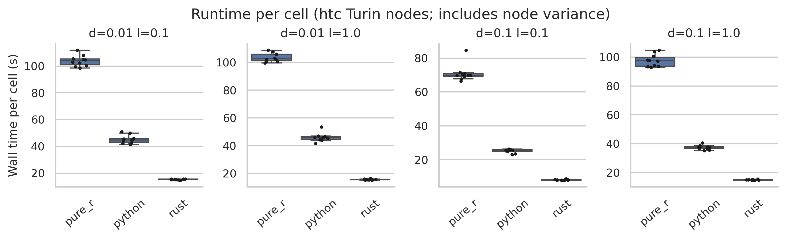
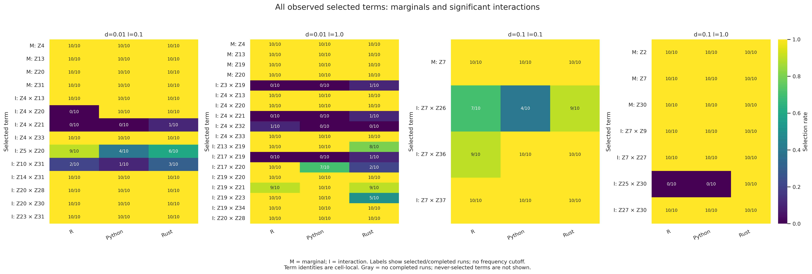

# CD4 QR-control Rust benchmark

This run replaces the SVD control fitter with the existing ordered,
reorthogonalized OLS fitter. Selection, sampleCV, random draws, parallel control
execution and scoring formulas are unchanged. Near-dependent designs can produce
different control scores because the rank criterion changes.

The run reuses the preceding 40-fit manifest: ten seeds × four delta/lambda
settings, 1,000 selection draws, 500 sampleCV holdouts (K=4), four workers and one
BLAS thread per worker. Fresh checkpoints include control reporting and export.
R, Python, SSc and final CV are not rerun. Previous results remain intact in
`../2026-11-08_cd4-rust-rerun/parallel-controls/`.

Fitting source: `aacac0ac649743345a71732f92321096de74fb61` (clean tracked tree when frozen).

## Reproduction

Exact fit arguments and fitting source revision are in `manifests/rust-cd4.json`.
`source/` freezes that revision's Cargo files, crates, Python source and benchmark
scripts. Build time is outside fit timers. Patient-level outputs, source, binary
and logs are local and ignored by Git.

Submit from the repository root:

```bash
sbatch --parsable --job-name=cd4-rust-qr --cluster=htc --partition=htc --constraint=turin --cpus-per-task=4 --mem=32G --time=01:30:00 --output="$PWD/benchmarks/results/2026-11-09_cd4-qr-controls/logs/%j.out" --wrap 'set -euo pipefail
source /vast/djishnu/Aaron/1_general_use/SLIDE/benchmarks/results/2026-11-09_cd4-qr-controls/environment.sh
mkdir -p "$TMPDIR" "$MPLCONFIGDIR"
cd "$RUN/source"
export CC="$ENV/bin/x86_64-conda-linux-gnu-cc" CXX="$ENV/bin/x86_64-conda-linux-gnu-c++"
export CARGO_TARGET_X86_64_UNKNOWN_LINUX_GNU_LINKER="$CC" LIBCLANG_PATH="$ENV/lib" CARGO_BUILD_JOBS=2
export PKG_CONFIG_PATH="$REPO/benchmarks/results/2026-11-02_ssc-cd4-retry-benchmarks/build/pkgconfig"
export CARGO_TARGET_DIR="$REPO/.scratch/2026-11-09_qr-controls/target"
toolchain="$HOME/.rustup/toolchains/1.99.1-x86_64-unknown-linux-gnu/bin"
export RUSTC="$toolchain/rustc" RUSTDOC="$toolchain/rustdoc" PATH="$toolchain:$PATH"
cargo build --release --locked -p slide-rs --bin slide
cp "$CARGO_TARGET_DIR/release/slide" "$RUN/bin/slide"
sha256sum --check --quiet "$REPO/benchmarks/results/2026-11-02_ssc-cd4-retry-benchmarks/input-files.sha256"
bash benchmarks/scripts/run_backend_array.sh --manifest "$RUN/manifests/rust-cd4.json"
'
```

## Status

**40/40 Rust fits succeeded**, across all ten manifest bundles. Slurm job
`12158255;htc` completed with exit `0:0` on `htc-n90` in **12m53s**, including
a **3m39s release build**. Score tests passed (15 passed; one optional R
weighted-GLM test ignored).

## Runtime and memory

The current comparison combines these 40 Rust fits with the 80 saved R/Python
fits from November 2–3. CD4 has 2,482 samples and 1,776 features. Each measurement
covers a fresh-process full workflow, including sampleCV, first-time control
reporting and exports. Final CV is excluded; build time is outside fit timers.

| delta / lambda | Rust seconds | Python seconds | R seconds | Rust peak GiB | Python peak GiB | R peak GiB |
| --- | ---: | ---: | ---: | ---: | ---: | ---: |
| 0.01 / 0.1 | 15.28 | 44.69 | 103.81 | 0.415 | 1.295 | 1.665 |
| 0.01 / 1.0 | 15.61 | 45.92 | 102.57 | 0.415 | 1.292 | 1.644 |
| 0.1 / 0.1 | 8.05 | 25.72 | 69.95 | 0.414 | 1.251 | 1.665 |
| 0.1 / 1.0 | 14.90 | 37.47 | 97.55 | 0.414 | 1.267 | 1.678 |

Entries are medians over ten fits. [Summary with quartiles](analysis/cd4/summary.csv)
and [per-fit runtime, memory and screening metrics](analysis/cd4/workflow_metrics.csv)
retain the measurements. Rust has the lowest median in all four cells.



Runtime panels use separate y-axis ranges to show within-cell variation; use
the table for cross-cell absolute comparisons. The harness samples summed Linux
process-group RSS every 50 ms. Shared pages can count twice and short peaks can
be missed; these are not cgroup peaks. Rust fit peaks range from 0.411 to
0.420 GiB. Slurm batch MaxRSS was 4,214,788 KiB, including the build.

The job requested four CPUs, 32 GiB and 90 minutes on a Turin node. Rust ran on
`htc-n90`; the preceding parallel-SVD run used `htc-n91`. Saved R measurements
used `htc-n73`/`htc-n89`; Python used `htc-n73`/`htc-n80`/`htc-n89`. Node, date
and system-load variation remain. Profiling overhead is unmeasured; filesystem
and library caches were not flushed. Backend-specific work also differs,
including R upsilon submodels. These are workflow comparisons, not equal-work
solver timings or a controlled same-node speedup experiment.

### Control-reporting timing

Median wall seconds from explicit Rust stage logs, ten fits per cell:

| delta / lambda | Previous parallel SVD controls | QR controls | QR fitting¹ | QR export |
| --- | ---: | ---: | ---: | ---: |
| 0.01 / 0.1 | 29.145 | 0.200 | 13.405 | 0.955 |
| 0.01 / 1.0 | 29.095 | 0.205 | 13.720 | 0.840 |
| 0.1 / 0.1 | 13.295 | 0.040 | 6.780 | 0.540 |
| 0.1 / 1.0 | 19.190 | 0.080 | 13.580 | 0.515 |

¹ The log's `TOTAL` stage includes LOVE, factor mapping, knockoff selection and
sampleCV screening, but excludes control reporting and export. Independent
medians do not add exactly; workflow time also includes startup and checkpoint
I/O. Stage logs round most durations to 0.01 seconds.

## Selected factors

All backends select these marginals in all ten fits per cell:

| delta / lambda | Marginal factors |
| --- | --- |
| 0.01 / 0.1 | Z4, Z13, Z20, Z31 |
| 0.01 / 1.0 | Z4, Z13, Z19, Z20 |
| 0.1 / 0.1 | Z7 |
| 0.1 / 1.0 | Z2, Z7, Z30 |



The figure includes every observed marginal and significant interaction, with
no frequency cutoff. Factor identities are local to each cell. Marginal Jaccard
is 1.000 throughout. Interaction agreement remains incomplete: at 0.1/1.0,
Rust selects Z30–Z25 in addition to the three shared interactions in all ten
fits, giving R–Rust interaction Jaccard 0.750.

[Backend combined overlap](analysis/cd4/overlap_combined_backends.png),
[individual-run combined overlap](analysis/cd4/overlap_combined_repeats.png),
[interaction overlap](analysis/cd4/overlap_interaction_backends.png) and
[selected-count distributions](analysis/cd4/counts.png) retain variability.
Backend means use 45 distinct within-backend pairs or 100 cross-backend pairs;
these pairs reuse runs and are dependent. Two empty sets count as 1. Repeat
matrices include self-comparisons. Larger interaction sets can dominate combined
overlap. Matching sets and factor matrices do not establish full backend
equivalence or FDR control.

## Scientific-output comparison and screening

For all 40 matching Rust seed/cell pairs, the QR and previous parallel-SVD runs
have byte-identical marginal and interaction selection files, exported Z
matrices, sampleCV model JSON and sampleCV prediction CSVs. Across all numeric
entries in the 40 matching `ControlPerformance.csv` files, the largest absolute
difference is **5.33e-15**. This is an observed result on CD4, not a guarantee
for nearly dependent designs or proof of R solver equivalence.

All 120 fits have defined sampleCV scores. Median pooled held-out Spearman,
with 10/10 valid fits per entry:

| delta / lambda | Rust | Python | R |
| --- | ---: | ---: | ---: |
| 0.01 / 0.1 | 0.552836 | 0.552927 | 0.553986 |
| 0.01 / 1.0 | 0.568073 | 0.568289 | 0.568127 |
| 0.1 / 0.1 | 0.506534 | 0.507070 | 0.506679 |
| 0.1 / 1.0 | 0.539103 | 0.539228 | 0.539215 |

sampleCV uses 500 holdouts with K=4 on terms selected from the full dataset;
these are screening diagnostics, not nested external validation. All 120 factor
matrices pass absolute tolerance 1e-6 against R, with matching K and column
names/order. The largest difference is 2.02e-7 in cell 0.1/1.0; tolerance
acceptance is not exact equality.

## Measurement provenance and analysis reproduction

R/Python measurements remain under
`../2026-11-02_ssc-cd4-retry-benchmarks/full-fit/cd4/`. The previous
[parallel-SVD Rust report](../2026-11-08_cd4-rust-rerun/parallel-controls/README.md)
and its raw results remain unchanged. The current tables replace only Rust
measurements.

Per-bundle `benchmark_summary.json` timestamps (UTC) and fitting revisions:

| Backend | First timestamp | Last timestamp | Fitting revision |
| --- | --- | --- | --- |
| Rust | 2026-11-09 11:46:01 | 2026-11-09 11:54:19 | `aacac0ac649743345a71732f92321096de74fb61` |
| Python | 2026-11-02 20:43:31 | 2026-11-03 00:10:40 | `81e1fc97fc13e3e2be3e579907f4608a1ece3515` |
| R | 2026-11-02 20:01:48 | 2026-11-03 00:05:39 | `81e1fc97fc13e3e2be3e579907f4608a1ece3515` |

Analysis reuses `benchmarks/scripts/analyze_seed_replicates.py` from clean
revision `5e11ed5` on November 9, before report edits. Run from the repository root:

```bash
source benchmarks/results/2026-11-09_cd4-qr-controls/environment.sh
OLD="$REPO/benchmarks/results/2026-11-02_ssc-cd4-retry-benchmarks"
python "$REPO/benchmarks/scripts/analyze_seed_replicates.py" \
  "$RUN/analysis/cd4" \
  --arm "pure_r=pure_r:$OLD/full-fit/cd4/pure_r" \
  --arm "python=python:$OLD/full-fit/cd4/python" \
  --arm "rust=rust:$RUN/full-fit/cd4/rust" \
  --test python:pure_r --test rust:pure_r \
  --min-runs 10 --expected-cells 4 --z-reference pure_r --z-tol 1e-6
```

`workflow_metrics.csv` extracts `wall_seconds` and `peak_rss_bytes / 2**30`
from each bundle's `benchmark_summary.json` timings and joins `sampleCV.metric`
from `cell_artifacts` by backend/delta/lambda. It contains no patient-level data.
Analyzer tables retain selected sets, overlap and uncertainty; figures have
300-dpi PNG and SVG versions. All ten PNGs were visually inspected for clipping,
label accuracy, legibility and agreement with the tables.
