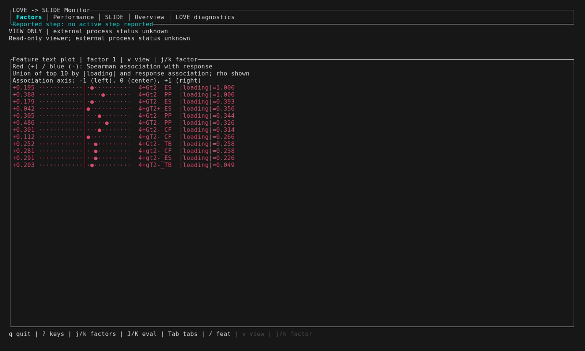
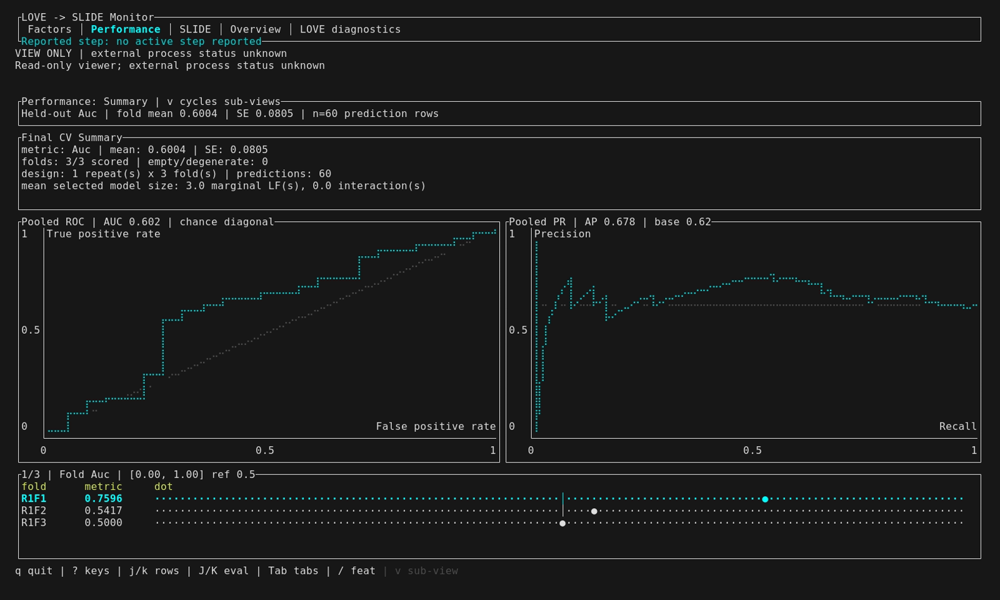
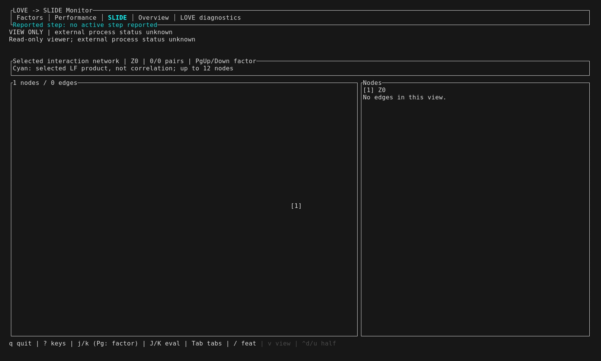

# Results-first TUI gallery (2026-10-21)

Captured from `dcefee6` with the rebuilt `target/debug/slide`.
This run replaces the earlier gallery with factor text plots first, performance
curves next, and LOVE diagnostics last. It adds the interaction-network empty state.

Command (inside the Rust environment with VHS dependencies available):

```bash
SLIDE_TUI_SCREENSHOT_DIR="$PWD/docs/assets/tui/2026-10-21_results-first" \
  scripts/capture-tui-screenshots.sh --skip-prepare
```

Reused fixture: `.tmpfiles/2026-10-21_tui-smoke/`, including its exported results.
The fixture uses 40 HIV features, eight knockoff iterations, one grid cell,
binary response, and three-fold final CV. These are UI demonstration outputs,
not scientific conclusions. Interactions are disabled; no selected edges or
continuous-response residuals appear here.

The performance header reports the held-out fold mean and SE. ROC AUC and
average precision use pooled prediction rows and can differ from that mean.
“Permuted CV” shows randomized in-sample OLS controls, not held-out CV.

## Results







## All captures, in navigation order

- [factor-text-plot.png](factor-text-plot.png)
- [factor-network.png](factor-network.png)
- [factor-1.png](factor-1.png)
- [factor-2.png](factor-2.png)
- [factor-3.png](factor-3.png)
- [performance.png](performance.png)
- [performance-controls.png](performance-controls.png)
- [performance-folds.png](performance-folds.png)
- [performance-predictions.png](performance-predictions.png)
- [performance-roc-pr.png](performance-roc-pr.png)
- [slide-interactions.png](slide-interactions.png)
- [slide-selection.png](slide-selection.png)
- [slide-response.png](slide-response.png)
- [overview.png](overview.png)
- [love-diagnostics.png](love-diagnostics.png)
- [love-covariance.png](love-covariance.png)
- [love-loading-matrix.png](love-loading-matrix.png)
- [love-block-correlation.png](love-block-correlation.png)
- [love-gamma.png](love-gamma.png)
- [Animated walkthrough](tui-demo.gif)

[Archived earlier gallery](../archive/2026-10-21_visual-outputs/README.md)
