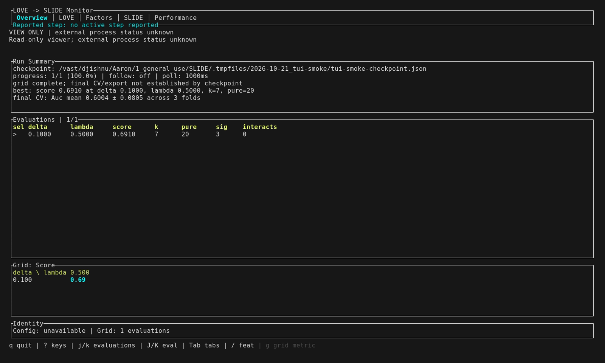
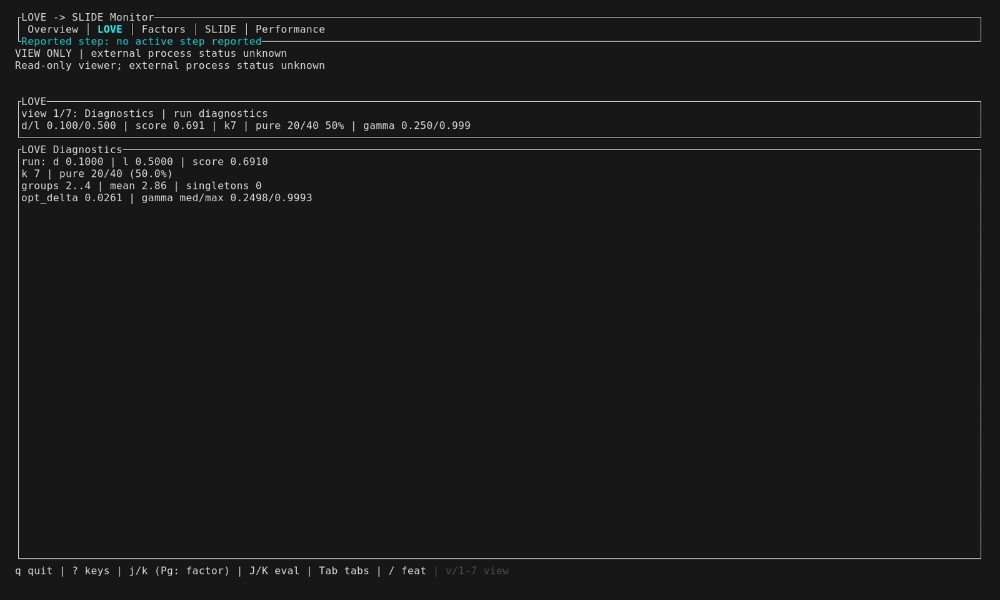
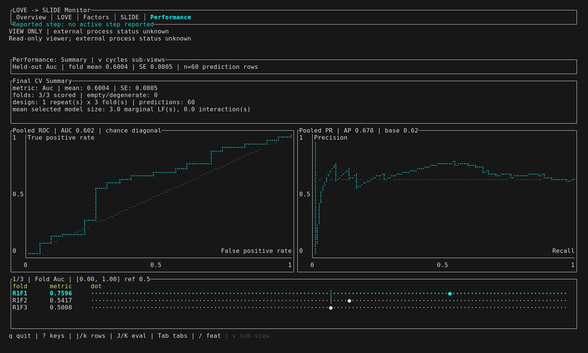

# Restored-tab TUI gallery (2026-10-21)

Captured from `2e80876` with the rebuilt `target/debug/slide`.
This run replaces the results-first gallery with the restored tab order:
Overview → LOVE → Factors → SLIDE → Performance. LOVE diagnostics remain
sub-views, cycled with `v` or selected with `1`–`7`.

## Reproduce

Build with `scripts/cargo-rust-blas build -p slide-rs`, then reuse the existing
smoke fixture and maintained capture tape:

```bash
export TMPDIR="$PWD/.tmpfiles"
export PATH="$PWD/.tmpfiles/2026-10-21_tui-capture:$PATH"
export LD_PRELOAD=/usr/lib64/libstdc++.so.6
export SLIDE_TUI_SCREENSHOT_DIR="$PWD/docs/assets/tui/2026-10-21_restored-tabs"
scripts/with-rust-blas-env.sh scripts/capture-tui-screenshots.sh --skip-prepare
```

The PATH entry supplies this host's cached ttyd; LD_PRELOAD selects its system
C++ runtime for Chromium. Other hosts need their own VHS dependencies.

Fixture: `.tmpfiles/2026-10-21_tui-smoke/`, including exported results.
It uses 40 HIV features, eight knockoff iterations, one grid cell, binary
response, and three-fold final CV. These are UI demonstrations, not scientific
conclusions. Interactions are disabled, so selected edges and continuous-response
residuals are not demonstrated.

The held-out fold mean and SE differ from metrics computed on pooled prediction
rows. “Permuted CV” shows randomized in-sample OLS controls, not held-out CV.

## Preview







## Known display limitations

At 1600×960, the factor histogram title clips on the right. The loading matrix
uses fallback feature IDs, and Overview shows `Config: unavailable` despite
receiving `--config`. These captures preserve those existing limitations.

## All captures

- [factor-1.png](factor-1.png)

- [factor-2.png](factor-2.png)

- [factor-3.png](factor-3.png)

- [factor-network.png](factor-network.png)

- [factor-text-plot.png](factor-text-plot.png)

- [love-block-correlation.png](love-block-correlation.png)

- [love-covariance.png](love-covariance.png)

- [love-diagnostics.png](love-diagnostics.png)

- [love-gamma.png](love-gamma.png)

- [love-loading-matrix.png](love-loading-matrix.png)

- [overview.png](overview.png)

- [performance-controls.png](performance-controls.png)

- [performance-folds.png](performance-folds.png)

- [performance-predictions.png](performance-predictions.png)

- [performance-roc-pr.png](performance-roc-pr.png)

- [performance.png](performance.png)

- [slide-interactions.png](slide-interactions.png)

- [slide-response.png](slide-response.png)

- [slide-selection.png](slide-selection.png)

- [tui-demo.gif](tui-demo.gif)

[Previous results-first gallery](../2026-10-21_results-first/README.md)
