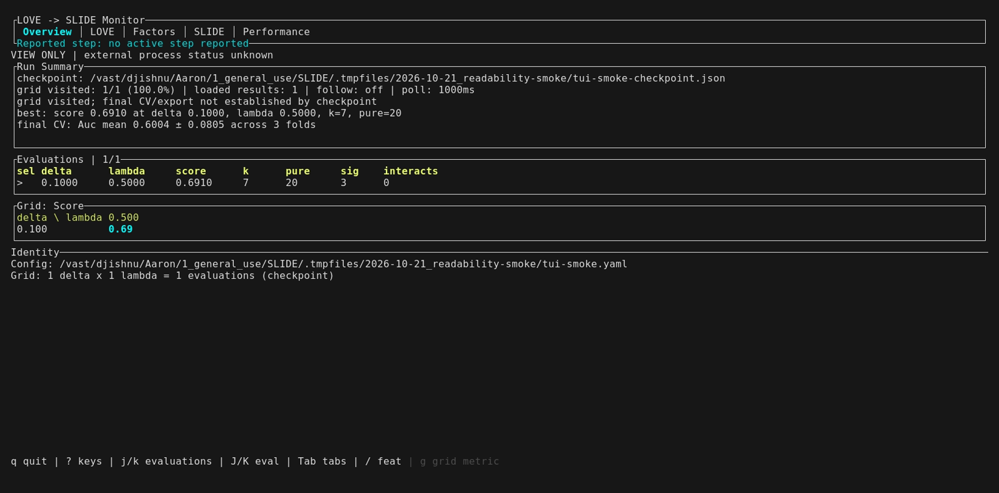
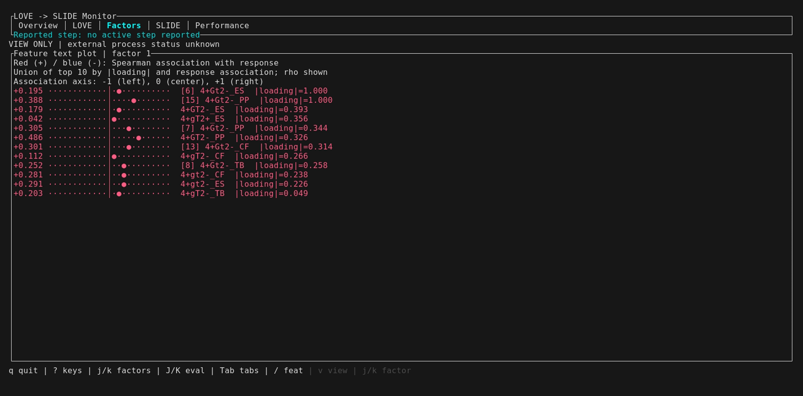
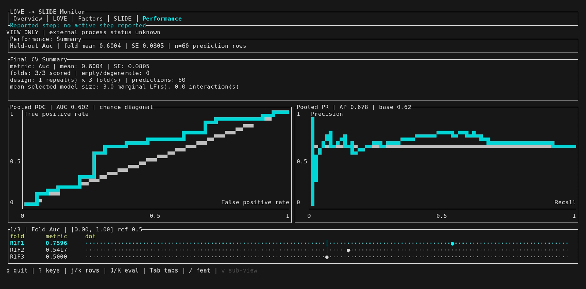
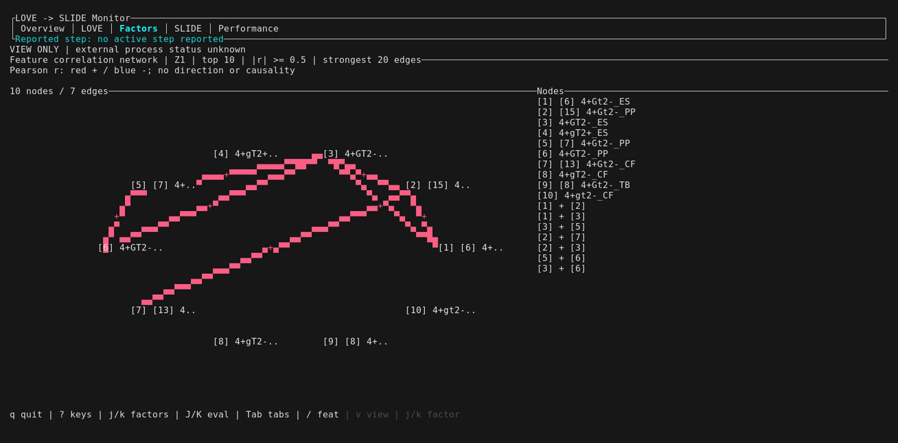
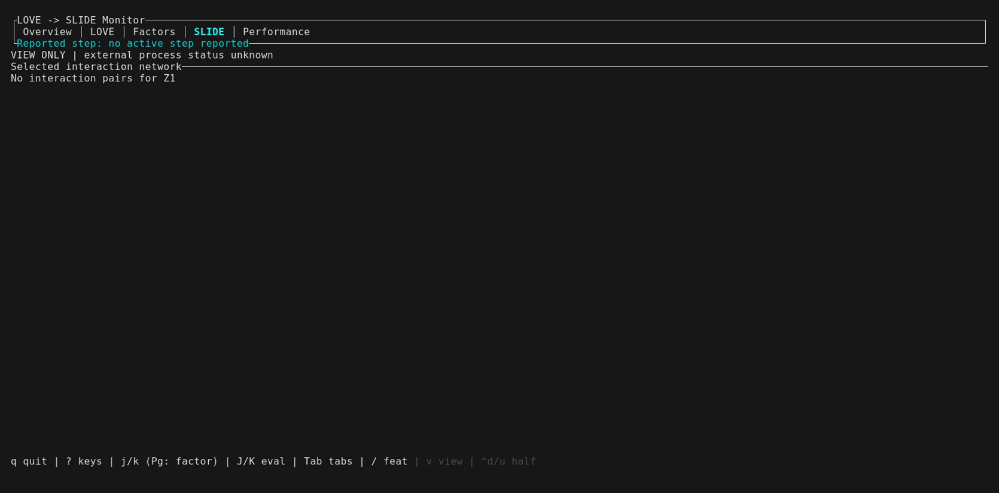
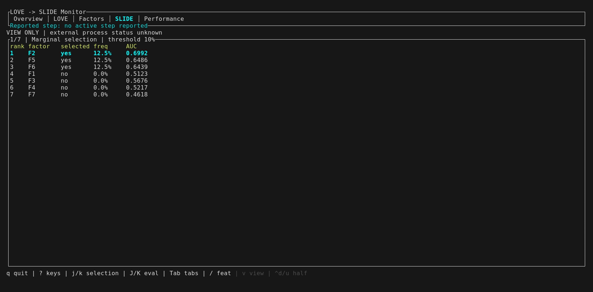
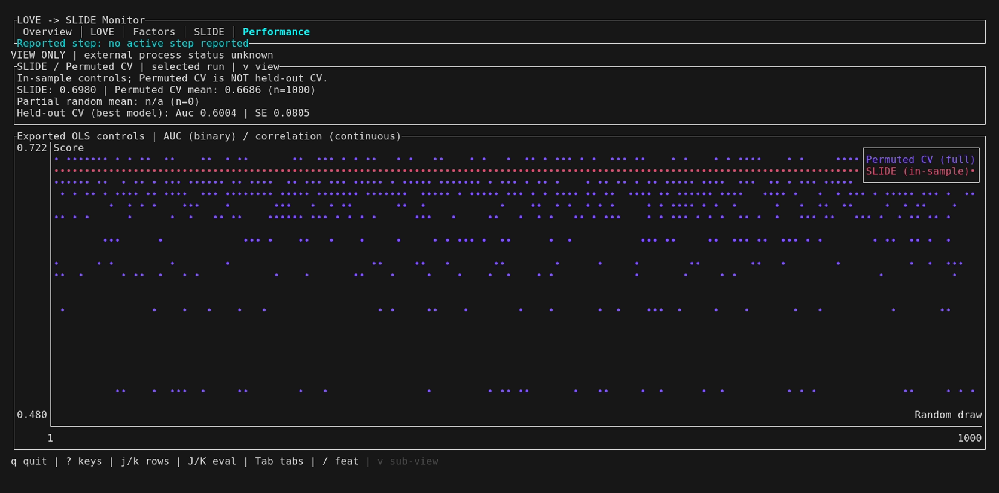
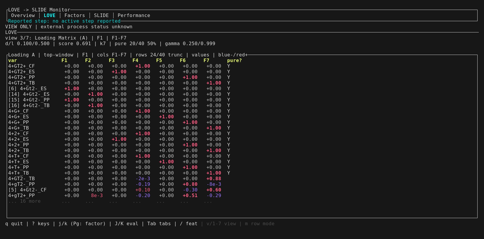

# SLIDE TUI Guide

The `slide` binary (built from the `slide-rs` package) includes a terminal
dashboard (TUI) for monitoring SLIDE pipeline runs in real time. It reads checkpoint files written during
optimization and renders live-updating views of LOVE factor creation, SLIDE
knockoff selection, factor diagnostics, and more.

---

# Fast Example
Clone the repository
```bash
git clone https://github.com/TranscriptionFactory/SLIDE.git
```
From the project repository:
```bash
cargo build --release && ./target/release/slide run --tui \
  --config tests/test_config_quick.yaml \
  --checkpoint tests/test_config_checkpoint.json
```

> The Cargo package is named `slide-rs`, but the built binary is `slide`.
> The path is `target/release/slide`, not `target/release/slide-rs`.


## Building

From the repo root:

```bash
cargo build --release
```

The binary lands at `target/release/slide`.

> Requires OpenBLAS headers on the system. On the CRC cluster, load the
> appropriate module first (e.g. `module load openblas`).

---

## Four Ways to Use It

Migration: replace `slide monitor` with `slide run --tui`, and `slide tui` with
`slide view`. The old subcommands are no longer accepted.

### 1. `run --tui` — Run pipeline + TUI together (recommended)

Launches the SLIDE optimization as a child process and opens the TUI on top.
The pipeline's stdout/stderr are redirected to a `.log` file next to the
checkpoint. The TUI polls the checkpoint file and updates as results arrive.

```bash
./target/release/slide run --tui \
  --config path/to/config.yaml \
  --checkpoint path/to/checkpoint.json
```

Press `q` to request exit. While the owned worker is active, confirm with `y`
or Enter to stop it; any other key cancels. Quitting `view` never stops a job.

### 2. `run` — Pipeline only (headless)

Runs optimization and writes checkpoint JSON, no TUI. Useful for batch/SLURM
jobs where you attach the TUI separately.

```bash
./target/release/slide run \
  --config path/to/config.yaml \
  --checkpoint path/to/checkpoint.json
```

### 3. `view` — Dashboard only (attach to existing run)

Opens the TUI against a checkpoint file written by a running or completed
pipeline.

```bash
./target/release/slide view \
  --checkpoint path/to/checkpoint.json
```

Optional flags:

| Flag           | Default | Description |
|----------------|---------|-------------|
| `--config`     | —       | YAML config file (shows config details in summary) |
| `--result`     | —       | Result JSON from a completed run |
| `--x`          | —       | Feature matrix CSV/TSV (recovers feature names) |
| `--poll-ms`    | 1000    | Checkpoint polling interval in milliseconds |
| `--no-follow`  | false   | Disable live polling (view a static checkpoint) |


### Checkpoint reuse and dashboard ownership

`slide run` and `slide run --tui` create new state or resume a compatible
checkpoint. Corrupt or incompatible state is rejected, never reset. Use a new
checkpoint path for a new run. Recorded grid evaluations are reused; a full grid
does not mean final CV or configured export succeeded. The owned dashboard
shows worker success/failure and its log path while it remains open.

`slide view` never launches computation. Progress sidecars can be stale and do
not prove that an external process is alive. Loaded results and visited grid
slots do not establish worker success. Missing or invalid progress reports do
not imply completion. `--config` supplies dashboard
metadata, not execution instructions. Missing checkpoints are polled unless
`--no-follow` is supplied. `slide submit` keeps its scheduler behavior.

`run --tui` currently truncates the checkpoint-adjacent `.log` at startup;
archive an earlier log before relaunching if it must be retained.

### 4. `submit` — Submit a SLURM job + attach TUI

Submits a SLURM batch script via `sbatch` and immediately opens the TUI to
watch progress. Designed for HPC clusters where the pipeline runs as a
scheduled job and writes its checkpoint to a shared filesystem.

```bash
./target/release/slide submit \
  --script job.sh \
  --checkpoint path/to/checkpoint.json \
  --config path/to/config.yaml
```

| Flag           | Description                                   |
|----------------|-----------------------------------------------|
| `--script`     | SLURM batch script to submit                  |
| `--checkpoint` | Checkpoint path the SLURM job will write to   |
| `--config`     | Optional YAML config for the TUI summary pane |

---

## Release Screenshots

The repo includes a scripted VHS tape for repeatable screenshots of the
Ratatui dashboard. It builds a 40-feature HIV smoke-test checkpoint with final CV,
exports result tables and plots (including `ControlPerformance.csv`), launches
`slide view --no-follow`, navigates through the release-worthy tabs/views,
and writes PNG screenshots plus an animated GIF.

```bash
scripts/capture-tui-screenshots.sh
```

Outputs go into `docs/assets/tui/YYYY-MM-DD_visual-outputs/`. The
[2026-10-21 gallery](assets/tui/2026-10-21_readability/README.md) includes
31 PNGs and an animated GIF, including 80×24 and 60×20 terminal views. This small binary-response fixture uses eight
knockoff iterations and one grid cell; use it to inspect the UI, not to draw
scientific conclusions. Interactions are disabled, so this gallery does not
demonstrate selected interaction edges or continuous-response residuals.

### Captured results

These captures show the restored tab order: Overview, LOVE, Factors, SLIDE,
and Performance. LOVE diagnostics remain sub-views within LOVE.











### More views







The gallery includes all seven LOVE sub-views, three factor tables, response
dots, fold scores, prediction bins, and a full-size ROC/PR view. The
[previous restored-tab gallery](assets/tui/archive/2026-10-21_restored-tabs/README.md)
remains in the archive.

The wrapper runs one VHS session per terminal size and checks the dimensions
with `stty size`: 160×40, 80×24, and 60×20. Pixel dimensions are calibrated
for the capture font and ttyd; a size mismatch fails the capture check. Compact layouts show fewer loading columns around
the selected factor and a loading-only factor table; use `PgUp` / `PgDn` to
change factors. Very small terminals can still omit secondary metadata.

### Reproduce the capture

The wrapper uses `cargo` and `python3` for preparation, plus VHS, ttyd ≥ 1.7.2,
FFmpeg, and Chromium for capture. Run it inside your Rust build environment,
for example `pixi run --locked -e rust scripts/capture-tui-screenshots.sh`.
It redirects temporary capture files into the project's `.tmpfiles/` and
unsets `NO_COLOR` inside the recorded shell so signed colors remain visible.
On HPC systems, load the FFmpeg module **before** entering Pixi to keep
module-provided C++ libraries from overriding the Rust runtime:

```bash
module load ffmpeg
pixi run --locked -e rust scripts/capture-tui-screenshots.sh
```

Override `SLIDE_TUI_WORKDIR`, `SLIDE_TUI_OUT_PATH`, and
`SLIDE_TUI_SCREENSHOT_DIR` to name a new run. The default result export is
`$SLIDE_TUI_WORKDIR/exported-results`; it must not already exist.
Use `--skip-prepare` to recapture an existing fixture without rerunning exports.
The wrapper refuses to overwrite an existing gallery. Archive it before
recapturing into the same directory.

If you only want to regenerate the fixture before manually opening the TUI:

```bash
scripts/capture-tui-screenshots.sh --prepare-only
./target/debug/slide view \
  --checkpoint .tmpfiles/$(date +%F)_tui-smoke/tui-smoke-checkpoint.json \
  --config .tmpfiles/$(date +%F)_tui-smoke/tui-smoke.yaml \
  --no-follow
```

Use the wrapper rather than running the tape directly: it selects each size
section from the maintained tape and supplies dated output paths.
VHS install options are documented at <https://github.com/charmbracelet/vhs>.

---

## Config File

The YAML config tells the pipeline where data lives and what hyperparameters to
sweep. Minimal example:

```yaml
x_path: /path/to/features.csv
y_path: /path/to/response.csv

delta: [0.05, 0.1]
lambda: [0.1, 0.5]

y_factor: true
do_interacts: true
pure_homo: true
spec: 0.1
fdr: 0.1
thresh_fdr: 0.2
SLIDE_iter: 500
```

### R-generated knockoffs

Rust uses its native knockoff generator by default. To generate the Gaussian
knockoff matrices with R's `knockoff` package instead, add:

```yaml
knockoff_backend: r
rscript: /path/to/Rscript
```

The selected `Rscript` must have the `knockoff` and `corpcor` packages
available. R computes the covariance, SDP solution, and random Gaussian draws;
the remaining SLIDE voting and scoring pipeline stays in Rust. Use
`knockoff_backend: rust` (or omit the key) for the fully native Rust path.

Each `(delta, lambda)` pair becomes one evaluation. The pipeline writes
intermediate results to the checkpoint file after each evaluation completes.

A quick-test config with fewer iterations for verifying the TUI is at
`tests/test_config_quick.yaml`.

---

## TUI Tabs and Views

The dashboard opens on Overview. Tab order is **Overview → LOVE → Factors → SLIDE → Performance**.
Factors opens on loading tables; SLIDE opens on marginal selection. LOVE
diagnostics are sub-views within LOVE, not separate tabs. Use the keys below to navigate.
The `Reported step:` label below the tabs shows the latest reported pipeline phase on
every tab, including interaction progress. `no active step reported` means no
progress report is available; it does not confirm that the run succeeded.

### Overview tab

Summary table of all evaluated `(delta, lambda)` pairs, a cycleable grid
metric (`g` toggles score, factor count, pure count, selected marginals, and
selected interactions), and a visual phase timeline bar showing where the
pipeline is currently spending time:

```
[LOVE Factors ████  Z Scores ░░░░  SLIDE Marginal ░░░░  SLIDE Interactions ░░░░]
```

### LOVE tab

LOVE factor creation outputs. Cycle through all seven sub-views with `v`,
or select one directly with `1`–`7`.

| Key | Sub-view | What it shows |
|-----|----------|---------------|
| `1` | Diagnostics | Factor count, pure coverage, group sizes, gamma summaries, and parameters |
| `2` | Factor Covariance (C) | Heatmap of the factor covariance matrix; large `k` uses a compact window around the selected factor |
| `3` | Loading Matrix (A) | Ranked loading heatmap with row modes for top-window, pure-variable-first, or selected-factor ranking |
| `4` | Group Correlation | Within-group correlation heatmap; large `k` uses a compact window around the selected factor |
| `5` | Block Correlation | Block-structure correlation heatmap (half-block `▀` rendering, blue-white-red, capped at 300 vars) |
| `6` | Gamma (Noise Variance) | Advanced: ranked top-30 noise variance estimates |
| `7` | Interaction Ranking | Advanced: ranked interaction table with selected status, frequency, and response association when available |

For large LOVE outputs, the matrix-style views prioritize scanability over
showing every cell. Covariance and group-correlation matrices show a centered
window around the currently selected factor, while the loading matrix ranks
features according to its active row mode and caps rows and columns to the
terminal space. Its row count refers to visible data rows. Press
`m` in the loading matrix view to cycle `top-window`, `pure variables`, and
`selected factor` modes. The title line reports the active mode, factor window,
visible row count, and `PgDn` / `PgUp` factor-window navigation.

Loading cells retain signed numeric values; bold values have magnitude ≥ 0.5.
Small nonzero values use scientific notation, while `NA` marks unavailable
values. Compact covariance/group cells use a sign and magnitude glyph
(`░` below 0.1, `▓` below 0.5, `█` at least 0.5); `.` means zero.

Press `/` to search feature names (case-insensitive substring matching).
Type the query, then press `Enter` to keep it or `Esc` to clear it. While
editing, keys such as `q` enter text instead of triggering navigation. Search
results appear in the feature-detail panels; matching rows are highlighted in
the loading matrix. The viewer loads feature and response data from the checkpoint’s `x_ref` and
`y_ref` paths. Keep those input files accessible for text plots, networks, and
response associations. Use `--x` to override the feature path and recover
original names instead of fallback labels such as `feature_1`. Loading and
Gamma views load these names without requiring a visit to another tab.
Repeated names receive a stable, one-based feature ID in brackets; empty names
show that ID and `unnamed`. The display labels do not change feature order or
rankings. Mismatched input dimensions produce a warning rather than assigning
names to incompatible loadings. Matching dimensions alone do not verify input
identity: use the original checkpoint inputs.
`--config` does not replace these input references; pass it to locate exported
controls through `out_path`.

### Factors tab

Per-factor detail for the selected run:

- Top features by loading weight
- Factor score distributions rendered as sparkline histograms (`▁▂▃▅▆▇█`)

Use `j` / `k` or Down / Up to select factors. Press `v` to cycle through
these tables (default), the red/blue feature text plot, and a feature-correlation network.

The text plot uses the same top-feature selection as the exported gene plots:
the union of the top 10 by absolute loading and response association. Red (+)
and blue (-) show the sign of the feature's Spearman correlation with the
response, not the sign of its loading. Gray means zero or unavailable.

The network shows the selected factor's top 10 nonzero-loading features.
Edges show Pearson correlations with |r| ≥ 0.5, limited to the 20 strongest
edges. Red means positive and blue means negative; `+`/`-` labels also mark
edge signs. Large layouts put abbreviated names beside nodes and retain full
names in the node list. Narrow layouts use numbered nodes and that list.
These are descriptive
correlations, not causal links or significance tests. Both views need the
feature matrix; the text plot also needs the response vector. Use a tall
terminal to see all feature labels.

### SLIDE tab

Four sub-views (cycle with `v`), starting with Marginal:

| Sub-view | What it shows |
|----------|---------------|
| Marginal | Ranked factor IDs, selected yes/no, exact frequency, and response association |
| Interactions | Ranked directed voting pairs, selected yes/no, and exact frequency |
| Response | Factor-response dots with exact values and fixed reference axes |
| Network | Selected interaction pairs involving the current factor; up to 12 nodes |

The Response sub-view displays scrollable factor-response dots. Correlation
uses a fixed −1 to +1 axis with zero; AUC uses 0 to 1 with a 0.5 reference.
Exact values accompany the dots; unavailable metrics show `n/a`. Use `j/k` to
move through ranked rows, or `Ctrl-d/u` to move half a viewport. The title shows
position/total. Pair frequencies refer to the marginal factor
and candidate in the displayed directed vote, not a new pair-response estimate.
In the network, cyan edges mean selected LF products, not positive
correlations. Use `PgUp` / `PgDn` to change the focus factor; the title reports
how many of its selected pairs are visible. The TUI computes response
associations on demand when the response vector is available.

Gamma (LOVE `6`) lists the highest 30 gamma values with rank, stable feature ID,
exact value, and feature name. Its title reports the displayed count and total.
LOVE `7` keeps its top-30 pair ranking; `assoc*` is the mean absolute
association of the two constituent factors, not a pair-response estimate.
At 60×20 and 80×24, the Factors table view uses a compact full-width loading table; normal
width retains both rankings. Very small terminals may lack room for data rows.
Search input captures printable keys, including `j`, `k`, `q`, and `v`; Enter
keeps the query and Esc clears it.

### Performance tab

Final cross-validation results for the best SLIDE model, when the run
configuration enabled final CV:

```yaml
cv:
  enabled: true
```

This tab reads the persisted `final_cv` block from the checkpoint or result
JSON. Cycle Performance sub-views with `v`. It shows:

- Final CV metric, mean, and standard error
- Scored fold count vs empty or degenerate folds
- Fold-score dots with exact metrics (correlation −1 to +1, AUC 0 to 1; expanded if values exceed those bounds)
- Per-fold train/validation sizes and selected model sizes
- Prediction histograms with numeric intervals, class counts, and scrollable count bars
- ROC and precision-recall curves with labeled 0–1 axes, chance diagonal, and prevalence reference for binary responses
- Residual histogram with numeric intervals and count bars for continuous responses

Performance opens on ROC/PR curves for binary responses or a residual histogram
for continuous responses, with fold scores below when space permits. The header
reports the held-out fold mean and SE. Curve AUC and average precision (AP) use
pooled prediction rows across folds/repeats, so they can differ from the fold
mean. Tied prediction scores share one threshold. Narrow terminals stack the
curves vertically when space permits. At 80×24 and 60×20, a compact summary
shows the same pooled AUC, AP, and prevalence instead of overlapping axes;
enlarge the terminal to see curves. Use the Fold Scores sub-view for model-size details.

The **SLIDE / Permuted CV** sub-view reads the selected run's exported
`ControlPerformance.csv`. Pass `--config` with the run YAML containing
`out_path`. Scores appear after export finishes; press `r` to reload if using
`--no-follow`. This view also works when final CV is disabled.

**“Permuted CV” is a display label for the full-random in-sample OLS control,
not held-out CV or response-label permutation.** The plot shows the real
SLIDE score and randomized draws, including partial-random controls when
available. The header reports their means. Actual held-out CV remains
separately labeled and refers to the best model, not necessarily the selected
run. The TUI does not compute new controls or fit a permuted CV model.

If final CV was not enabled for the run, the other sub-views display a short
"not available" message instead. During live runs, the Overview tab also shows
`FinalCv` as the current phase while final CV is running.

---

## Keyboard Reference

| Key | Action |
|-----|--------|
| `Tab` / `l` / `Right` | Next tab |
| `Shift+Tab` / `h` / `Left` | Previous tab |
| `j` / `Down` | Next primary item: factor on Factors, evaluation on Overview, row in ranked views |
| `k` / `Up` | Previous primary item (bounded) |
| `J` / `K` | Next / previous evaluation globally (application shortcut) |
| `Ctrl-d` / `Ctrl-u` | Down / up half the visible list viewport |
| `?` | Key help; any key closes it |
| `PgDn` | Next factor (legacy alias) |
| `PgUp` | Previous factor (legacy alias) |
| `v` | Cycle sub-views (LOVE, Factors, SLIDE, and Performance tabs) |
| `1`–`7` | Jump to LOVE sub-view directly (`6` and `7` are advanced) |
| `g` | Cycle Overview grid metric |
| `m` | Cycle loading-matrix row mode (LOVE view `3`) |
| `/` | Edit feature-name search |
| `Enter` / `Esc` | Keep / clear search while editing |
| `r` | Force reload checkpoint from disk |
| `q` | Quit |

---

## Typical Workflows

### Interactive monitoring on a login node

```bash
# Single command — runs pipeline and TUI together
./target/release/slide run --tui \
  --config my_config.yaml \
  --checkpoint .tmpfiles/my_run.json
```

### SLURM batch job + separate TUI

Submit the pipeline as a SLURM job:

```bash
#!/bin/bash
#SBATCH --job-name=slide
#SBATCH --time=2-00:00:00
#SBATCH --mem=50G
#SBATCH --cpus-per-task=4
#SBATCH --cluster=htc

./target/release/slide run \
  --config my_config.yaml \
  --checkpoint /ix/djishnu/$USER/checkpoints/run1.json
```

Then attach the TUI from a login node while the job runs:

```bash
./target/release/slide view \
  --checkpoint /ix/djishnu/$USER/checkpoints/run1.json
```

The TUI auto-polls the checkpoint file every second and updates as new
evaluations complete. Add `--no-follow` to view a finished run without polling.

### Reviewing a completed run

```bash
./target/release/slide view \
  --checkpoint results/checkpoint.json \
  --x data/features.csv \
  --no-follow
```

Pass `--x` to display original feature names instead of column indices.

---

## Troubleshooting

| Problem | Fix |
|---------|-----|
| TUI shows "Waiting for pipeline to start..." | The checkpoint does not exist yet. Check the path or wait for the first result. |
| TUI shows "error: failed to load checkpoint" | The checkpoint exists but cannot be read or parsed. Check the file, then press `r` to retry. |
| Blank heatmaps | Terminal must support 256 colors or truecolor. Use a modern terminal emulator. |
| Block correlation shows "too many variables" | The view caps at 300 variables. This is by design for readability. |
| Garbled display | Resize your terminal or press `r` to force a reload. Minimum ~120 columns recommended. |
| Build fails with OpenBLAS errors | Ensure OpenBLAS dev headers are available: `module load openblas` or install `libopenblas-dev`. |
